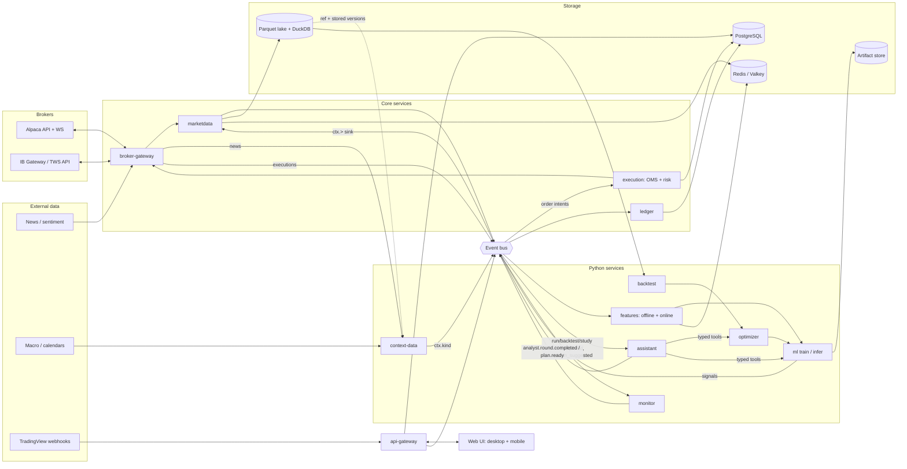
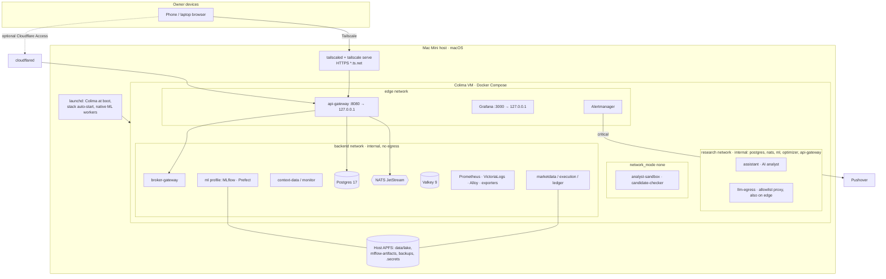
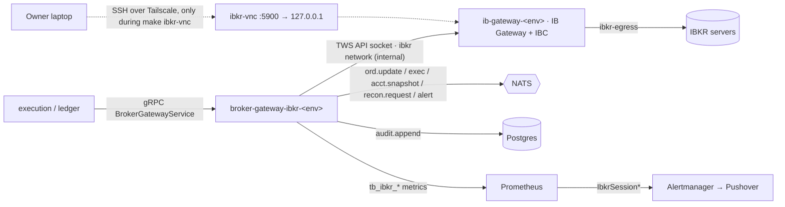

# Architecture overview

**Status:** Phase 0 in progress. Stack decisions are accepted per [`../decisions.md`](../decisions.md) (research report); ADRs are added as each phase implements them. The service list with paths and owners is in the [root `AGENTS.md` system map](../../AGENTS.md#system-map); this doc covers how the pieces connect.

## Components and data flow



## The two loops

**Trading path (latency-sensitive, fail-closed):**
market data → features → model → signal → strategy (sizing, rules) → `OrderIntent` → pre-trade risk → OMS → broker adapter → `ExecutionReport` → ledger → reconciliation → monitoring.
Rules: [orders and execution](../business-logic/orders-and-execution.md), [risk](../business-logic/risk-management.md), [virtual portfolios](../business-logic/virtual-portfolios-and-attribution.md).

**Research loop (throughput-oriented, reproducible):**
data snapshot → features + labels → train → backtest + validation → optimize → register → shadow/paper → live → monitor → retrain.
Rules: [data and features](../business-logic/data-and-features.md), [strategies and model lifecycle](../business-logic/strategies-and-model-lifecycle.md), [backtesting](../business-logic/backtesting.md).

**ML and optimization services** ([ADR-0035](../adr/0035-ml-and-optimizer-contracts-and-analyst-tool-apis.md)): `ml` (`MLService`) builds datasets, trains, evaluates, and writes a `DiagnosticsReport` for every run; `optimizer` (`OptimizerService`) runs nested Optuna studies, keeps one trial ledger per research lineage, scores candidates through the backtest scorer, and owns the registry stages and the analyst permission table; `HoldoutService` is the only path to the sealed holdout and never accepts the assistant. api-gateway calls them as the owner (with step-up attestations); the assistant calls them as actor `analyst`, which the services derive from its service token. Rules: [ML](../business-logic/ml.md), [optimization](../business-logic/optimization.md).

**Analyst loop (closes the research loop; [assistant](../business-logic/assistant.md)):**
completed training run, backtest, or study (`ml.run.completed`, `backtest.completed`, `optimizer.study.completed`) or live feedback (`monitor.retrain_suggested.<lineage>` with a `LiveFeedbackReport`) → the assistant's deterministic orchestrator collects the reports by ID through its tool server → masked planner prompt → validated `Diagnosis` + ranked `ImprovementPlan` → pre-registered round in section 11's cycle → owner approval (level 0) or auto-launch within budget (levels 1–2) through section 10/11 tools → every trial in the lineage's trial ledger → deflated outcome → journal (`AnalystRound` in Postgres `analyst`, `analyst.round.completed`) → next round or stop (plateau, no edge, budget, unreachable). Optimizer does the numerical search; the LLM plans (Centaur). The holdout service, the scorer, live promotion, and the order path are outside the analyst's reach (AN-030..AN-032).

**Backtests reuse the trading path** ([ADR-0031](../adr/0031-two-tier-backtester-and-simcore.md)): the event-driven tier replays lake bars or a recorded bus stream (`RecordedMessage`) through the live runtime core (`tbcore.strategy.host`) and sends each `OrderIntent` to `tb-simcore`, a Go process that runs the production OMS engine and pre-trade gate with the ledger's accounting core behind a passive simulated broker; the backtester's fill and cost models (or recorded executions) decide fills. The vectorized tier screens signal matrices with the same cost model.

## Cross-cutting design

| Concern | Design | Decision |
|---|---|---|
| Contracts | All cross-service messages in `contracts/proto/tb/<domain>/v1/`; generated (committed) for Go, Python, TypeScript; `make gen-check` fails CI on stale code; internal RPC is gRPC, UI is REST + SSE (D14) ([contracts](#contracts)) | D3 ([ADR-0003](../adr/0003-contracts-protobuf-buf.md)) |
| Messaging | Durable streams for order path (`ord.*`, `exec.*`, `risk.kill`), at-least-once, idempotent consumers | D2 |
| Storage split | Market/context data in the Parquet lake: marketdata is the single writer (staging + compaction, revisions retained, temp + rename, Postgres manifest), Python reads with Polars point-in-time (`tbcore.data`); reference data in Postgres `refdata` mirrored to `ref/`; transactional state (orders, ledgers, users, audit) in Postgres; hot bars and online features in Valkey (`contracts/cache/README.md`) | D4–D6 ([ADR-0020](../adr/0020-lake-layout-write-path-and-query-layer.md)) |
| Features | One feature library (`tbcore.features`) used offline (snapshots) and online (ring buffers) through the same `compute`; finite lookback, scale-invariant, parity-tested | D39 ([ADR-0021](../adr/0021-feature-store.md)) |
| Time | UTC int64 ns; `event_time` / `available_at` / `ingested_at` on every market and context record | — |
| Identity | ULIDs; `instrument_id` independent of ticker; `correlation_id` from signal to fill | — |
| Modes | `mode ∈ {backtest, paper, live}` and `broker_account_id` on every strategy, order, and fill | — |
| Security | Authenticated gateway (passkeys + TOTP fallback, server-side sessions, CSRF), step-up for dangerous actions via one policy function, encrypted credentials only in broker-gateway, signed service tokens on internal calls, private network only, hash-chained audit log | D15–D17, D33, D34 ([ADR-0009](../adr/0009-owner-authentication.md)) |
| Observability | Prometheus metrics from every service's ops listener, JSON logs → Alloy → VictoriaLogs, provisioned Grafana dashboard, Alertmanager → Pushover; OTel spans exported when an endpoint is set (Tempo in Phase 5) | D22 ([ADR-0014](../adr/0014-observability-stack.md)) |
| Deployment | Mac Mini host: Docker Compose under Colima (boot-time LaunchDaemon), native launchd ML workers; same Compose on a droplet later | D21, D28, D29 |

## Contracts

| Package | Messages / services | Producer → consumers |
|---|---|---|
| `tb.common.v1` | `Decimal`, `Mode`, `AssetClass`, `Side`, `Horizon`, `Broker`, `Instrument`, `Provenance` | shared |
| `tb.marketdata.v1` | `Bar`, `Quote`, `Trade`, `CorporateAction`, `SourceHealth` | marketdata → bus, lake, cache |
| `tb.marketdata.v1` | `MarketDataService` (backfill jobs and status, universe, feed status, `IsFresh`, `GetBars` for charts, `ResolveSymbols` for tickers) ([ADR-0022](../adr/0022-market-data-ingestion.md), [MD-](../business-logic/market-data.md)) | marketdata → api-gateway, execution |
| `tb.context.v1` | `ContextEvent` (kinds news, news_sentiment, macro, calendar, earnings, fundamentals, short_interest, filing, regime; `record_key`, `vintage`, provenance) ([ADR-0032](../adr/0032-context-data-pipeline-and-point-in-time-rules.md), [CX-](../business-logic/context-data.md)) | context-data → bus `ctx.<kind>` → marketdata (lake writer), strategy-runtime (`ctx.calendar`, `ctx.earnings`) |
| `tb.features.v1` | `FeatureVector` | feature service → ml-infer |
| `tb.signals.v1` | `Signal`, `RuntimeHeartbeat` (dead-man, RM-017) | ml-infer / strategy runtime → execution |
| `tb.orders.v1` | `OrderIntent` (horizon, kind, protective spec, source), `RiskDecision`, `Order` (role, attempt, parent), `ExecutionReport`, `KillSwitchEvent` (latched) | strategy/UI → execution → broker-gateway → ledger |
| `tb.orders.v1` | `ExecutionService` (submit/preview intents, orders, intents, fills, trace, strategy registry and modes, risk limits, kill switches, trading status) ([ADR-0025](../adr/0025-oms-risk-gate-and-kill-switches.md), [OE-](../business-logic/orders-and-execution.md), [RM-](../business-logic/risk-management.md)) | execution → api-gateway |
| `tb.ledger.v1` | `AccountSnapshot`, `StrategyPosition`, `LedgerEntry`, `LedgerUpdate`, `ReconciliationResult` (breaks, halted pairs), `Break` | broker-gateway, ledger → UI, execution, monitor, strategy-runtime |
| `tb.ledger.v1` | `LedgerService` (account view by owner, strategy portfolio, ownership constraints, capital and reservations, owners and allocations, reconcile, breaks, equity curve, owner and broker-shadow lots, wash-sale flags, reconciliation reports) ([ADR-0024](../adr/0024-virtual-ledgers-and-reconciliation.md), [VP-](../business-logic/virtual-portfolios-and-attribution.md)) | ledger → execution, api-gateway |
| `tb.ml.v1` | `ModelVersion` (with `RegistryStage`), `BacktestRun`; `MLService` (training jobs, runs, model cards, prediction, diagnostics and analyst tools), `TrainingConfig`, `DiagnosticsReport`, `MLRunCompleted`, `BacktestCompleted` ([ADR-0035](../adr/0035-ml-and-optimizer-contracts-and-analyst-tool-apis.md), [ML-](../business-logic/ml.md)) | ml, backtest, optimizer → registry, UI, assistant |
| `tb.optimizer.v1` | `OptimizerService` (lineages, cycles, studies, trial ledger, overfitting statistics, gate reports, registry transitions, evidence packs, retraining), `HoldoutService`, `StudyCompleted`, `StageChanged` ([ADR-0035](../adr/0035-ml-and-optimizer-contracts-and-analyst-tool-apis.md), [EX-](../business-logic/optimization.md)) | optimizer → api-gateway, assistant (no holdout), UI |
| `tb.backtest.v1` | `SimRequest`/`SimResponse` (simcore protocol over stdio, length-delimited) and `RecordedMessage` (bus recordings for replay and parity) ([ADR-0031](../adr/0031-two-tier-backtester-and-simcore.md), [BT-](../business-logic/backtesting.md)) | `tbcore.backtest` ↔ `tb-simcore`; recorder → backtester |
| `tb.analyst.v1` | `AnalystRound` (trigger, pre-registration, `Diagnosis` with evidence-cited findings, `ImprovementPlan` with schema-validated config diffs, budget used, deflated outcome, decision, provider and prompt hashes), `AutonomySetting` (level, budget, promotion limits), `LoopStatus`, `CodeProposal`; events `RoundCompleted`, `PlanReady`, `Escalation`, `LowerAutonomy`; `AnalystService` (journal, review actions with `PreparedLaunch`es for owner submission at level 0, record launches, pause/resume, request analysis, trial ledger view, code proposals, chat) ([assistant](../business-logic/assistant.md)) | assistant → api-gateway (only caller), bus `analyst.*` → monitor, UI |
| `tb.monitor.v1` | `LiveFeedbackReport` (live vs expected percentiles, parity, decay test, drift, calibration, error slices, regime, execution quality, triggered conditions; no balances or account IDs), `RetrainSuggested` ([monitoring](../business-logic/monitoring.md)) | monitor → bus `monitor.retrain_suggested.<id>` → assistant (analyst loop), optimizer (default retraining policy) |
| `tb.alerts.v1` | `Alert` | any → monitor → channels |
| `tb.audit.v1` | `AuditEvent` | all → audit store |
| `tb.broker.v1` | `CredentialService` (gRPC: put, delete, list status; no plaintext read) | api-gateway → broker-gateway |
| `tb.broker.v1` | `BrokerGatewayService` (accounts, sessions, snapshots, submit/cancel/replace/lookup, order and execution lists and streams, instrument info) — one contract for every adapter ([ADR-0018](../adr/0018-broker-gateway-interface.md), [BR-](../business-logic/brokers.md)) | broker-gateway (Alpaca, simulator), broker-gateway-ibkr (IBKR) → execution, ledger, marketdata |
| `tb.broker.v1` | `BrokerMarketDataService` (historical bars, bidirectional market-data stream over the single upstream socket, assets, corporate actions, feed status, vendor news `GetNews`) | broker-gateway → marketdata; `GetNews` → context-data |

The UI ↔ gateway API (REST commands + SSE streams, D3/D14) is specified in [`contracts/openapi/gateway.yaml`](../../contracts/openapi/gateway.yaml). Only `/healthz` and the auth bootstrap endpoints are public (SE-004).

Trading pages (ADR-0028): the gateway calls execution, ledger, and marketdata over signed gRPC and returns the canonical protojson of their `tb.*` responses; the UI types them with the generated `*Json` types. Owner actions are authorized in the gateway (`policy.Authorize`, step-up) and re-checked by the owning service (execution: limit loosening, kill release from a desktop passkey; ledger: allocation capacity). Charts use one SSE stream per chart: the gateway subscribes to `md.bar.<tf>.<id>` (final, correction, partial coalesced to ≤4 Hz) and `exec.>` (filtered to the instrument) on core NATS; history comes from `GetBars` (cache ring).

## Deployment topology (Phase 0, Mac Mini)



- Only the gateway and Grafana publish ports, on `127.0.0.1` (SE-051, OP-041).
- The AI analyst (`assistant`) is only on the internal `research` network, which no order-path service joins (AN-032); it reaches LLM providers only through `llm-egress` (AN-053); candidate code runs in `analyst-sandbox` with no network, exchanging files with `candidate-checker` (also no network) over the `analyst-jobs` volume (AN-071). `make up NATIVE_ML=1` additionally exposes Postgres and NATS on loopback for native workers (D29).
- The same Compose file runs on a Linux droplet later (D21); the `ml-workers` profile replaces native launchd workers there.

### IBKR (profiles `ibkr`, `ibkr-live`; ADR-0023)



- The TWS API socket is unauthenticated, so it is never published and only the adapters share the internal `ibkr` network with the gateways; the gateways reach IBKR through `ibkr-egress` (IB-071). The IBKR login is mounted only into the gateway (SE-034).
- IBC restarts the gateway daily (session reused) and cold-restarts it on Sunday (full login, 2FA). The adapter classifies outages against that calendar and pages only when the owner must act (IB-013..IB-015).
- The IBKR adapter keeps its own outbox in schema `broker_ibkr` and relays it with the same subjects, payloads, and `Nats-Msg-Id` values as broker-gateway, so consumers cannot tell the adapters apart (IB-031, ADR-0023).

## Bus subjects

```
md.bar.<timeframe>.<instrument_id>   md.quote.<instrument_id>   md.trade.<instrument_id>
md.bar.partial.<tf>.<instrument_id>  md.bar.correction.<tf>.<instrument_id>   ref.corporate_action.<instrument_id>
ctx.<kind>                            feat.<feature_set>.<instrument_id>
sig.<strategy_id>                     ord.intent   ord.decision   ord.update.<broker_account>   ord.order.<broker_account>
exec.<broker_account>                 acct.snapshot.<broker_account>
ledger.update.<broker_account>        recon.result.<broker_account>   recon.request.<broker_account>
risk.kill                             alert.<severity>           sys.health.<service>
ml.run.completed                      backtest.completed         optimizer.study.completed   ml.registry.stage_changed
monitor.retrain_suggested.<lineage>
monitor.decay.<lineage>              monitor.drift.<lineage>    monitor.divergence.<lineage>   monitor.feedback.<strategy>
analyst.round.completed               analyst.plan.ready         analyst.escalation         analyst.autonomy.lower
```

Live feedback (section 13 analyst slice): the monitor builds a `LiveFeedbackReport` per shadow/paper/live strategy on `monitor.feedback.<strategy>` and, when a trigger condition fires with enough samples, publishes `RetrainSuggested` on `monitor.retrain_suggested.<lineage>` (plus the matching decay/drift/divergence subject) in the durable `MONITOR` stream; the optimizer runs its default retraining policy for lineages at autonomy 0 (EX-040). The assistant opens a round for that lineage; a critical trigger also publishes `analyst.autonomy.lower` (level 0, paused). The analyst publishes `analyst.*` in the durable `ANALYST` stream. At autonomy level 0 the analyst may not launch (ML-024, EX-031): `ReviewActions` returns validated `PreparedLaunch` requests that api-gateway submits to `MLService`/`OptimizerService` as the owner (with the round ID for ledger linkage) and reports back with `RecordLaunches`.

Context data (section 09, ADR-0032) flows context-data → `ctx.<kind>` (durable stream `CONTEXT`, `Nats-Msg-Id` per version) → marketdata's context sink, which stays the only lake writer and compacts `context/kind=…` partitions (CX-003, ST-011). Alpaca news reaches context-data through `BrokerMarketDataService.GetNews` on broker-gateway (credential custody, BR-022); FMP, FRED/ALFRED, FINRA, and SEC EDGAR are called directly from context-data. Readers use `tbcore.context.ContextStore` (point-in-time per `record_key`). Source health goes to `sys.health.ctx.<job>`. strategy-runtime reads `ctx.calendar`/`ctx.earnings` and the lake for `EventBlackout` (CX-016).

`ord.update.<acct>` carries the broker's view (`tb.broker.v1.BrokerOrderUpdate`) from the adapters; the OMS's own `Order` state is published by execution on `ord.order.<acct>`, risk decisions on `ord.decision`, and strategy intents arrive on `ord.intent` (section 07). Execution's and the strategy runtime's heartbeats on `sys.health.execution` / `sys.health.strategy-runtime` feed the dead-man checks (RM-017). The strategy runtime (ADR-0026) consumes `md.bar.*` and its own strategies' `ledger.update.*` and publishes intents on `ord.intent`; it never talks to brokers. Broker adapters publish `ord.update.*`, `exec.*`, `acct.snapshot.*`, and `recon.request.*` through a Postgres transactional outbox (schema `broker`), so a crash never loses or double-publishes an execution (ADR-0018). `recon.request.<acct>` follows every reconnect resync (OE-008).

Final bars (`md.bar.*`) are published 60 s after the bar closes, deduplicated by `Nats-Msg-Id`; partial bars are UI-only and never stored; corrections of final bars carry a higher `revision` (MD-002, DF-007). `ref.corporate_action.*` lives in the durable `REF` stream for the ledger; `sys.health.<source>` carries `SourceHealth` for each data source (ADR-0022).

Update this doc when a data flow, subject, store, or trust boundary changes.
