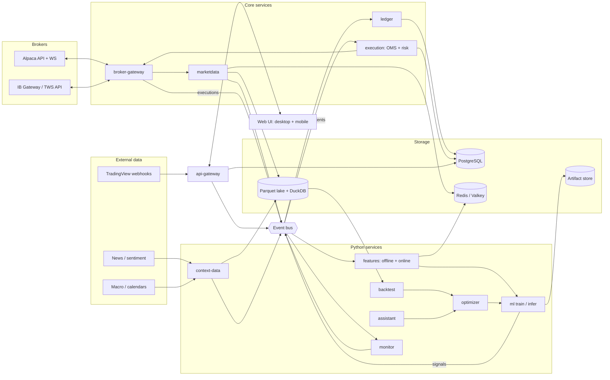
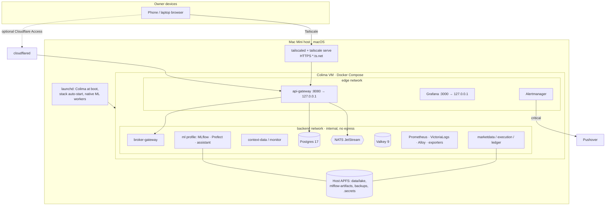

# Architecture overview

**Status:** Phase 0 in progress. Stack decisions are accepted per [`../decisions.md`](../decisions.md) (research report); ADRs are added as each phase implements them. The service list with paths and owners is in the [root `AGENTS.md` system map](../../AGENTS.md#system-map); this doc covers how the pieces connect.

## Components and data flow



## The two loops

**Trading path (latency-sensitive, fail-closed):**
market data → features → model → signal → strategy (sizing, rules) → `OrderIntent` → pre-trade risk → OMS → broker adapter → `ExecutionReport` → ledger → reconciliation → monitoring.
Rules: [orders and execution](../business-logic/orders-and-execution.md), [risk](../business-logic/risk-management.md), [virtual portfolios](../business-logic/virtual-portfolios-and-attribution.md).

**Research loop (throughput-oriented, reproducible):**
data snapshot → features + labels → train → backtest + validation → optimize → register → shadow/paper → live → monitor → retrain.
Rules: [data and features](../business-logic/data-and-features.md), [strategies and model lifecycle](../business-logic/strategies-and-model-lifecycle.md).

## Cross-cutting design

| Concern | Design | Decision |
|---|---|---|
| Contracts | All cross-service messages in `contracts/proto/tb/<domain>/v1/`; generated (committed) for Go, Python, TypeScript; `make gen-check` fails CI on stale code; internal RPC is gRPC, UI is REST + WebSocket ([contracts](#contracts)) | D3 ([ADR-0003](../adr/0003-contracts-protobuf-buf.md)) |
| Messaging | Durable streams for order path (`ord.*`, `exec.*`, `risk.kill`), at-least-once, idempotent consumers | D2 |
| Storage split | Market/context data in the lake (single writer, many readers); transactional state (orders, ledgers, users, audit) in Postgres; hot bars and online features in cache | D4–D6 |
| Time | UTC int64 ns; `event_time` / `available_at` / `ingested_at` on every market and context record | — |
| Identity | ULIDs; `instrument_id` independent of ticker; `correlation_id` from signal to fill | — |
| Modes | `mode ∈ {backtest, paper, live}` and `broker_account_id` on every strategy, order, and fill | — |
| Security | Authenticated gateway (passkeys + TOTP fallback, server-side sessions, CSRF), step-up for dangerous actions via one policy function, encrypted credentials only in broker-gateway, signed service tokens on internal calls, private network only, hash-chained audit log | D15–D17, D33, D34 ([ADR-0009](../adr/0009-owner-authentication.md)) |
| Observability | Prometheus metrics from every service's ops listener, JSON logs → Alloy → VictoriaLogs, provisioned Grafana dashboard, Alertmanager → Pushover; OTel spans exported when an endpoint is set (Tempo in Phase 5) | D22 ([ADR-0014](../adr/0014-observability-stack.md)) |
| Deployment | Mac Mini host: Docker Compose under Colima (boot-time LaunchDaemon), native launchd ML workers; same Compose on a droplet later | D21, D28, D29 |

## Contracts

| Package | Messages / services | Producer → consumers |
|---|---|---|
| `tb.common.v1` | `Decimal`, `Mode`, `AssetClass`, `Side`, `Broker`, `Instrument`, `Provenance` | shared |
| `tb.marketdata.v1` | `Bar`, `Quote`, `Trade`, `CorporateAction` | marketdata → bus, lake, cache |
| `tb.context.v1` | `ContextEvent` | context-data → lake, bus |
| `tb.features.v1` | `FeatureVector` | feature service → ml-infer |
| `tb.signals.v1` | `Signal` | ml-infer / strategy → execution |
| `tb.orders.v1` | `OrderIntent`, `RiskDecision`, `Order`, `ExecutionReport`, `KillSwitchEvent` | strategy/UI → execution → broker-gateway → ledger |
| `tb.ledger.v1` | `AccountSnapshot`, `StrategyPosition`, `LedgerEntry`, `ReconciliationResult` | broker-gateway, ledger → UI, execution, monitor |
| `tb.ml.v1` | `ModelVersion`, `BacktestRun` | ml, backtest, optimizer → registry, UI |
| `tb.alerts.v1` | `Alert` | any → monitor → channels |
| `tb.audit.v1` | `AuditEvent` | all → audit store |
| `tb.broker.v1` | `CredentialService` (gRPC: put, delete, list status; no plaintext read) | api-gateway → broker-gateway |
| `tb.broker.v1` | `BrokerGatewayService` (accounts, sessions, snapshots, submit/cancel/replace/lookup, order and execution lists and streams, instrument info) — one contract for every adapter ([ADR-0018](../adr/0018-broker-gateway-interface.md), [BR-](../business-logic/brokers.md)) | broker-gateway (Alpaca, simulator), broker-gateway-ibkr (IBKR) → execution, ledger, marketdata |
| `tb.broker.v1` | `BrokerMarketDataService` (historical bars, bidirectional market-data stream over the single upstream socket, assets, corporate actions, feed status) | broker-gateway → marketdata |

The UI ↔ gateway API (REST commands + SSE streams, D3/D14) is specified in [`contracts/openapi/gateway.yaml`](../../contracts/openapi/gateway.yaml). Only `/healthz` and the auth bootstrap endpoints are public (SE-004).

## Deployment topology (Phase 0, Mac Mini)



- Only the gateway and Grafana publish ports, on `127.0.0.1` (SE-051, OP-041). `make up NATIVE_ML=1` additionally exposes Postgres and NATS on loopback for native workers (D29).
- The same Compose file runs on a Linux droplet later (D21); the `ml-workers` profile replaces native launchd workers there.

## Bus subjects (planned)

```
md.bar.<timeframe>.<instrument_id>   md.quote.<instrument_id>   md.trade.<instrument_id>
ctx.<kind>                            feat.<feature_set>.<instrument_id>
sig.<strategy_id>                     ord.intent   ord.decision   ord.update.<broker_account>
exec.<broker_account>                 acct.snapshot.<broker_account>
ledger.update.<broker_account>        recon.result.<broker_account>   recon.request.<broker_account>
risk.kill                             alert.<severity>           sys.health.<service>
```

`ord.update.<acct>` carries the broker's view (`tb.broker.v1.BrokerOrderUpdate`) from the adapters; the OMS's own `Order` state will use a separate subject (section 07). Broker adapters publish `ord.update.*`, `exec.*`, `acct.snapshot.*`, and `recon.request.*` through a Postgres transactional outbox (schema `broker`), so a crash never loses or double-publishes an execution (ADR-0018). `recon.request.<acct>` follows every reconnect resync (OE-008).

Update this doc when a data flow, subject, store, or trust boundary changes.
