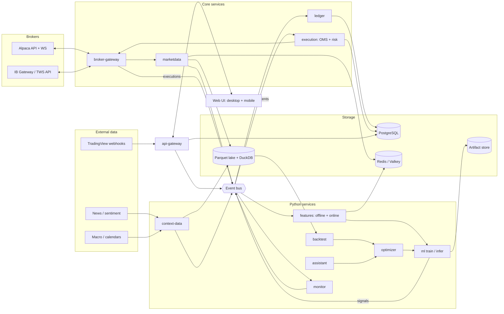

# Architecture overview

**Status:** target design, not built. Components and stack are `DECISION PENDING` per [`../decisions.md`](../decisions.md) until ADRs accept them. The service list with paths and owners is in the [root `AGENTS.md` system map](../../AGENTS.md#system-map); this doc covers how the pieces connect.

## Components and data flow



## The two loops

**Trading path (latency-sensitive, fail-closed):**
market data → features → model → signal → strategy (sizing, rules) → `OrderIntent` → pre-trade risk → OMS → broker adapter → `ExecutionReport` → ledger → reconciliation → monitoring.
Rules: [orders and execution](../business-logic/orders-and-execution.md), [risk](../business-logic/risk-management.md), [virtual portfolios](../business-logic/virtual-portfolios-and-attribution.md).

**Research loop (throughput-oriented, reproducible):**
data snapshot → features + labels → train → backtest + validation → optimize → register → shadow/paper → live → monitor → retrain.
Rules: [data and features](../business-logic/data-and-features.md), [strategies and model lifecycle](../business-logic/strategies-and-model-lifecycle.md).

## Cross-cutting design

| Concern | Design | Decision |
|---|---|---|
| Contracts | All cross-service messages in `contracts/`; generated for every language | D3 |
| Messaging | Durable streams for order path (`ord.*`, `exec.*`, `risk.kill`), at-least-once, idempotent consumers | D2 |
| Storage split | Market/context data in the lake (single writer, many readers); transactional state (orders, ledgers, users, audit) in Postgres; hot bars and online features in cache | D4–D6 |
| Time | UTC int64 ns; `event_time` / `available_at` / `ingested_at` on every market and context record | — |
| Identity | ULIDs; `instrument_id` independent of ticker; `correlation_id` from signal to fill | — |
| Modes | `mode ∈ {backtest, paper, live}` and `broker_account_id` on every strategy, order, and fill | — |
| Security | Authenticated gateway, step-up for dangerous actions, encrypted credentials only in broker-gateway, private network only, hash-chained audit log | D15–D17 |
| Observability | Metrics, logs, traces per service; trade audit trail | D22 |
| Deployment | Docker Compose profiles locally; same Compose on one remote droplet | D21 |

## Bus subjects (planned)

```
md.bar.<timeframe>.<instrument_id>   md.quote.<instrument_id>   md.trade.<instrument_id>
ctx.<kind>                            feat.<feature_set>.<instrument_id>
sig.<strategy_id>                     ord.intent   ord.decision   ord.update.<broker_account>
exec.<broker_account>                 acct.snapshot.<broker_account>
ledger.update.<broker_account>        recon.result.<broker_account>
risk.kill                             alert.<severity>           sys.health.<service>
```

Update this doc when a data flow, subject, store, or trust boundary changes.
