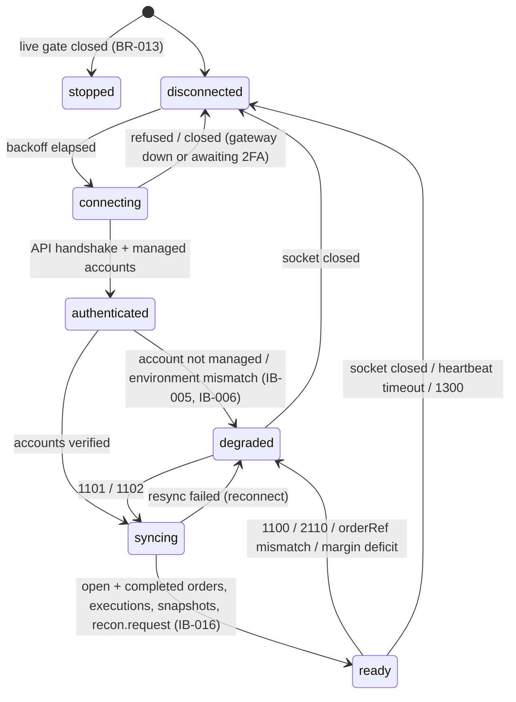

# Brokers: IBKR adapter

**Prefix:** `IB-`  ·  **Owners:** `services/broker-gateway-ibkr` (Python, `ib_async`), `infra/compose` (IB Gateway containers)  ·  **Related:** [brokers](brokers.md) (`BR-`, the shared interface this adapter serves), [orders and execution](orders-and-execution.md) (`OE-`), [virtual portfolios](virtual-portfolios-and-attribution.md) (`VP-001`/`VP-002`), [security](security.md) (`SE-034`), [ADR-0023](../adr/0023-ibkr-adapter-gateway-and-sessions.md), [ADR-0018](../adr/0018-broker-gateway-interface.md), runbook [ibkr-weekly-2fa](../runbooks/ibkr-weekly-2fa.md)

## Scope

IBKR-specific behavior behind `tb.broker.v1.BrokerGatewayService`: the IB Gateway container and its login, session supervision across IBKR's daily and weekly resets, order translation and attribution in `orderRef`, status and error-code mapping, executions and commissions, account snapshots, and historical-data pacing. Cross-broker rules (error model, idempotent submit, resync, live gating, audit) are `BR-` rules in [brokers.md](brokers.md); this doc states how IBKR satisfies them and what is IBKR-only.

## Concepts and states

- **IB Gateway + IBC:** IBKR's headless trading gateway, logged in automatically by IBC 3.24.2 inside the pinned `ghcr.io/gnzsnz/ib-gateway` image. One container per environment (`ib-gateway-paper`, `ib-gateway-live`). The TWS API socket it exposes is unauthenticated.
- **Adapter process:** one per environment (`broker-gateway-ibkr-paper`, `-live`). It owns the order connection (client ID 1, the gateway's master client, so it also sees orders placed in TWS / IBKR Mobile) and a market-data connection (client ID 2).
- **`broker_account_id`:** `ibkr-<environment>-<alias>`, mapped to an IBKR account code by `TB_IBKR_ACCOUNTS` (`alias=CODE`). One login may manage several accounts (D19 linked "bot" account); only mapped accounts are visible or tradable.
- **`permId`:** IBKR's durable order ID, used as `broker_order_id`. The session-scoped `orderId` is never a durable key.
- **Maintenance calendar (US/Eastern):** daily restart at `TB_IBKR_DAILY_RESTART` (default 23:45, IBC `AUTO_RESTART_TIME`, session reused, no 2FA); weekend maintenance from Saturday 00:00 to the Sunday cold restart; weekly cold restart at `TB_IBKR_COLD_RESTART` (default Sunday 17:00, IBC `ColdRestartTime`, full login, IBKR Mobile 2FA push for live).
- **Account hold:** a per-account reason (today only `margin_deficit`) that turns a `ready` session into `degraded` for that account (BR-021).

Session state machine: the shared one in [brokers.md](brokers.md) (`BR-010`). IBKR transitions:

## Rules

| ID | Rule | Status | Code / tests |
|---|---|---|---|
| IB-001 | Every platform order MUST carry its attribution ID as `orderRef` (BR-003 format) and MUST be rejected locally (`REJECT_CODE_INVALID_ATTRIBUTION`, nothing sent) if the ID is malformed or longer than `TB_IBKR_ORDER_REF_MAX_LEN` (default 44 = the longest BR-003 ID, pending spike V1). | Implemented | `attribution.py`, `adapter.py` `submit_order`; `test_attribution.py`, `test_oe002_*`, `test_ib001_*`, `test_br003_*` |
| IB-002 | When IBKR first echoes an order's `orderRef` (openOrder/completedOrder), it MUST equal the ID sent; on mismatch the order becomes `unknown`, the session goes `degraded` with `order_ref_mismatch` until the process restarts, and a critical alert fires. A replace waits for the echo of the new attempt's ID before the mismatch check applies. | Implemented | `adapter.py` `_check_ref_echo`, `session.py` `fail_closed`; `test_ib002_truncated_order_ref_fails_closed`, `test_ib022_*` |
| IB-003 | `broker_order_id` (and `perm_id`) MUST be the IBKR `permId`; the session `orderId` is used only to address an order on its own client connection. | Implemented | `adapter.py`; `test_submit_sets_attribution_account_and_contract` |
| IB-004 | Owner resolution from `orderRef`: no `tb1-` prefix → external (manual, VP-001); `tb1-manual-…` → platform manual; a valid ID → its strategy; a `tb1-` prefix that does not parse → external **and** a warning alert. An order is never attributed to a strategy from a malformed ID. | Implemented | `attribution.py` `resolve_owner`; `test_vp001_ib004_owner_resolution`, `test_vp001_malformed_tb1_ref_goes_to_manual_with_alert` |
| IB-005 | Only accounts in `TB_IBKR_ACCOUNTS` are exposed; every outbound order MUST set `account` explicitly; orders and executions of unmapped accounts managed by the same login are ignored. A mapped account that the login does not manage keeps the session `degraded` (`account_not_managed`). | Implemented | `config.py` `parse_accounts`, `adapter.py`; `test_ib005_*` |
| IB-006 | Environment guard: every `broker_account_id` MUST name the process environment (`ibkr-paper-*` / `ibkr-live-*`), and paper accounts (code prefix `DU`/`DF`) MUST only be served by a paper adapter and vice versa; a mismatch keeps the session `degraded` (`environment_mismatch`) with a critical alert. | Implemented | `adapter.py` `_after_connect`, `_validate_accounts_config`; `test_ib006_*` |
| IB-007 | A live adapter MUST stay `stopped` (no gateway connection) unless `TB_TRADING_LIVE_ENABLED=true` and every mapped account is live-enabled by an audited owner action (BR-013, OE-010). Until section 15 provides the enablement record, no account is enabled. | Implemented | `config.py` `live_gate`, `NoLiveEnablement`; `__main__.py`; `test_oe010_*`, `test_entrypoint_live_without_gates_stays_stopped` |
| IB-010 | Only a `ready` session accepts submits and replaces; cancels are allowed in any connected state (BR-010). A heartbeat (`reqCurrentTime`) every 15 s with a 10 s timeout detects a hung gateway. | Implemented | `session.py`, `adapter.py` `_require_ready`; `test_oe004_*`, `test_ib010_heartbeat_timeout_reconnects` |
| IB-011 | Reconnects back off exponentially (base 1 s, cap 60 s) with equal jitter (delay ≥ half the ceiling, so never a tight loop; BR-012's intent), reset after 5 min of `ready`; supervision survives any internal error. | Implemented | `backoff.py`, `session.py`; `test_ib011_*`, `test_stable_session_resets_backoff` |
| IB-012 | Status 1100 / 2110 MUST move the session to `degraded` without dropping the socket; 1101 / 1102 MUST trigger a full resync (and resubscription on 1101) before `ready`; 1300 drops and reconnects. | Implemented | `session.py` `_handle`; `test_ib012_*`, `test_replay_daily_reset_*`, `test_supervisor_over_real_ib_async_session_lifecycle` |
| IB-013 | An outage that starts inside the daily restart window MUST NOT alert while it lasts less than the window plus `TB_IBKR_REAUTH_GRACE_SECONDS` (default 180 s); after that it alerts critical (weekday) / warning (weekend) with `reauth_required`. | Implemented | `schedule.py` `classify_outage`; `test_ib013_*` |
| IB-014 | Weekly re-auth: outages from Saturday 00:00 ET until the Sunday cold restart are weekend maintenance (no alert). At the cold restart a live adapter sends a warning reminder ("approve the IBKR Mobile push"); if the session is not `ready` within the grace, a critical alert with the 2FA runbook fires. Reaching `ready` resolves both. | Implemented | `schedule.py`, `session.py` `_periodic`, `_assess`; `test_ib014_*` |
| IB-015 | Any other outage alerts once it exceeds the grace: critical on weekdays, warning on weekends, with the reminder that a gateway restart mid-week needs a fresh 2FA. One alert per outage, escalating warning → critical only. | Implemented | `schedule.py`, `session.py`; `test_ib015_*` |
| IB-016 | Resync before `ready` (BR-011, OE-008): open orders of all clients, completed orders, executions since the last acknowledged one minus 5 min, an account snapshot per account, then `recon.request.<acct>` (reason `reconnect`, or `execution_gap`, IB-033). | Implemented | `adapter.py` `_resync`; `test_oe008_*`, `test_br011_*` |
| IB-017 | Client IDs are fixed per purpose: 1 = orders (gateway `TWS_MASTER_CLIENT_ID`), 2 = market data, 7-9 = opt-in diagnostics and spikes. | Implemented | `config.py`, `docker-compose.yml`; `test_ib_async_port_handshake_and_queries` |
| IB-020 | IBKR statuses map through the table below; anything else is `unknown` (BR-006, OE-005). Filled quantity never decreases and a terminal state is never replaced by a stale non-terminal update. | Implemented | `status_map.py`, `adapter.py` `_ingest_snapshot`; `test_status_map.py`, `test_out_of_order_status_never_regresses`, `test_replay_out_of_order_and_duplicates` |
| IB-021 | Submit is idempotent (BR-007): a repeated `client_order_id` returns the existing order; a submit not acknowledged within `TB_IBKR_SUBMIT_TIMEOUT` (5 s) is looked up twice by `orderRef`/order id in open and completed orders, then answered `SUBMIT_OUTCOME_UNKNOWN`. It is never resubmitted. | Implemented | `adapter.py` `_recover_submit`; `test_oe003_*`, `test_oe_i1_*`, `test_br007_*` |
| IB-022 | A replace modifies the order in place under the next attempt's attribution ID (same strategy and intent); `permId` is unchanged; the old ID is reported `replaced` and the new one `pending_replace` until IBKR echoes it; a rejected modification (104/105) restores the previous attempt. | Implemented | `adapter.py` `replace_order`, `_revert_replace`; `test_ib022_*` |
| IB-023 | The adapter MUST NOT cancel or modify orders placed outside the platform (external owner) and MUST NOT call `reqGlobalCancel` (BR-020, VP-006). | Implemented | `adapter.py` `cancel_order`; `test_ib023_*`, `test_br020_*` |
| IB-024 | A `Cancelled` status that the platform did not request, for a DAY (16:00 ET, 20:00 with extended hours), OPG (09:30), or CLS order after its cutoff, maps to `expired`; otherwise `canceled`. | Implemented | `schedule.py` `tif_lapsed`, `status_map.py`; `test_ib024_*` |
| IB-025 | Order translation: market → `MKT` (`MOC` with TIF cls), limit → `LMT` (`LOC` with cls), stop → `STP`, stop-limit → `STP LMT`; TIF day/gtc/ioc/fok map 1:1, opg → `OPG`, cls → DAY + MOC/LOC; extended hours → `outsideRth` (not for market orders); sell and sell-short → `SELL`. Unsupported combinations are rejected locally. | Implemented | `adapter.py` `build_place_order`; `test_ib025_*`, `test_ib026_*` |
| IB-026 | Prices are tick-rounded per BR-017 (buy limits down, sell limits up, stops away from the market) using the instrument's `min_tick`, or $0.0001 below $1; quantities must be whole shares (IBKR API orders are not fractional). | Implemented | `adapter.py` `round_to_tick`, `tick_round_prices`; `test_br017_tick_rounding_direction` |
| IB-030 | An execution is published joined with its commission report: held up to `TB_IBKR_COMMISSION_WAIT` (2 s), published with `fees` unset if the report is late; a late report is kept for `ListExecutions` and the ledger's statement reconciliation, not republished. | Implemented | `adapter.py` `_on_execution`, `_on_commission`; `test_ib030_*` |
| IB-031 | Executions are deduplicated on `execId` per account across restarts by a durable cursor (`/var/lib/broker-gateway-ibkr/cursor-<env>.json`, atomic replace), marked after publication (at-least-once; JetStream `Nats-Msg-Id = exec|<acct>|<execId>` and consumers dedupe, OE-006). | Implemented | `cursor_store.py`, `bus.py`; `test_oe006_*`, `test_ib031_dedupe_survives_restart` |
| IB-032 | An execution whose `execId` shares the base of a published one with a higher revision suffix is a correction and carries `corrects_exec_id`. | Implemented | `adapter.py` `exec_base_and_revision`; `test_ib032_*` |
| IB-033 | IBKR serves executions for the current day only; if the session was last in sync before today's start (ET), resync raises a warning alert and requests reconciliation with reason `execution_gap` (statement review). | Implemented | `adapter.py` `_execution_gap`; `test_ib033_*` |
| IB-040 | Account snapshots (`NetLiquidation`, `TotalCashValue`, `BuyingPower`, `ExcessLiquidity`, `MaintMarginReq`, positions by `conId`) are published at resync and every `TB_IBKR_SNAPSHOT_INTERVAL` (30 s) while ready. | Implemented | `adapter.py` `get_account_snapshot`, `run_snapshots`; `test_snapshot_positions_keyed_by_con_id` |
| IB-041 | Negative `ExcessLiquidity` is a margin deficit: the account is held `degraded` (`margin_deficit`) with one critical alert per episode, and returns to `ready` on the first clean snapshot with a `margin_restored` reconciliation request (BR-021, RM-013). | Implemented | `adapter.py` `_apply_margin`; `test_br021_*` |
| IB-050 | Historical requests are paced: ≤ 48 per 10 min (80% of 60), no identical request within 15 s, ≤ 6 per contract/exchange/type within 2 s, ≤ 50 open; a pacing violation (162 with "pacing violation", 100, 420) freezes requests for 60 s. Pacing never degrades the order session. | Implemented | `pacing.py`; `test_pacing.py` |
| IB-051 | Streaming market data counts against the account's line budget (default 100) and fails with a clear error when exhausted; subscription errors (354, 10089, 10090, 10167, 10168, 101) are surfaced as such. Real-time IBKR data is minimal by D20 (Alpaca SIP is the feed). | Implemented (budget) / Planned (streams) | `pacing.py` `MarketDataLines`, `error_codes.py`; `test_ib051_*` |
| IB-060 | IBKR error codes are classified by the table below; unlisted codes 2100-2199 are warnings, others unclassified (logged, no state change). | Implemented | `error_codes.py`; `test_error_codes.py` |
| IB-061 | IBKR reject codes map to `RejectCode` (BR-005): 201 → insufficient buying power when the text mentions equity with loan / buying power / margin, not shortable or market closed by text, else broker risk; 103 duplicate; 200 unknown instrument; 203/116/117 not tradable; 404 not shortable; 104/105/109/110/321/388/434 invalid order; others broker other. | Implemented | `codec.py` `ibkr_reject_code`; `test_br005_ibkr_margin_reject_maps_to_buying_power` |
| IB-062 | Submit, cancel, and replace are audited (`broker.order.*` via `audit.append` as `svc_broker_gateway_ibkr`) **before** they are sent and fail if the append fails; local and broker rejects are audited when they occur (BR-014, OE-011, SE-021). Without a configured database every order request fails. | Implemented | `audit.py`, `adapter.py`; `test_br007_*`, `test_br003_*`, `test_se021_audit_failure_blocks_the_order`, `test_entrypoint_paper_session_grpc_and_fail_closed_audit` |
| IB-070 | The IBKR login (`ibkr_<env>_username`, `ibkr_<env>_password`) is a deploy-time secret mounted only into `ib-gateway-<env>`; the adapter holds no broker credential (SE-034). | Specified | `infra/compose/docker-compose.yml`, `tools/tbctl/secrets.go` |
| IB-071 | The TWS API port is never published; only the IBKR adapters share the internal `ibkr` network with the gateways; the gateways reach IBKR over `ibkr-egress`, which nothing else joins. | Specified | `infra/compose/docker-compose.yml` |
| IB-072 | VNC to the gateway is reachable only while the on-demand `ibkr-vnc` proxy runs (`make ibkr-vnc`), on `127.0.0.1:5900`, password-protected; the owner reaches it over SSH on Tailscale (OP-041). | Specified | `infra/compose/docker-compose.yml`, `Makefile`; runbook |
| IB-073 | The gateway image is pinned by tag and digest (`10.50.1f`, IBC 3.24.2); upgrades are planned changes rehearsed on paper (opt-in suite + one weekly cycle) before live. | Specified | `infra/compose/docker-compose.yml`, `scripts/check-arm64.sh` |

## Order-state mapping (IB-020)

| IBKR status | Normalized | Notes |
|---|---|---|
| `ApiPending`, `PendingSubmit` | `SUBMITTED` (`PARTIALLY_FILLED` if filled > 0) | Transmitted, not yet acknowledged |
| `PreSubmitted` | `ACCEPTED` (`PARTIALLY_FILLED` if filled > 0) | Held at IBKR: stop not triggered, outside RTH, simulated type |
| `Submitted` | `ACCEPTED` / `PARTIALLY_FILLED` | Working |
| `ApiUpdate` | `ACCEPTED` / `PARTIALLY_FILLED` | `ib_async` status after a modification is acknowledged |
| `PendingCancel` | `PENDING_CANCEL` | |
| `Cancelled`, `ApiCancelled` | `CANCELED`, or `EXPIRED` when unrequested after the TIF cutoff (IB-024) | Fills before the cancel stand (`filled_qty`) |
| `Filled` | `FILLED`; `PARTIALLY_FILLED` if `remaining > 0` (out-of-order delivery) | |
| `Inactive` | `REJECTED` after an order-reject error; otherwise `UNKNOWN` | IBKR also parks orders as Inactive: fail closed |
| `ValidationError` | `REJECTED` | |
| anything else | `UNKNOWN` | |
| (adapter-local) | `PENDING_SUBMIT` before any IBKR status; `PENDING_REPLACE` until a modification's new `orderRef` is echoed | |

## Error-code categories (IB-060)

| Category | Codes | Adapter action |
|---|---|---|
| Connectivity | 1100, 2110 → degrade; 1101 → resync + resubscribe; 1102 → resync; 1300, 502, 504, 507, 509 → reconnect | IB-012 |
| Session | 10197 (competing live session) → degrade (market-data connection) | |
| Farm status | 2103-2108, 2119, 2157, 2158 | Log only; real loss is 1100/2110 |
| Pacing | 100, 162 (pacing text only), 420; 366 logged | IB-050 penalty |
| Market data | 101, 354, 10089, 10090, 10167, 10168 | Subscription error (IB-051) |
| Contract | 200, 321 | Reject order |
| Order reject | 103-107, 109, 110, 116, 117, 135, 161, 201, 203, 388, 404, 434, 10147, 10148 | Reject order; 104/105/161/10147/10148 on a live order reject only the cancel/modify |
| Order cancel | 202 | Informational; state from `orderStatus` |
| Order warning | 399, 2109, 2137, 2161 | Log |
| Informational | 2100, other 2100-2199 | Log |

## Invariants

| ID | Invariant | Checked by |
|---|---|---|
| IB-I1 | Each `client_order_id` maps to at most one IBKR order (`permId`) across retries, timeouts, and restarts of the adapter. | `test_oe003_*`, `test_oe_i1_*`, `test_br007_*` |
| IB-I2 | Each `execId` is published at most once per adapter state file, and at least once across crashes. | `test_oe006_*`, `test_ib031_*`, `test_oe008_*` |
| IB-I3 | No order reaches IBKR while the account is not `ready`, without a valid attribution ID, or without a recorded audit event. | `test_oe004_*`, `test_oe002_*`, `test_se021_*` |

## Edge cases

| Scenario | Expected behavior | Rules |
|---|---|---|
| Submit acknowledged after 30 s | Lookup finds it by `orderRef`; `recovered_by_lookup=true`; one order | IB-021 |
| Submit never reached IBKR | Two lookups fail → `SUBMIT_OUTCOME_UNKNOWN`, order `unknown`; a retry of the same ID does not resubmit | IB-021 |
| IBKR truncates `orderRef` | Order `unknown`, session `degraded` (`order_ref_mismatch`) until restart, critical alert; spike V1 sets the real limit | IB-002 |
| Owner sells in IBKR Mobile | Order and fills appear without attribution (external → ledger `manual`); the platform cannot cancel it | IB-004, IB-023, BR-019 |
| Daily restart at 23:45 ET | `degraded`/`disconnected` with `daily_restart`, no alert; resync on return | IB-013, IB-016 |
| Daily restart cannot reuse the token | After window + grace: critical, `reauth_required` | IB-013 |
| Sunday 17:00 ET cold restart (live) | Reminder warning; critical with the 2FA runbook if not ready within 3 min; resolved when ready | IB-014 |
| Gateway container restarted on a Tuesday | After 3 min: critical "gateway unreachable… needs a fresh 2FA" | IB-015 |
| 1100 then 1102 within a minute | `degraded` (orders refused, cancels allowed), resync, `ready`; no page | IB-012 |
| Fill while disconnected | Published once at resync, then reconciliation requested | IB-016, IB-031 |
| Outage across midnight ET | Resync alerts `execution_gap`; reconciliation reason `execution_gap` | IB-033 |
| Commission report arrives before its execution | Joined when the execution arrives | IB-030 |
| Duplicate `execDetails` | Published once | IB-031 |
| Correction `….01.02` of `….01.01` | Published with `corrects_exec_id` | IB-032 |
| Stale `Submitted` after `Filled` | Stays `FILLED`, filled quantity unchanged | IB-020 |
| Paper adapter pointed at a live login | `degraded` (`environment_mismatch`), critical alert, never `ready` | IB-006 |
| Live adapter with only the env flag | `stopped`; order RPCs `FAILED_PRECONDITION` (`SESSION_STATE_STOPPED`); no gateway connection | IB-007 |
| Excess liquidity below zero | Account `degraded` (`margin_deficit`), critical alert once, `ready` again on a clean snapshot | IB-041 |
| Backoff after days of outage | Delay stays within 30-60 s (no overflow) | IB-011 |
| Audit database down | Submit/cancel/replace fail; nothing sent | IB-062 |

## Spike V1: `orderRef` length and persistence

**Status: harness ready, result pending an owner run on a paper account** (no IBKR credentials were available to the build). Until then the limit is `TB_IBKR_ORDER_REF_MAX_LEN=44` (the longest BR-003 ID) and IB-002 fails closed if IBKR ever returns a different `orderRef`.

Procedure (`make test-ibkr-paper`, see the runbook): submits far-from-market limit orders with 20/40/44/64/128/255-character refs, reads them back from open orders (and executions with `TB_IBKR_SPIKE_FILLS=1`), writes `v1-order-ref.json`; after a gateway restart, `TB_IBKR_SPIKE_PHASE=after_restart` re-reads the refs by `permId` from completed orders. Also observe whether a modification changes `orderRef` (IB-022 assumes it does; if not, attribution still resolves because the strategy and intent are unchanged). Record the result here and, if the limit is below 44, change `TB_IBKR_ORDER_REF_MAX_LEN` and the attribution format by ADR.

## Open questions

- Spike V1 result (above). Spike V8 (per-order tax-lot selection, self-trade prevention across linked accounts) is section 06's.
- Bracket/OCO/OTO and trailing stops are not offered (capabilities false): swing strategies place their GTC protective stop as a separate order (D30). Revisit with BR-018 if the OMS needs broker-side legs on IBKR.
- Durable event path: executions go to NATS with JetStream dedupe plus the file cursor (IB-031); adopting the shared Postgres outbox (ADR-0018 §5) for IBKR is tracked in ADR-0023.
- The audited live-enablement record (`broker.live_enablement`, section 15) replaces `NoLiveEnablement` when it exists.
- Instrument master (section 03): the adapter accepts the caller's `ibkr_con_id` and a static map (`TB_IBKR_INSTRUMENTS_PATH`); `GetInstrumentInfo` answers only from that map.
