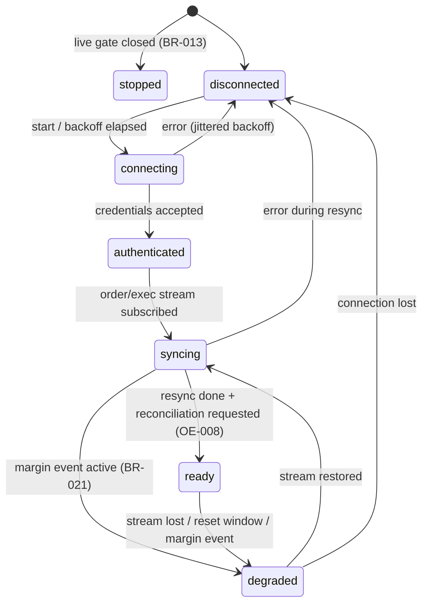

# Brokers

**Prefix:** `BR-`  ·  **Owners:** `broker-gateway` (Go: Alpaca, simulator), `broker-gateway-ibkr` (Python: IBKR)  ·  **Related:** [orders and execution](orders-and-execution.md) (OE-), [virtual portfolios](virtual-portfolios-and-attribution.md) (VP-002 attribution), [security](security.md) (SE-030..SE-040), [ADR-0018](../adr/0018-broker-gateway-interface.md), [ADR-0019](../adr/0019-alpaca-adapter-and-simulator.md), runbook [broker-outage](../runbooks/broker-outage.md)

## Scope

The broker abstraction every adapter implements (`tb.broker.v1.BrokerGatewayService`, `BrokerMarketDataService`): capability model, error model, order-state mapping per broker, attribution validation, session lifecycle, resync, rate limits, live gating, and the shared market-data connection. What to trade, risk, and the OMS are in [orders and execution](orders-and-execution.md) and [risk](risk-management.md); ownership is in [virtual portfolios](virtual-portfolios-and-attribution.md).

## Concepts and states

- **Adapter:** the code that talks to one broker for one or more `broker_account_id`s. Alpaca and the simulator live in `broker-gateway`; IBKR lives in `broker-gateway-ibkr`. Both serve the same gRPC contract.
- **`broker_account_id`:** platform name for one account in one environment, e.g. `alpaca-paper`, `ibkr-live-bot`. Never the broker's account number (that stays inside snapshots).
- **Capabilities:** per-account declaration (order types, TIFs, bracket/OCO/OTO, fractional, short, extended hours, max attribution length, margin, data feeds, replace, trailing stops).
- **Session states:** `disconnected → connecting → authenticated → syncing → ready ⇄ degraded`, plus `stopped` (adapter deliberately not running). Only `ready` accepts orders.
- **Canonical execution ID:** the `broker_exec_id` used for deduplication; it MUST be identical whether an execution arrives on the stream or from a REST resync (BR-008).

## Rules

| ID | Rule | Status | Code / tests |
|---|---|---|---|
| BR-001 | Every adapter MUST implement the full `BrokerGatewayService` contract and pass the shared contract test suite (`services/broker-gateway/internal/contract`) against its paper environment; the simulator MUST pass it in CI. | Implemented | `internal/contract`; `TestBR001ContractSimulator`, `TestBR001ContractAlpacaFake`, opt-in `TestBR001ContractAlpacaPaper`, `TestBR001ContractRemote`; IBKR adapter: `make test-ibkr-contract` (CI, fake gateway) |
| BR-002 | Each account MUST declare `Capabilities`; adapters MUST reject (locally, `REJECT_CODE_INVALID_ORDER`) an order whose type, TIF, order class, extended-hours flag, fractional quantity, or short side the account does not support. | Implemented | `internal/adapter/validate.go`; `TestBR002CapabilityRejects` |
| BR-003 | The attribution ID MUST match `^tb1-[a-z0-9]{6,8}-[0-9A-HJKMNP-TV-Z]{26}-[0-9]{1,4}$` (VP-002) or the reserved manual form `tb1-manual-<ULID>-<n>`, and fit `max_client_order_id_len`; otherwise the order is rejected locally with `REJECT_CODE_INVALID_ATTRIBUTION` and never sent (OE-002). | Implemented | `internal/attribution`; `TestBR003AttributionFormat` |
| BR-004 | Error model: broker or adapter rejections are responses (`SUBMIT_OUTCOME_REJECTED` + `RejectReason`); a non-`ready` session returns gRPC `FAILED_PRECONDITION` with `ErrorInfo{reason: BROKER_UNAVAILABLE}` (OE-004); transport middleware MUST NOT retry order RPCs. | Implemented | `internal/grpcsvc`; `TestBR004NotReadyIsFailedPrecondition` |
| BR-005 | Broker rejection codes MUST map to a `RejectCode` with the raw code kept in `broker_code`; unmapped codes map to `REJECT_CODE_BROKER_OTHER`. Alpaca HTTP 403 with a wash-trade/self-cross message maps to `REJECT_CODE_SELF_CROSS`; 403 insufficient buying power to `REJECT_CODE_INSUFFICIENT_BUYING_POWER`; 422 to `REJECT_CODE_INVALID_ORDER`; 429 to `REJECT_CODE_RATE_LIMITED`. | Implemented | `internal/alpaca/mapping.go`; `TestBR005AlpacaRejectMapping` |
| BR-006 | Every broker order status MUST map through an explicit table (below) to `tb.orders.v1.OrderState`; an unmapped status maps to `ORDER_STATE_UNKNOWN` and raises an alert (OE-005). | Implemented | `internal/alpaca/mapping.go`; `TestBR006AlpacaStatusMapping` |
| BR-007 | Submit is idempotent on `client_order_id`: on timeout or transport error the adapter MUST look the order up by `client_order_id` (bounded retries with backoff) and return it with `recovered_by_lookup=true`; if the lookup cannot confirm either way it returns `SUBMIT_OUTCOME_UNKNOWN`. It MUST NOT resubmit (OE-003, OE-I1). | Implemented | `internal/adapter/account.go` (`Submit`); contract cases "submit timeout recovers by lookup" and "lost submit reports UNKNOWN" (sim + Alpaca fake) |
| BR-008 | Executions are deduplicated on the canonical `broker_exec_id` before publication; the store insert and the outbox row commit in one transaction, so each execution is published exactly once across restarts (OE-006, OE-008). Alpaca canonical ID: `<broker_order_id>:<cumulative filled qty after the fill>` (identical in `trade_updates` and the FILL activities API); the raw `execution_id` is kept for audit. | Implemented | `internal/execstore`; `TestBR008DuplicateExecutionsPublishedOnce`, `TestBR008StoreIntegration` |
| BR-009 | Execution order: consumers sort by broker `event_time`, then `sequence`, then canonical ID; out-of-order partial fills never move `filled_qty` backwards (OE-I2). | Implemented | `internal/adapter/account.go` (`merge`); `TestBR009OutOfOrderFills` |
| BR-010 | Session state machine as diagrammed above; only `ready` accepts `SubmitOrder` / `ReplaceOrder` (`CancelOrder` is also allowed in `degraded` when the REST API is reachable, because cancelling reduces risk). | Implemented | `internal/session`; `TestBR010Transitions`, `TestBR010CancelAllowedWhenDegraded` |
| BR-011 | On every (re)connect the adapter MUST, before `ready`: list open orders, fetch executions since the last acknowledged exec time minus a 5-minute overlap, publish missed order updates and executions (deduplicated by BR-008), then publish a `ReconciliationRequest` on `recon.request.<acct>` (OE-008). | Implemented | `internal/adapter/account.go` (`Resync`); contract case "disconnect: … missed fills published once", `TestBR011ResyncRecoversAfterStoreFailure` |
| BR-012 | Reconnects use full-jitter exponential backoff (base 1 s, cap 60 s, configurable); a connection-limit or auth failure waits at least the cap and alerts; there is no tight reconnect loop. | Implemented | `libs/go/resilience`, `internal/adapter/account.go` (`Run`); `TestBR012BackoffBounds` |
| BR-013 | A live-environment account MUST stay `stopped` unless `TB_TRADING_LIVE_ENABLED=true` **and** `broker.live_enablement` holds an enabled row for that account written by an audited owner action (section 15). Paper and live credentials and base URLs are never shared; the environment is part of the account ID and of the credential AAD (SE-030) (OE-010). | Implemented | `internal/livegate`; `TestBR013LiveAdapterStaysStopped`, `TestBR013LiveGateIntegration` |
| BR-014 | Every submit, cancel, replace, and reject (local or broker) MUST append an audit event (`broker.order.submit`, `.cancel`, `.replace`, `.reject`) with the attribution ID, account, and outcome, never credentials (OE-011, SE-012). | Implemented | `internal/adapter/account.go`; `TestBR014AuditOnSubmitCancelReplaceReject` |
| BR-015 | One upstream market-data WebSocket per vendor feed and credential: `broker-gateway` multiplexes every subscriber over it and subscribes the union of client symbols; no other process opens its own Alpaca data socket on the platform key. An Alpaca `406 connection limit exceeded` sets the feed `FEED_STATE_CONNECTION_LIMIT`, alerts, and backs off ≥ 60 s (V7). | Implemented | `internal/alpaca/mdstream.go`, `internal/mdhub`; `TestBR015SingleUpstreamUnionSubscriptions`, `TestBR015ConnectionLimit` |
| BR-016 | Per-broker request budgets use priority token buckets at 80% of the documented limit: Alpaca trading 160/min (of 200), priority cancel > submit > query; Alpaca data 8,000/min with Algo Trader Plus or 160/min Basic (`TB_ALPACA_DATA_RATE_PER_MIN`). Trading and data budgets are separate so backfills cannot starve orders. HTTP 429 honors `Retry-After`. | Implemented | `libs/go/resilience`; `TestBR016PriorityOrdering`, `TestBR016RetryAfter` |
| BR-017 | Quantities and prices are `Decimal` end to end; prices are rounded to the instrument tick before submission with an explicit mode: buy limits round down, sell limits round up, stop prices round away from the market (buy stops up, sell stops down). Quantities are never rounded silently: a fractional quantity on a non-fractionable instrument is rejected (BR-002) (OE-007). | Implemented | `internal/adapter/rounding.go`; `TestBR017TickRounding` |
| BR-018 | Bracket/OCO/OTO legs are returned as `legs` with `parent_broker_order_id`; every leg update is published under the parent's attribution ID so the OMS knows child orders (OE-009). | Implemented | `internal/alpaca/broker.go` (`toOrder`); `TestBR018BracketLegsAttributed` |
| BR-019 | Orders and executions without the `tb1-` prefix (placed in the broker's own app, TradingView panel) MUST still be returned by `ListOrders`, `StreamOrderUpdates`, and `StreamExecutions`, unmodified, so the ledger assigns them to `manual` (VP-001). | Implemented | contract case "manual order is visible without attribution" (sim + Alpaca fake) |
| BR-020 | Account-wide liquidation and cancel-all endpoints (Alpaca `DELETE /v2/positions`, `DELETE /v2/orders`; IBKR `reqGlobalCancel` outside the emergency account-scope kill switch) MUST NOT be called by any adapter code path (N3, VP-006). | Implemented | `internal/alpaca/client.go` (`Routes`, `allowed`); `TestBR020NoAccountWideEndpoints`, `TestBR001ContractAlpacaFake` request log |
| BR-021 | An account snapshot reporting an intraday margin deficit or margin call MUST move the session to `degraded` with that reason and publish `alert.critical` (RM-013); it returns to `ready` only after a clean snapshot and a reconciliation request. | Implemented | `internal/adapter/account.go` (`snapshotLoop`); `TestBR021MarginEventDegrades` |
| BR-022 | broker-gateway MUST serve vendor news (`BrokerMarketDataService.GetNews`, Alpaca `GET /v1beta1/news`, ascending, ≤ 50 per page) only to `context-data` (SE-040 allowlist) so the Alpaca credential stays in broker-gateway (SE-031). Text is passed through unchanged (context-data sanitizes it, CX-011); bodies are returned only when `include_content` is set; `created_at` is the first-publication time. Without a market-data account the RPC answers `UNIMPLEMENTED`. | Implemented | `internal/alpaca/data.go` (`News`), `internal/grpcsvc` (`GetNews`, `AllowedCallers`); `TestCX010NewsFixtureDecodesAndOmitsBodyUnlessRequested` |

## Order-state mapping

### Alpaca (`status` field of an order)

| Alpaca status | Normalized | Notes |
|---|---|---|
| `pending_new` | `SUBMITTED` | Received by Alpaca, not yet routed |
| `accepted`, `new`, `accepted_for_bidding`, `held` | `ACCEPTED` | `held`: bracket/OTO child waiting for its trigger |
| `partially_filled` | `PARTIALLY_FILLED` | |
| `filled` | `FILLED` | |
| `done_for_day`, `stopped` | `ACCEPTED` if `filled_qty < qty`, else `FILLED` | Still working (GTC) / execution guaranteed |
| `calculated` | `FILLED` if `filled_qty == qty`, `PARTIALLY_FILLED` if `0 < filled_qty < qty`, else `ACCEPTED` | Settlement calculation pending |
| `pending_cancel` | `PENDING_CANCEL` | |
| `pending_replace` | `PENDING_REPLACE` | |
| `canceled` | `CANCELED` | Remainder canceled; fills before the cancel stand |
| `expired` | `EXPIRED` | |
| `replaced` | `REPLACED` | Replacement order carries the live state |
| `rejected` | `REJECTED` | |
| `suspended` | `UNKNOWN` | Fail closed (OE-005) |
| anything else | `UNKNOWN` | Alert `broker.unmapped_status` |

### Simulator

The simulator emits normalized states directly (`ACCEPTED`, `PARTIALLY_FILLED`, `FILLED`, `PENDING_CANCEL`, `CANCELED`, `REJECTED`, `REPLACED`, `EXPIRED`) with raw status names equal to the lowercase state.

### IBKR

Full table, rationale, and IBKR-only rules (`IB-`): [brokers-ibkr.md](brokers-ibkr.md) (IB-020). `permId` is the durable `broker_order_id` (IB-003).

| IBKR status | Normalized |
|---|---|
| `ApiPending`, `PendingSubmit` | `SUBMITTED` (`PARTIALLY_FILLED` if filled > 0) |
| `PreSubmitted`, `Submitted`, `ApiUpdate` | `ACCEPTED` / `PARTIALLY_FILLED` |
| `PendingCancel` | `PENDING_CANCEL` |
| `Cancelled`, `ApiCancelled` | `CANCELED`; `EXPIRED` when unrequested after the TIF cutoff |
| `Filled` | `FILLED` (`PARTIALLY_FILLED` if quantity remains) |
| `Inactive` | `REJECTED` after an order-reject error, else `UNKNOWN` |
| `ValidationError` | `REJECTED` |
| anything else | `UNKNOWN` |

## Alpaca specifics

| Topic | Behavior | Rules |
|---|---|---|
| Endpoints | Paper `https://paper-api.alpaca.markets`, live `https://api.alpaca.markets`, data `https://data.alpaca.markets`, streams `wss://{paper-api,api}.alpaca.markets/stream` (trade updates) and `wss://stream.data.alpaca.markets/v2/{sip,iex}` (market data). Base URLs come from the account environment, never from free-form config. | BR-013 |
| Credentials | Fields `api_key_id`, `api_secret` from `CredentialService` (encrypted, SE-030); decrypted only in broker-gateway and kept in memory; never logged (registered with the redactor). | SE-031, SE-012 |
| Snapshots | `GET /v2/account` + `GET /v2/positions` every `TB_ALPACA_SNAPSHOT_INTERVAL` (default 15 s) and after every fill; published on `acct.snapshot.<acct>`. Removed PDT fields (`pattern_day_trader`, `daytrade_count`) are not read; `day_trade_count = -1`. | BR-021, D30 |
| Fees | Equity trades are commission-free: `ExecutionReport.fees = 0`; regulatory fees (TAF, SEC) arrive as `FEE` activities for the ledger (section 06). | — |
| Capabilities | Order types market/limit/stop/stop_limit/trailing_stop; TIF day/gtc/ioc/fok/opg/cls; bracket/OCO/OTO; fractional (market/limit day only); short; extended hours (limit, day/gtc only, no brackets or trailing stops); `max_client_order_id_len = 128`; replace supported. | BR-002 |

## Invariants

| ID | Invariant | Checked by |
|---|---|---|
| BR-I1 | A `client_order_id` maps to at most one broker order, across retries, timeouts, and restarts. | `TestBR007SubmitTimeoutNoDuplicate`; contract suite |
| BR-I2 | Every canonical `broker_exec_id` appears exactly once on `exec.<acct>` (per Nats-Msg-Id) and once in `broker.executions`. | `TestBR008*`, `TestBR011*` |
| BR-I3 | No order RPC succeeds while the account session is not `ready` (cancel excepted in `degraded`). | `TestBR010*`, contract suite |

## Edge cases

| Scenario | Expected behavior | Rules |
|---|---|---|
| Submit times out but the order reached the broker | Lookup by `client_order_id` returns it; `recovered_by_lookup=true`; no second order | BR-007 |
| Submit times out and the lookup also fails | `SUBMIT_OUTCOME_UNKNOWN`; OMS blocks the instrument/strategy and reconciles | BR-007, OE-005 |
| Same fill on the stream and in the REST resync | One canonical ID, one publication | BR-008 |
| Duplicate stream message | Dropped by the store's unique key | BR-008 |
| Partial fills out of order (cum 60 arrives before cum 30) | Both stored; `filled_qty` reported as the max cumulative | BR-009 |
| Trade stream drops mid-session | Session `degraded`; orders refused (cancels allowed); reconnect → resync → reconciliation request → `ready` | BR-010, BR-011 |
| Order placed in the Alpaca app | Appears in `ListOrders`/streams without `tb1-`; ledger assigns to `manual` | BR-019 |
| Second Alpaca data socket on the same key (e.g. a notebook) | 406 for whoever connects second; feed state `CONNECTION_LIMIT`, alert, ≥ 60 s backoff | BR-015 |
| Live account configured, flag set, no audited enablement | Adapter `stopped`; orders return `BROKER_UNAVAILABLE` | BR-013 |
| Snapshot shows a margin call | Session `degraded`, critical alert, no new orders | BR-021 |
| Opposite-side order against a resting strategy/manual order | Alpaca 403 → `REJECT_CODE_SELF_CROSS`; OMS cancels and replaces | BR-005 |

## Open questions

- IBKR mapping, error-code categories, pacing, and the daily/weekly reset flow: specified in [brokers-ibkr.md](brokers-ibkr.md); the `orderRef` limit (spike V1) awaits an owner paper run.
- Whether a TradingView broker-panel connection occupies the Alpaca market-data slot: spike V7 (needs the owner's key).
