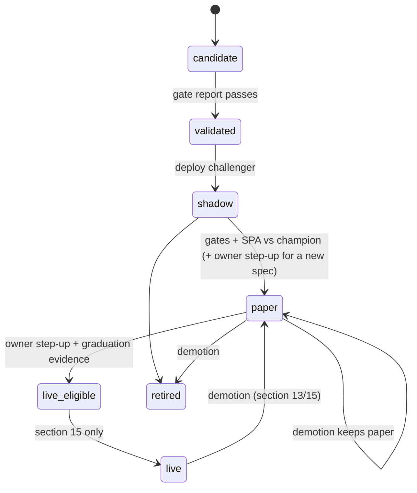

# Optimization, experiments, holdout, and the registry

**Prefix:** `EX-`  ·  **Owners:** `services/optimizer` (studies, trial ledger, gates, registry, holdout service), `services/backtest` (scorer), `services/ml` (training)  ·  **Related:** [ML](ml.md), [backtesting](backtesting.md), [strategies and model lifecycle](strategies-and-model-lifecycle.md), D31, ADR-0035, ADR-0038, ADR-0039, ADR-0040

## Scope

Optuna studies with nested validation, research lineages with one trial ledger, research cycles budgeted by MinBTL, pre-registration, the sealed holdout service, gate reports, registry stages and champion/challenger, the analyst permission table, evidence packs, retraining, and compute budgets. The live switch is section 15; the analyst's reasoning is section 12; scoring thresholds are the scorer's (BT-080).

## Concepts and states

- **Lineage:** every trial for one strategy family on one data domain (timeframe + universe). Holds the holdout boundary, the analyst autonomy level and budget, promotion limits, the current research cycle, and the paper champion.
- **Research cycle:** a MinBTL-budgeted window of effective trials; when spent, only the owner opens the next (D31 rule 3).
- **Trial:** one evaluated configuration (owner study, analyst round, retrain, single run), whatever its status.
- **Candidate:** the final selection of a study, refit on the whole study period, with its gate report.
- **Registry stages:**

## Rules

| ID | Rule | Status | Code / tests |
|---|---|---|---|
| EX-001 | Reported study performance MUST be the outer walk-forward estimate of the whole selection procedure: for each outer fold, an inner Optuna sub-study selects parameters by inner CPCV on that fold's training window only, the selection is refit on the window and tested on the fold, and the test results are stitched. The best inner metric is shown only as "inner". | Implemented | `tb_optimizer/nested.py` (`test_ex001_ex024_study_completes_with_outer_estimate_dsr_and_pbo`, `test_ex021_pure_noise_inner_looks_good_outer_and_dsr_do_not`) |
| EX-002 | The deployable candidate MUST come from a final sub-study (`outer_fold = -1`) over the whole study period, refit on it. | Implemented | `tb_optimizer/nested.py` final sub-study, `core.py` `_candidate` (`test_ex001_ex024_*`) |
| EX-003 | Trials are scored by the vectorized out-of-fold portfolio evaluator; the top `event_driven_top_k` (default 1) candidates MUST be rerun event-driven before any gate (BT-006). | Implemented | `tb_optimizer/gates.py` `event_evidence`, `tbcore/backtest/model_eval.py` (`test_ex001_ex024_*`: engine `event`) |
| EX-004 | Pruned, failed, and abandoned trials MUST still be written to the ledger with their status. | Implemented | `tb_optimizer/nested.py` `_objective` (pruned/failed/abandoned records) |
| EX-005 | A study with `objective.extra_metrics` MUST report the Pareto front (non-dominated trials over the objective and extra metrics). | Implemented | `tb_optimizer/core.py` `study_diagnostics` (inner metric vs max drawdown) |
| EX-006 | Search spaces MUST come from the family hyperparameter schemas plus feature-set, label-spec, timeframe, universe, and rule dimensions; family-specific parameters are conditional; every trial records which dimensions the study varied. | Implemented | `tb_optimizer/nested.py` `_config`, `default_space` (`test_ex001_ex024_*`: dimensions) |
| EX-010 | Each lineage MUST fix a holdout boundary at creation (default: newest data minus `TB_HOLDOUT_MONTHS` = 12 months); training and study periods MUST end at or before it, and `CheckDataAccess` refuses (and audits) any other request. | Implemented | `tb_optimizer/holdout.py` `check_data`, `core.py` `create_study`, `services/ml` `prepare` (`test_ex010_ex012_holdout_is_refused_to_studies_and_the_analyst`, `test_ml011_*`) |
| EX-011 | `EvaluateOnHoldout` MUST require actor `owner` from api-gateway with a step-up no older than `TB_HOLDOUT_STEPUP_MAX_AGE` (300 s), a non-empty reason, and at most one touch per family per calendar quarter; it returns pass/fail and DSR only and writes an audit record. | Implemented | `tb_optimizer/holdout.py` `evaluate` (`test_ex011_ex013_owner_holdout_touch_once_per_quarter_and_counted`) |
| EX-012 | The analyst MUST NOT reach holdout data or results: the holdout service allowlist excludes `assistant`, results live only in the holdout store, and no analyst-readable message carries a holdout result. Analyst attempts are denied and audited. | Implemented | `tb_optimizer/grpc_api.py` `HOLD_ALLOW`, `holdout.py`, migration `holdout` (`test_ex012_ex030_grpc_boundaries_for_the_assistant`, `test_ex011_ex013_*`, `TestSE032SchemaIsolation`) |
| EX-013 | Every holdout evaluation MUST be counted on the lineage ledger (`holdout_evaluations`) and add `TB_HOLDOUT_TRIAL_INFLATION` (1) trial to the lineage count; the UI shows the counter. | Implemented | `tb_optimizer/core.py` `note_holdout_touch`, `stats.py` (`test_ex011_ex013_*`, `test_ex021_stats_count_unusable_trials_and_holdout_inflation`) |
| EX-014 | Only the owner (step-up) may move a boundary, only forward; the previous holdout becomes ordinary data and is listed in `retired_boundaries`. A boundary never moves backward. | Implemented | `tb_optimizer/holdout.py` `set_boundary` (`test_ex014_boundary_moves_only_forward_with_step_up`) |
| EX-015 | Holdout evaluation MUST use the candidate's frozen model and pipeline (no refit) through the same evaluator as the gate. | Implemented | `tb_optimizer/holdout.py` `_evaluate_frozen` (`test_ex011_ex013_*`) |
| EX-020 | Every trial MUST be written to its lineage's ledger whatever its source (owner, analyst, schedule) or status, with spec hash, pre-registration hash, dataset snapshot, code commit, seed, params, and its out-of-fold session-return series. | Implemented | `tb_optimizer/core.py` `_write_trial`, `record_trial` (`test_ex020_ex041_owner_analyst_and_retrain_trials_share_one_ledger`, `test_ml024_*`) |
| EX-021 | Lineage statistics MUST cover all trials in the lineage: `n_trials` (plus holdout inflation), effective N by ONC over the trials' out-of-fold return matrix aligned on the union of sessions (missing sessions = 0 return) with trials that have no usable series (fewer than 10 sessions) counted at the same redundancy ratio, cross-trial Sharpe variance, DSR of the best trial and of each candidate, and PBO by CSCV (S = 16). Gate reports and analyst tools expose only these lineage-level deflated numbers for decisions. | Implemented | `tb_optimizer/stats.py`, `gates.py`, scorer `extra_trials` (`test_ex021_*`, `test_bt080_ex021_uncounted_trials_lower_the_dsr`) |
| EX-022 | Completed studies MUST publish `optimizer.study.completed`; candidate evaluations publish `backtest.completed`. | Implemented | `tb_optimizer/core.py` `_run`, `_candidate` (`test_ex001_ex024_*`) |
| EX-023 | `significance_reachable` MUST be false when the Sharpe needed for DSR ≥ 0.95 at the cycle's maximum effective N exceeds the best trial Sharpe plus two cross-trial standard deviations. | Implemented | `tb_optimizer/stats.py` `cumulative` (`test_ex021_study_diagnostics_and_lineage_stats`) |
| EX-024 | Each candidate MUST get a gate report: outer estimate with bootstrap CI, DSR, PBO, SPA and Romano–Wolf against the champion (when one exists), walk-forward and regime breakdowns, net results at 1×, 1.5×, and 2× costs, parameter stability (neighbor trials), leakage-suite result, survivorship status, and the scorer verdict (BT-080). | Implemented | `tb_optimizer/gates.py` `build_gate_report` (`test_ex001_ex024_*`) |
| EX-025 | A research cycle's effective-trial budget MUST be the largest N with MinBTL(N, `target_sharpe`) ≤ available years of study data; when the cycle's effective trials reach it the cycle is `spent` and new studies or analyst launches in the lineage are refused until the owner opens a new cycle. | Implemented | `tb_optimizer/core.py` `open_cycle`, `_cycle_spent`, `stats.cycle_budget` (`test_ex026_ex025_preregistration_and_cycle_budget`) |
| EX-026 | A study MUST have a pre-registration (hypothesis, metric, universe, period, stop rule) before it starts; its hash is stamped on every trial, and a different metric needs a new study. | Implemented | `tb_optimizer/core.py` `start_study` (`test_ex026_ex025_*`) |
| EX-027 | A study that ends without its final selection (no candidate) MUST end `stopped`, never `completed`, with the reason in its message: the research cycle budget spent (EX-025) or its own budget exhausted (EX-060). | Implemented | `tb_optimizer/core.py` `_run` (`test_ex027_cycle_spent_mid_study_stops_without_a_candidate`) |
| EX-030 | The actor MUST be resolved from the calling service: `assistant` → `analyst` (whatever the request says), `api-gateway` → the claimed owner with its step-up attestation, `ml`/`optimizer` internal → `schedule` or `system`. | Implemented | `tbcore/ml/caller.py` `resolve` (`test_ex030_grpc_forces_actor_analyst_for_the_assistant`, `test_ex012_ex030_*`) |
| EX-031 | Registry transitions MUST follow the permission table below, enforced in the optimizer for every caller (table-driven test). | Implemented | `tb_optimizer/registry.py` `decide` (`test_ex031_permission_table`) |
| EX-032 | `CheckTransition` MUST return exactly the decision `PromoteCandidate` would make, without side effects. | Implemented | `tb_optimizer/core.py` `check` (same `decide`) |
| EX-033 | Raising a lineage's autonomy level MUST need owner step-up; lowering is immediate. At level 2 the analyst's paper promotions are limited by `PromotionLimits` (defaults: 1 per 14 days, ≥ 10 shadow sessions, 14-day cooldown after any demotion) and never change the paper allocation. | Implemented | `tb_optimizer/registry.py`, `core.py` `set_autonomy` (`test_ex033_ex052_ex053_ex055_promotion_limits_and_special_cases`, `test_ex020_ex041_*`) |
| EX-034 | `NominateLiveEligible` MUST notify the owner (`alert.info`) and never change a stage. | Implemented | `tb_optimizer/core.py` `nominate` (`test_ex050_ex056_ex057_*`) |
| EX-035 | Gate reports returned to the analyst MUST have `reasons` and `thresholds` cleared (pass/fail and DSR stay, BT-080). | Implemented | `tb_optimizer/gates.py` `analyst_view` (`test_ex011_ex013_*`, `test_ex012_ex030_*`) |
| EX-036 | Analyst launches MUST stay within the lineage analyst budget (trials, CPU hours) and the global analyst budget; an alert fires at 80 % and launches are refused at 100 %. | Implemented | `tb_optimizer/core.py` `create_study`, `_budget_left`, `_budget_alert`; `services/ml` (`test_ml024_*`, `test_ml031_*`) |
| EX-040 | Retrain triggers (scheduled, drift, performance) MUST produce a challenger study with the same spec and an extended window, never an in-place model change; when the lineage autonomy is ≥ 1 the trigger is routed to the analyst (`optimizer.retrain_requested.<lineage>`), otherwise the default policy runs; scheduled retrains may reach validated and shadow, never paper on their own. The champion is replaced only if the challenger passes the same gates (and EX-052 for paper). | Implemented | `tb_optimizer/core.py` `trigger_retrain`, `tick` (`test_ex020_ex041_*`) |
| EX-041 | Retrain trials are ledgered with source `schedule` like any other; scheduled refits of an unchanged spec add little effective N because ONC clusters them with their parent. | Implemented | `tb_optimizer/core.py`, `stats.py` (`test_ex020_ex041_*`) |
| EX-050 | Every stage change MUST be audited and published on `ml.registry.stage_changed`. | Implemented | `tb_optimizer/core.py` `_transition` (`test_ex050_ex056_ex057_*`) |
| EX-051 | `candidate → validated` MUST require a passing scorer verdict on event-driven evidence with the leakage suite passed. | Implemented | `tb_optimizer/registry.py` `_gate_failures`, `gates.py` (`test_ex033_ex052_*`) |
| EX-052 | `shadow → paper` MUST require: validated, a current passing gate report, SPA or Romano–Wolf p ≤ 0.05 against the paper champion when one exists, survivorship status `complete`, and a generated evidence pack. A **new spec** (lineage without a paper champion) additionally needs owner approval with step-up. Candidates trained on synthetic data are never `live_eligible`. | Implemented | `tb_optimizer/registry.py` (`test_ex031_permission_table`, `test_ex033_ex052_*`) |
| EX-053 | `paper → live_eligible` MUST require owner step-up, non-synthetic data, and graduation evidence (≥ `TB_GRADUATION_MIN_SESSIONS` = 20 paper sessions recorded on the candidate, SM-005). | Implemented | `tb_optimizer/registry.py` (`test_ex033_ex052_ex053_*`) |
| EX-054 | The optimizer MUST NOT set `live`; that is section 15 only. | Implemented | `tb_optimizer/registry.py` `decide` (`test_ex031_permission_table`) |
| EX-055 | Demotion (section 13 input or owner) moves a candidate to `paper` or `retired` and marks it demoted; re-promotion of a demoted candidate is owner-only. | Implemented | `tb_optimizer/core.py` `demote`, `registry.py` (`test_ex033_ex052_ex053_ex055_*`) |
| EX-056 | A lineage has at most one paper champion; challengers deploy to `shadow` with a registry entry in mode `shadow` next to the champion on the same bars. | Implemented | `tb_optimizer/core.py` `_deploy`, `registry.registry_entry`; strategy-runtime `load_runner` (`test_ex050_ex056_ex057_*`, `test_ex056_shadow_challenger_runs_next_to_the_paper_champion`, `test_ex056_research_deployments_join_the_seed_but_never_live`) |
| EX-057 | Every human-gated promotion MUST generate a one-page evidence pack (markdown + HTML) and record its hash in the audit event. | Implemented | `tb_optimizer/registry.py` `evidence_pack`, `core.py` `promote` (`test_ex050_ex056_ex057_*`) |
| EX-060 | Studies MUST stop at their budget (trials, wall time, CPU hours); lineage and global budgets cap the sum. | Implemented | `tb_optimizer/core.py` `_budget_left`, `nested.py` `_budget_callback` (`test_ex001_ex024_*`) |
| EX-061 | Optimization work MUST run at lower priority than live services (worker threads capped by `TB_OPT_MAX_THREADS`) and in queue order live retrain > owner > analyst. | Specified (ml jobs are queued by priority, ML-030; a study queue arrives with the Prefect adapter, ADR-0038) | — |
| EX-062 | Each lineage MUST have deployment limits: the horizon profile from `TB_OPT_DEPLOYMENT_LIMITS` (shipped defaults: intraday allocation 20,000, drawdown 3,000, 12 consecutive losses, 8 positions, daily loss 600; swing allocation 50,000, drawdown 10,000, 15 consecutive losses, 15 positions, daily loss 2,000; see `deployment.py`) overlaid field by field with an owner override. Only the owner may set the override; raising any limit or the allocation above the current effective value (or setting a field the profile leaves to execution's global default) MUST need a fresh passkey step-up; the analyst and schedules are always denied. Every change is audited (`optimizer.deployment_limits.set`). | Implemented | `tb_optimizer/deployment.py`, `core.py` `deployment_limits`, `set_deployment_limits`; `test_ex062_*`; gateway `TestEX062DeploymentLimitsRaiseNeedsPasskey` |
| EX-063 | The event-driven gate rerun MUST run each candidate at its lineage's deployment allocation with the deployment limits in the strategy scope (the same merge execution applies on paper, RM-019), and the gate report MUST record them (`GateReport.deployment_limits`). | Implemented | `gates.event_evidence`, `core._candidate`; `test_ex063_*` |
| EX-064 | A shadow/paper deployment entry MUST carry the deployment limits and allocation and a `monitoring` block (lineage, candidate, model version, training run, feature set, and paths to `expectation.json`, the training `reference.parquet`, `oof.parquet`, and `importance.json`); `expectation.json` holds the rerun's per-session returns (bps of equity), per-trade returns (bps), modeled slippage and implementation shortfall (fill vs the intent's reference price plus fees). Registration with execution is the owner's `strategy.register` action (passkey) in api-gateway: `RegisterStrategy` in the candidate's stage mode, the allocation through the ledger, and `SetRiskLimits(strategy:<id>)` with the owner's step-up. | Implemented | `core._entry`, `registry.registry_entry`, `gates.write_expectation`; gateway `handleCandidateRegister`; `test_ex050_ex056_ex057_*`, `TestSM016RegisterCandidateWithExecution` |

### Permission table (EX-031)

| Transition | Owner | Analyst L0 | Analyst L1 | Analyst L2 |
|---|---|---|---|---|
| `candidate → validated` (gates pass) | yes | no | yes (automatic on gate pass) | yes |
| `validated → shadow` | yes | no | yes | yes |
| `shadow → paper` (replace paper champion) | yes (step-up for a new spec) | no | no | yes, within promotion limits, after the minimum shadow period, never a new spec |
| `paper → live_eligible` | yes, step-up | no | no | nominate only |
| `live_eligible → live` | section 15 only | no | no | no |
| `EvaluateOnHoldout` | yes, step-up | never | never | never |
| Re-promote a demoted candidate | yes | no | no | no |

## Invariants

| ID | Invariant | Checked by |
|---|---|---|
| EX-I1 | The ledger's trial count for a lineage never decreases. | Ledger store test |
| EX-I2 | Holdout touch count per family and quarter is ≤ 1 and never decreases (SM-I3). | Holdout test |
| EX-I3 | No analyst-readable record contains a holdout result. | Holdout isolation test |

## Edge cases

| Scenario | Expected behavior | Rules |
|---|---|---|
| Pure-noise data | Best inner metric looks good; outer estimate near zero; DSR far below 0.95; no candidate validated | EX-001, EX-021 |
| Study stopped mid-trial | Running trial stored as `abandoned` and counted | EX-004, EX-020 |
| Second holdout request in the same quarter | Refused with the next allowed quarter; audited | EX-011 |
| Analyst asks to promote a challenger to paper in a lineage with no paper champion | Denied (new spec needs owner) | EX-052, EX-031 |
| Demoted candidate, analyst level 2 | Re-promotion denied | EX-055 |
| Cycle budget spent | New study refused with `cycle_spent`; owner may open a new cycle | EX-025 |
| Cycle budget spent during a study | The running study stops searching, ends `stopped` with no candidate and the reason in its message | EX-025, EX-027 |

## Open questions

- Graduation evidence comes from section 15 (paper P&L, divergence) once built; until then the owner records paper sessions on the candidate.
- Prefect flow deployment for studies (D10) is Planned; studies run on the optimizer worker's queue (ADR-0038).
