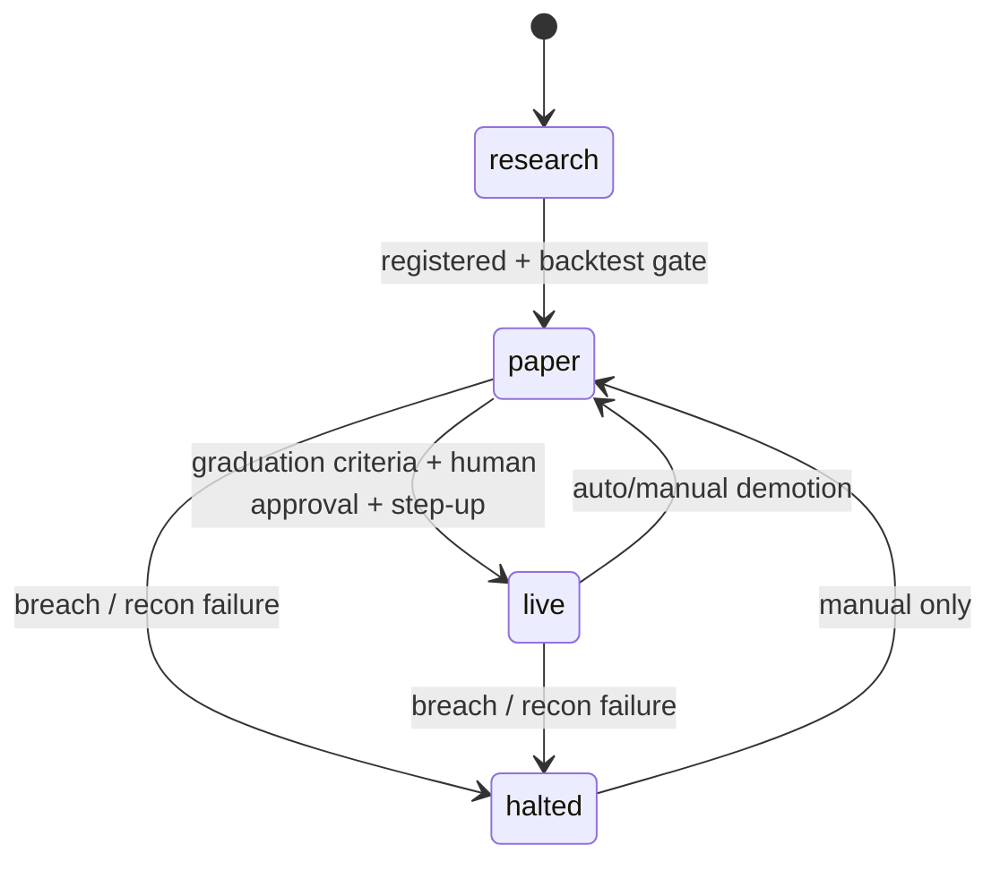

# Strategies and model lifecycle

**Prefix:** `SM-`  ·  **Owners:** `ml`, `backtest`, `optimizer`, `execution` (runtime), `monitor` (demotion), `assistant`  ·  **Related:** [data and features](data-and-features.md), [risk](risk-management.md)

## Scope

How a strategy and its models move from research to live and back: modes, validation, holdout discipline, promotion, demotion, reproducibility, and the assistant's limits. Feature and label correctness is in [data and features](data-and-features.md).

## Concepts and states

- **Strategy:** model version(s) + signal-to-intent rules + sizing + limits, bound to one virtual portfolio.
- **Strategy modes:**

- **Model stages (registry):** `candidate → challenger (shadow/paper) → champion`, `archived`.

## Rules

| ID | Rule | Status | Code / tests |
|---|---|---|---|
| SM-001 | Every new strategy MUST start in `paper` (or below: `disabled`, `shadow`); nothing may create a strategy directly in `live`. Re-registering an existing strategy never changes its mode. | Implemented | execution `RegisterStrategy`, `Seed` |
| SM-002 | Validation MUST use walk-forward or purged/embargoed CV; random K-fold on time series is forbidden. | Specified | — |
| SM-003 | The sealed final holdout MUST NOT be accessible to optimization; each access is logged and counted, and evaluated once per promotion candidate. | Specified | — |
| SM-004 | Promotion to `live` MUST require: graduation criteria met, explicit human approval with step-up auth, a per-strategy capital cap, the global live flag, and an audit record. | Specified | — |
| SM-005 | Default graduation criteria: ≥ 20 trading days and ≥ 100 trades in paper; live-vs-backtest divergence within tolerance; no unexplained reconciliation breaks; max drawdown within the backtest's 95th percentile. All configurable. | Specified | — |
| SM-006 | Any risk breach, reconciliation failure, or monitoring alarm MAY demote automatically to `paper` or `halted`; re-promotion MUST be manual. | Specified | — |
| SM-007 | Every model, backtest, and experiment MUST record code commit, config, dataset snapshot ID, seeds, and environment lockfile; unreproducible runs are not promotable. | Specified | — |
| SM-008 | Strategy ranking MUST report multiple-testing-aware statistics (deflated Sharpe, PBO) alongside Sharpe, Sortino, Calmar, max drawdown, turnover, cost drag. | Specified | — |
| SM-009 | Challengers run in shadow or paper next to the champion; replacing a live champion follows SM-004. | Specified | — |
| SM-010 | The assistant MUST NOT place orders, change live config or limits, promote strategies, read the holdout, or see credentials or account identifiers; its experiments run within a compute budget. | Specified | — |
| SM-011 | Backtest strategy code MUST be the same code that runs live (shared strategy API in `libs/py/tbcore`). | Specified | — |
| SM-012 | Strategy modes are `disabled`, `shadow`, `paper`, `live`, `halted`. Owner actions may set `disabled`, `shadow`, `paper`, `halted`; `live` only through the section 15 go-live flow (SM-004). A paper strategy may only send to paper accounts and a live strategy only to live accounts, and only to its registered account. | Implemented | execution `SetMode`, risk `mode` |
| SM-013 | A `shadow` strategy's intents are evaluated by the full gate and recorded with `shadow=true`, but never reserve capital or reach a broker. Hypothetical fills are Planned (section 08 parity). | Implemented | OMS `process` |
| SM-015 | Model strategies MUST run on the shared host (`tbcore.strategy.model_signal`: `model_signal`, `meta_filter`, `residual_reversal`) in backtests, shadow, and paper: entries only when the model's score clears the threshold fitted on training data (or the filter takes the primary's entry), a protective stop on every entry (N5), exits after the label horizon (intraday also before the close). Live and shadow scoring uses the persisted bundle on `OnlineFeatureEngine` and fails closed on a feature-set mismatch (ML-040); a bar time's decisions are emitted when its last instrument bar arrives (cross-sectional features need the batch), and an incomplete older batch is skipped, never guessed. | Implemented | `tbcore/strategy/model_signal.py`, `host.py` (`test_ml041_ml042_online_predictions_equal_offline_for_the_same_bars`, `test_ex056_shadow_challenger_runs_next_to_the_paper_champion`) |
| SM-014 | Strategies see only their own virtual portfolio (ledger updates filtered to their owner) and data with `available_at <= decision_time`; the runtime uses `tbcore.strategy` so backtests run the same code (SM-011). | Implemented | `tbcore.strategy`, `tbcore.strategy.host.Runner` (shared by the runtime and the backtester); `test_runner_sees_only_its_own_positions_sm014`, `test_orb_ignores_bars_from_the_future_df002` |

## Invariants

| ID | Invariant | Checked by |
|---|---|---|
| SM-I1 | Every `live` strategy has an audited promotion record and a capital cap. | Startup check in execution; audit query |
| SM-I2 | Every registered model links to a reproducible run (SM-007 fields present). | Registry validation |
| SM-I3 | Holdout access count per study is recorded and never decreases. | Holdout API test |

## Edge cases

| Scenario | Expected behavior | Rules |
|---|---|---|
| Optimizer requests data overlapping the holdout period | Refused; logged | SM-003 |
| Paper strategy passes criteria but recon had one explained break | Eligible; explained breaks are recorded with reason | SM-005 |
| Live drift alarm at 15:55 | Auto-demote to `paper`; strategy-owned positions handled per the demotion policy (DECISION PENDING: hold vs flatten) | SM-006 |
| Assistant proposes raising a risk limit | Shown as a suggestion only; owner must apply with step-up auth | SM-010, RM-007 |

## Open questions

- Demotion policy for open positions (hold under paper rules, or flatten strategy-owned): DECISION PENDING.
- Divergence tolerance definition and retraining cadence/triggers (research §5, §9).
- MVP model families and labels (D23, D24).
