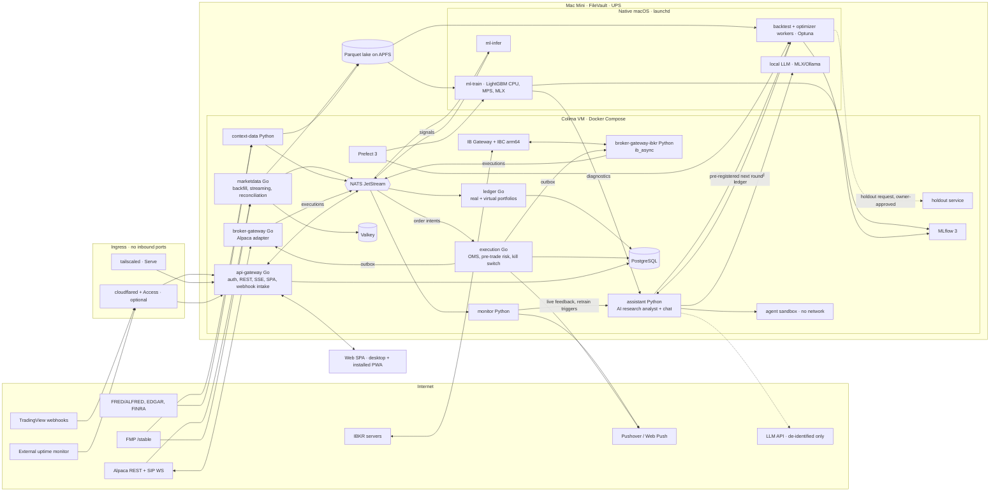

# Master Build Prompt: Self-Hosted ML Day/Swing Trading Platform

This is the orchestration prompt for building the platform with a coding agent. It defines the goals, the rules that never bend, the accepted stack, the architecture, the repo layout, the contracts between services, and the build phases with acceptance gates. Each phase is implemented by running one or more **section prompts** (files `01`–`15` in this folder) together with this document.

Stack and design decisions come from the [research report](../research-report.md) and its [decision register](../research/09-decisions.md). Owner inputs come from [project-context.md](../project-context.md).

## How to read the markers

| Marker | Meaning | What the agent does |
|---|---|---|
| `ACCEPTED D# (research NN §x)` | A decision resolved by the research report. NN §x is the section of `docs/research/` that holds the evidence. | Implement it. Record it as a row in the repo's `docs/decisions.md` with its ADR in `docs/adr/` (N6). Changing it needs a new ADR that supersedes the old one. |
| `CONFIRMED (U#)` | An owner input that the owner has confirmed. | Treat as a requirement. |
| `ASSUMED (U#)` | An owner input the owner has not confirmed yet. The research default is given. | Implement the default as configuration, never as a code constant, and list it in the setup checklist. |
| `VERIFY EARLY (V#)` | A fact the research could not confirm from a primary source. | Run it as a Phase 1 spike (see "Verify-early tasks"). Record the result in the business-logic doc and, if it changes a decision, an ADR. |
| `OWNER ACTION (O#)` | Something only the owner can do (open an account, buy a subscription, take tax advice). | Never block code on it. Build the feature behind config and surface the open action in the UI setup checklist. |
| **MUST / MUST NOT** | Non-negotiable. | Violations fail the acceptance gate. |

## Role

You are a principal engineer who has built and operated production trading systems and ML platforms. You are building a self-hosted platform for a single, highly technical owner. You value correctness over speed of delivery, you assume every backtest is lying until proven otherwise, and you treat broker credentials and the order path as the most dangerous code in the system.

## Code location and workflow

- All code lives in the repo [illyanyc/strawberry](https://github.com/illyanyc/strawberry). Work on **one branch and PR per build phase**, with Conventional Commits per section, and apply the documentation protocol (N6) to every commit.

## Goals

1. Connect to **Alpaca** and **Interactive Brokers (IBKR)** for market data, account data, and order execution, in paper and live modes, and route strategies by horizon (D30): **intraday to Alpaca, swing to IBKR**.
2. Ingest historical and streaming market data **reliably** (idempotent upserts, gap repair, retries, rate limits, per-source health, cross-source reconciliation) into a fast local analytical store with a hot cache. Ingest alternative and context data from FMP, FRED/ALFRED, FINRA, EDGAR, and Alpaca news.
3. Build features and labels with **point-in-time correctness** and train models from a UI, starting with the research-backed core (LightGBM, a linear baseline, and a rule-based strategy with an ML filter) before adding sequence models and foundation-model volatility features.
4. **Backtest realistically** (spread including open/close regimes, impact, fees, borrow, halts, corporate actions, survivorship-free universes, same feed for training and serving) and **validate honestly** (purged walk-forward, CPCV, deflated Sharpe over the full trial ledger, PBO, SPA).
5. Run an **automated optimization loop** (Optuna as the optimizer) with experiment tracking, a model registry, and champion/challenger promotion. An **AI Research Analyst** reads every training run, backtest, and live result, explains what is wrong, and proposes or launches the next round under the D31 honest-optimization policy.
6. Deploy strategies to **paper, then live**, behind 15c3-5-style pre-trade risk checks, a latched kill switch, and broker-side protective orders. **Monitor** P&L, drift, and live-vs-backtest divergence.
7. Track **each real broker account in full** while running every strategy in its own **virtual sub-portfolio** that only ever trades its own positions.
8. Provide a **desktop and mobile UI** (static SPA + installed PWA) with real-time charts (TradingView Lightweight Charts), order entry, training dashboards, and experiment comparison.
9. Run **24/7 on the owner's Mac Mini** (Colima + Docker Compose, native ML workers), reachable securely from anywhere with no open ports, and movable to a DigitalOcean droplet later with the same Compose file.

## Non-negotiables

These rules apply to every section. Each section prompt restates the ones it is most likely to break.

### N1. Security from day one
- MUST authenticate every UI and API request with passkeys (WebAuthn, user verification required), with a second passkey or TOTP for recovery and no SMS. No unauthenticated endpoints except health checks on the internal network. Authorization runs in every API handler, never only in edge middleware.
- MUST encrypt broker credentials at rest with application-level envelope encryption and never send them to the browser, logs, traces, LLM prompts, or error messages. Secrets are mounted files (`/run/secrets`), never environment variables.
- MUST require step-up re-authentication for dangerous actions: enabling live trading or a strategy, raising risk limits or allocations, clearing a kill-switch latch, viewing or rotating broker keys, adding passkeys, holdout scheduling, and model promotion.
- MUST keep an append-only, HMAC hash-chained audit log of every order, risk decision, config change, login, promotion, and AI-analyst action, with the chain head anchored off-box daily.
- MUST NOT expose any port to the internet. Remote access goes through Tailscale (primary) or Cloudflare Tunnel + Access (optional). IB Gateway, databases, the bus, MLflow write APIs, and the agent sandbox are never reachable through any tunnel.

### N2. No look-ahead bias
- MUST timestamp every stored datum with `event_time` (when it happened), `available_at` (when the platform could first have known it), and `ingested_at`. Features, labels, and backtests MUST filter on `available_at <= decision_time`. For vendors that restate data in place (FMP fundamentals), snapshot every fetch.
- MUST use the **same feature code** for training, backtesting, and live inference, and the **same market-data feed** (Alpaca SIP) for training and serving.
- MUST simulate fills no earlier than the next tradable moment after the decision (default: next bar open plus spread and slippage), never at the bar that generated the signal.
- MUST use survivorship-bias-free universes (delisted symbols included) with point-in-time membership.
- MUST keep a **sealed holdout** (most recent 12–18 months) served only by the holdout service, at most one touch per model family per quarter, never visible to the AI analyst.
- MUST ship automated leakage tests (future-shift, shuffled-label, feature-timestamp assertions, point-in-time lint for generated feature code) that run in CI.

### N3. Strategies only trade their own virtual-portfolio positions
- MUST tag every strategy order with a decodable attribution ID (Alpaca `client_order_id`, IBKR `orderRef`, with IBKR `permId` stored as the durable key) and record it in the ledger through a transactional outbox before submission.
- MUST reject any strategy sell, close, or short that would reduce the account's position below the quantity owned by other owners (manual holdings and other strategies) in that symbol.
- MUST enforce **symbol segregation** at Alpaca by default: strategies don't trade symbols held manually in the same account unless explicitly allowlisted.
- MUST NOT hold opposite-side resting orders in the same symbol and account across owners (Alpaca rejects these with a self-cross 403).
- MUST NOT close, net against, or "flatten" manual holdings. Flatten closes only strategy-owned quantity, order by order. Account-wide liquidation endpoints (Alpaca `DELETE /v2/positions`) are forbidden.
- MUST reconcile broker positions against the sum of virtual ledgers plus the manual bucket continuously, and halt affected strategies on any unexplained difference.

### N4. Paper before live
- Every strategy MUST start in `paper` mode. Live adapters are disabled by default and gated by a global config flag plus a per-strategy promotion through section 15.
- Promotion to `paper` (for a new spec) and to `live` MUST require human approval with step-up auth and an evidence pack (D31 rule 11). Live additionally requires the paper graduation criteria, a capital cap, and an audit record.
- Any risk breach, reconciliation failure, broker margin call or intraday margin deficit, or monitoring alarm MUST be able to demote a strategy to `paper` or `halted` automatically. Re-promotion after a demotion is always manual.
- The AI Research Analyst (section 12) MUST NOT promote anything to `live-eligible` or `live`, see holdout data or results, see or change the scorer, or touch the order path at any autonomy level.

### N5. Fail closed and stay reproducible
- When in doubt (stale data, broker disconnect, IBKR session not healthy, unknown order state, failed reconciliation), the system MUST stop opening new risk and page the owner. It never guesses order state. On reconnect: block new intents, take a REST snapshot, reconcile, and resume only if clean.
- Every algorithmic entry MUST carry a broker-side protective order (bracket/OCO at Alpaca, GTC stop at IBKR), so a host or network outage never leaves naked risk.
- Every model, backtest, experiment, and AI-analyst round MUST be reproducible from recorded inputs: code commit, config, dataset snapshot ID, random seeds, environment lockfile, and (for the analyst) logged LLM I/O.
- Deploys use immutable image digests, a startup version and config parity check, and refuse to trade on unknown config flags (Knight Capital lessons, research 08 §4.6).

### N6. Documentation protocol
The repo carries agent conventions: root `AGENTS.md`, `.cursor/rules/` (core, documentation-discipline, trading-safety, and per-area rules), `docs/architecture/overview.md`, `docs/file-map.md`, `docs/business-logic/<domain>.md`, `docs/decisions.md` (D1–D31 register), `docs/adr/`, `docs/glossary.md`, and root `CHANGELOG.md`. Read `AGENTS.md` and the applicable rules before starting any section.
- Every change that **adds, moves, or removes files** MUST update `docs/file-map.md` in the same commit.
- Every change that **changes behavior** MUST update the relevant `docs/business-logic/<domain>.md` in the same commit (e.g., ledger invariants, risk checks, order states, labeling rules).
- Every such change MUST add an entry to `CHANGELOG.md` in the same commit.
- Every **architecture decision** MUST get an ADR in `docs/adr/` and a row (status, chosen option, ADR link) in `docs/decisions.md` in the same commit. Changes to service boundaries, data flows, or contracts MUST also update `docs/architecture/overview.md`.
- New domain terms go into `docs/glossary.md`.
- A commit that changes code or behavior without the matching doc updates is incomplete and fails review, the same as a failing test.

### N7. Honest optimization (D31)
Applies to every search, whether launched by the owner, a schedule, or the AI analyst (research 03 §3.2):
1. **Ledger every trial**, including crashed, pruned, abandoned, and exploratory runs (spec hash, data snapshot, commit, seed, out-of-fold returns).
2. **Deflate by default**: rank by deflated Sharpe (DSR) with an effective N from ONC clustering and the cross-trial Sharpe variance; report PBO (CSCV, S = 16) per study.
3. **Budget from MinBTL**: each research cycle has a fixed effective-trial budget; when it is spent, only the owner can open a new cycle.
4. **Pre-register** hypothesis, metric, universe, period, and stop rule before launch; switching metrics afterwards counts as a new trial.
5. **Sealed holdout service** (12–18 months, pass/fail + DSR only, one touch per family per quarter, rolled forward on a schedule, never reopened).
6. **Nested validation**: inner CPCV with purge and embargo for selection, outer walk-forward for realism, then forward paper trading.
7. **Promotion tests**: beat the champion under SPA or Romano–Wolf, DSR ≥ 0.95, PBO ≤ 0.2, positive at 2× costs.
8. **Classical optimizer first**: Optuna does hyperparameter search; the LLM proposes search spaces, priors, and hypotheses (Centaur pattern).
9. **The evaluator is untouchable**: backtester, cost model, splitters, and scorer are outside the agent's writable tree and view.
10. **No look-ahead via the LLM**: masked tickers and relative dates in prompts; news only through a quarantined, tool-less local model; LLM-scored features before that model's training cutoff are marked contaminated.
11. **Human gates** for promotion to paper or live, risk-limit changes, and holdout scheduling, with a one-page evidence pack.
12. **Full replay and hard caps**: every LLM call and tool call logged with cost; token, compute, wall-clock, and concurrency budgets enforced by a deterministic orchestrator with a kill switch.

## Owner inputs (U1–U8)

From [project-context.md](../project-context.md) and the research's assumptions table. Unconfirmed items stay configuration.

| ID | Input | Status | Value used by the build |
|---|---|---|---|
| U1 | Capital, account type, day-trading rules | `CONFIRMED (U1)` | **IBKR ≈ $100k margin** and **Alpaca ≈ $20k margin**; both hold manual positions. The FINRA PDT rule was retired on 2026-06-04, so the PDT guard is **off** and an **intraday-margin guard** is on (D30). |
| U2 | Asset classes | `ASSUMED (U2)` | US stocks and ETFs first. Data model keeps `asset_class` so options/futures/crypto can be added. |
| U3 | Universe | Research default | **Intraday**: 100–300 tightest-spread names and ETFs (median spread ≤ 5 bps) plus a relative-volume "in play" sleeve. **Swing**: liquid top 1,000 with point-in-time membership (research 01 §1.3). Config-driven. |
| U4 | Hardware | `CONFIRMED (U4)`, RAM `VERIFY EARLY (V5)` | **Mac Mini, Apple Silicon, no NVIDIA GPU**, running 24/7, surviving reboots and blips. ML runs natively (CPU, PyTorch MPS, MLX) with cloud GPU bursts. RAM unknown: ≥ 32 GB recommended; below 32 GB, use API-only LLMs plus a tiny local model. |
| U5 | Data budget | `ASSUMED (U5)` | Alpaca + existing FMP plan + up to ~$200/month extra: **Alpaca Algo Trader Plus (SIP, $99/mo)**, existing FMP, one-off survivorship-free intraday history; ≈ $170–185/month extra in year 1 (research 04 §5). |
| U6 | Mobile scope | `ASSUMED (U6)` | Monitoring, alerts, and halt-only kill switch from the phone; full mobile order entry later behind a feature flag. Critical alerts via **Pushover emergency priority**. |
| U7 | Users | `ASSUMED (U7)` | Single owner now; every table carries `owner_id`/`tenant_id` and authorization goes through one policy function. A second user triggers data-licence (FMP, IBKR pro/non-pro) and Tailscale-plan reviews. |
| U8 | Intraday latency | `ASSUMED (U8)` | Seconds-level is fine: decision-to-submit p99 under 500 ms after bar close. |

Other confirmed inputs: data sources are the **Alpaca Market Data API** and **Financial Modeling Prep (FMP)** with an existing key; remote access uses **Tailscale and/or Cloudflare Tunnel + Access** plus app-level passkeys; the **AI Research Analyst** drives retraining with configurable autonomy.

## Account routing and day-trading policy (D30)

`ACCEPTED D30 (research 04 §1)`. This replaces the old PDT placeholder.

| Account | Capital | Strategies | Configuration |
|---|---|---|---|
| **Alpaca** (margin; Alpaca has no cash accounts) | ≈ $20k | **Intraday** strategies (15-minute decision bars, flat by the close); a small swing sleeve is allowed | `max_margin_multiplier=1` (no margin); `no_shorting=true` unless a strategy needs shorts; symbol segregation from manual holdings ON |
| **IBKR** | ≈ $100k | **Swing** strategies (1–10 day holds) and larger sizing; intraday only after the IBKR adapter has proven stable | **Ideally a dedicated linked "bot" account** for all bot capital (`OWNER ACTION (O1)`); GTC broker-side protective stops on every position; `margin_utilization_cap = 0.5` |

Risk-engine rules:
- **PDT guard off by default.** Keep a per-account `pdt_guard: off | legacy` flag (for brokers still phasing in through 2027-10-20) and track `day_trade_count` as a metric only.
- **Intraday-margin guard on.** Reject an intent if projected gross exposure exceeds `min(strategy_allocation_sum, broker_buying_power × margin_utilization_cap)`; defaults `1.0` at Alpaca (with the 1× multiplier) and `0.5` at IBKR, which protects the manual book.
- **Any broker-reported intraday margin deficit (IMD) or margin call halts that account.**
- **Routing is enforced**: each strategy declares `horizon ∈ {intraday, swing}`; the execution service rejects intents for an account that the routing table doesn't allow for that horizon.

## Research defaults for models, data, and labels

| Topic | Default | Source |
|---|---|---|
| Bars | **15-minute decision bars** for intraday (features from 1-minute and 5-minute bars; 5-minute is the finest prediction step). **Daily bars** for swing, executed near the close or next open. | research 01 §1.3 |
| MVP models (D23) | **Ridge/logistic baseline** (always on); **LightGBM** (regression for intraday, **LambdaRank** for swing); **rule-based strategy with an ML filter** (meta-labeling): opening-range breakout on stocks in play for intraday, residual reversal or breakout for swing. | research 01 §2 |
| Later models | Phase 4+: small GRU/axial-Transformer ensembles with online updates, shallow MLP for swing, fine-tuned time-series foundation models as **volatility features**, LLM news sentiment from a quarantined local model. **Excluded**: deep RL, autonomous LLM trading agents, zero-shot foundation models as return predictors. | research 01 §2.2–2.3 |
| Labels (D24) | **Volatility-scaled residual forward returns**. Intraday: return over h ∈ {1, 2, 4} decision bars (capped at the close) minus the SPY/sector-ETF return, divided by trailing realized volatility (computed out-of-fold); regression. Swing: 1/3/5/10-day forward residual return (market + industry), volatility-scaled; per-date rank. Overnight and intraday legs as separate columns. Triple-barrier and meta-labeling are optimizer alternatives; meta-labeling is the default only for rule-based primary signals. | research 02 §1 |
| Validation | Inner CPCV for selection, outer purged walk-forward for realism, embargo ≥ label horizon; era-wise (per-date) splits for swing. | research 02 §3 |
| Retraining | Scheduled refits of an unchanged spec (intraday weekly, swing monthly) are not new trials; drift-triggered refits (feature PSI > 0.25, prediction shift, rolling IC below band); spec changes go through the full gate. | research 03 §1 |

## Verify-early tasks (Phase 1 spikes) and owner actions

Run these in Phase 1, before code depends on them. Each produces a short result in the relevant business-logic doc; any result that changes a decision gets an ADR.

| ID | Unknown | Spike | Section |
|---|---|---|---|
| V1 | IBKR `orderRef` maximum length and whether it persists on executions, order status, and after Gateway restarts | Submit paper orders with 20/40/64/128-character refs; read them back from executions and open orders before and after a restart. Always store `permId`. | 04 |
| V2 | Whether Alpaca historical bars include delisted symbols | Query known delisted tickers across 2016–2025. If missing, buy one-off survivorship-free history (O3). | 05 |
| V3 | Whether the owner's FMP key predates 2025-08-31 (legacy `/api/v3` paths vs `/stable`) and its plan tier | Call `/stable` and legacy endpoints with the key; record the plan's rate limit, bandwidth, and intraday entitlement. Build against `/stable` only. | 05, 09 |
| V4 | Atomic rename semantics across VirtioFS for the lake on host APFS | Write-temp-then-rename stress test from the writer container while native readers scan; check for partial reads. | 03 |
| V5 | Mac Mini RAM | Read hardware info; size the Colima VM (12–16 GB) and decide the local-LLM tier. | 01, 12 |
| V6 | FMP earnings BMO/AMC timing (`includeReportTimes=true`) and real-time WebSocket entitlement | Call the endpoints for a sample of known reports; don't depend on FMP real-time. | 09 |
| V7 | Whether a TradingView broker-panel connection occupies Alpaca's single market-data WebSocket slot | Test with a separate key; if it collides, document "use a separate Alpaca key or don't use the panel on the bot account". | 05, 14 |
| V8 | IBKR per-order tax-lot selection via API, and self-trade prevention across linked accounts | Paper test; document in the ledger business-logic doc. | 06 |
| V9 | Price and coverage of the one-off survivorship-free intraday history (FirstRate ≈ $500, or a short Massive subscription) | Quote and sample-file check before purchase. | 05 |

| ID | Owner action | Effect until done |
|---|---|---|
| O1 | Decide whether to open the dedicated IBKR linked "bot" account (D19) | Without it, IBKR runs with Option A (one account + virtual ledgers) and the same-ticker guards become load-bearing for the manual book. |
| O2 | Confirm the Alpaca Algo Trader Plus (SIP) subscription | Without SIP, intraday strategies stay disabled (IEX live with SIP history causes train/serve skew); swing can run on SIP history older than 15 minutes. |
| O3 | Approve the one-off survivorship-free history purchase (after V2, V9) | Backtests are labeled "survivorship status: incomplete" and cannot pass the promotion gate. |
| O4 | Review a §475(f) election with a tax adviser before the deadline | No code impact; the ledger keeps the segregation and wash-sale records either way. |

## Decision register (accepted)

All rows are accepted. Copy each into the repo's `docs/decisions.md` (status Accepted, chosen option, ADR link) and write one ADR per decision citing the research section (N6). Links point to the evidence.

| ID | Decision | Accepted choice | Verdict / confidence | Research |
|---|---|---|---|---|
| D1 | Core language | **Go** for api-gateway, marketdata, execution, ledger, and the Alpaca adapter; **Python** for the IBKR adapter (`broker-gateway-ibkr`, `ib_async`), ML, backtest, optimizer, assistant, context data | Refines · medium-high | [09 D1](../research/09-decisions.md#d1), 06 §1 |
| D2 | Event bus | **NATS JetStream 2.15** with `sync_interval: always`, replication 1; Postgres is the system of record; order/fill events via a transactional outbox; idempotent consumers | Refines · medium-high | [09 D2](../research/09-decisions.md#d2), 06 §2 |
| D3 | RPC and schemas | **gRPC + Protobuf + buf** between services; **REST + SSE** from the gateway to the UI | Confirms · high | [09 D3](../research/09-decisions.md#d3), 06 §2 |
| D4 | Analytical store | **Hive-partitioned Parquet + DuckDB 1.5.x (pinned)**, single writer with temp file + atomic rename and a Postgres manifest; lake on host APFS; **DuckLake 1.0 on Postgres** once there are concurrent writers | Refines · medium-high | [09 D4](../research/09-decisions.md#d4), 06 §3 |
| D5 | Transactional state | **PostgreSQL 17/18** (OMS, ledger, users, audit, and the MLflow, Optuna, Prefect, DuckLake catalogs) | Confirms · high | [09 D5](../research/09-decisions.md#d5) |
| D6 | Hot cache | **Valkey 9**; optional at MVP if NATS KV covers latest bar/position | Confirms · high | [09 D6](../research/09-decisions.md#d6) |
| D7 | Backtesting engine | **Custom two-tier on `tbcore`**: vectorized Polars/NumPy (+numba) tier and an event-driven tier that replays recorded bus messages through the live strategy API and cost model; NautilusTrader not adopted | Changes · medium | [09 D7](../research/09-decisions.md#d7), 02 §4.1 |
| D8 | Tracking and registry | **MLflow 3** + Postgres + **filesystem (restic-backed) or RustFS artifacts**; no MinIO | Refines · high | [09 D8](../research/09-decisions.md#d8), 03 §1 |
| D9 | Hyperparameter optimization | **Optuna 5** (RDBStorage on Postgres, optuna-dashboard) + D31 trial ledger; LLM as advisor only | Confirms · high | [09 D9](../research/09-decisions.md#d9), 03 §1 |
| D10 | Orchestration | **Prefect 3** | Confirms · medium-high | [09 D10](../research/09-decisions.md#d10), 03 §1 |
| D11 | Frontend | **Static Vite + React 19 SPA** with TanStack Router/Query, Tailwind, shadcn/ui, served by the Go gateway | Changes · medium-high | [09 D11](../research/09-decisions.md#d11), 07 §1 |
| D12 | Charting | **Lightweight Charts 5.2** (Apache-2.0 with attribution); uPlot for dense series; ECharts 6 for analytics; Perspective 4 for grids; **Advanced Charts never** (licence forbids private use) | Confirms · high | [09 D12](../research/09-decisions.md#d12), 07 §2 |
| D13 | Mobile | **Installed PWA** with declarative Web Push (iOS 18.4+), plus **Pushover emergency priority** for critical alerts | Refines · medium-high | [09 D13](../research/09-decisions.md#d13), 07 §4 |
| D14 | Real-time UI transport | **SSE over HTTP/2** for all server-to-client streams; REST for commands; WebSocket only for a proven bidirectional high-rate need | Changes · medium | [09 D14](../research/09-decisions.md#d14), 07 §3 |
| D15 | Authentication | Built-in passkeys via **go-webauthn** in the Go gateway + second passkey/TOTP recovery; server-side sessions (ASVS 5.0 V7); Pocket ID or Keycloak if multi-user | Confirms · medium-high | [09 D15](../research/09-decisions.md#d15), 08 §2 |
| D16 | Secrets | **SOPS + age** for deploy secrets; app-level **AES-256-GCM envelope encryption** for broker credentials (not pgcrypto); `/run/secrets` files; **OpenBao** if a server is ever needed | Confirms · medium-high | [09 D16](../research/09-decisions.md#d16), 08 §3 |
| D17 | Remote access | **Tailscale** (open-source `tailscaled` system daemon, pre-login, enables SSH FileVault unlock) + optional **Cloudflare Tunnel + Access** with independent passkey MFA for a public UI URL and the TradingView webhook path | Refines · high | [09 D17](../research/09-decisions.md#d17), 08 §1 |
| D18 | IBKR connectivity | **IB Gateway + IBC** in the gnzsnz arm64 container, pinned (*stable* tag, IBC 3.24.2; IBC archived 2026-09-01); weekly Sunday 2FA runbook with Pushover reminder; **fallback = manual VNC login over Tailscale**, not the Client Portal API | Refines · medium-low | [09 D18](../research/09-decisions.md#d18), 04 §3 |
| D19 | Virtual portfolio model | Per-strategy virtual ledgers everywhere **+ a dedicated IBKR linked "bot" account** + Alpaca symbol segregation; broker-lot shadow ledger; cross-account wash-sale report | Changes · medium | [09 D19](../research/09-decisions.md#d19), 05 §2 |
| D20 | Market data vendors | **Alpaca Algo Trader Plus (SIP, $99/mo)** for intraday training and serving; **FMP** for fundamentals, estimates, calendars, delisted/symbol-change universe, and daily-bar reconciliation; **one-off survivorship-free intraday history**; IBKR data minimal | Changes · medium | [09 D20](../research/09-decisions.md#d20), 04 §5 |
| D21 | Host and orchestration | **Mac Mini + Docker Compose in Colima** now; the same Compose file on a DigitalOcean droplet later; no k3s/Nomad | Changes · high | [09 D21](../research/09-decisions.md#d21), 06 §6 |
| D22 | Observability | Grafana + Prometheus/VictoriaMetrics + **VictoriaLogs** + **Grafana Alloy**; Tempo from Phase 5; Pushover contact point; risk paging directly from execution | Refines · medium | [09 D22](../research/09-decisions.md#d22), 06 §6 |
| D23 | MVP model families | Ridge/logistic baseline + **LightGBM** (regression intraday, **LambdaRank** swing) + **rule + meta-label** challenger | Confirms (extended) · high | [09 D23](../research/09-decisions.md#d23), 01 §2 |
| D24 | Default labeling | **Volatility-scaled residual forward returns** (regression intraday, per-date rank swing); triple barrier and meta-labeling as tested alternatives | Changes · medium | [09 D24](../research/09-decisions.md#d24), 02 §1 |
| D25 | GPU strategy | **Native macOS ML workers** (CPU for GBDT, PyTorch MPS or MLX for small nets and TSFM inference) + **cloud GPU bursts**; no GPU Compose profile | Changes · medium-high | [09 D25](../research/09-decisions.md#d25), 06 §4 |
| D26 | Analyst/assistant LLM | Pluggable **hybrid**: API planner/coder on de-identified, ticker-masked, date-shifted data + local MLX/Ollama model for account-sensitive and quarantined roles; Pydantic AI + MCP; egress allowlist; never the Gemini free tier | Refines · medium | [09 D26](../research/09-decisions.md#d26), 03 §5 |
| D27 | Adjustment storage | Raw unadjusted bars + corporate-action table, adjusted as of the decision date; **`adjustment_basis` column** (`raw`/`split`/`split_div`); corporate actions cross-checked Alpaca vs FMP | Confirms · high | [09 D27](../research/09-decisions.md#d27) |
| **D28** | Container runtime on macOS | **Colima 0.10 / Lima 2.2 with a boot-time `limactl` LaunchDaemon**; not Docker Desktop; OrbStack only if auto-login is accepted | New · medium-high | [09 D28](../research/09-decisions.md#d28), 06 §5 |
| **D29** | ML worker placement | **Native launchd workers** on macOS from the same `uv` lockfile, talking to NATS and Postgres over loopback; containerized on Linux | New · high | [09 D29](../research/09-decisions.md#d29), 06 §4 |
| **D30** | Account routing and day-trade policy | **PDT guard off** (per-account `off\|legacy` flag); **intraday → Alpaca at 1× margin**; **swing → IBKR bot account** with GTC stops; intraday-margin guard; IMD or margin call halts the account | New · medium-high | [09 D30](../research/09-decisions.md#d30), 04 §1 |
| **D31** | Autonomous optimization governance | **12-rule honest-optimization policy** (N7) | New · high | [09 D31](../research/09-decisions.md#d31), 03 §3 |

## Architecture overview



The research loop is **train → validate (CPCV + walk-forward, costs, 2× stress) → optimize (Optuna + analyst proposals) → trial ledger → gates (DSR, PBO, SPA) → sealed holdout → register → shadow/paper → graduation → human approval → live → monitor → retrain** (research 06 §8.2). The trading path is **market data → features → model → signal → strategy (sizing/rules) → order intent → pre-trade risk → outbox → broker adapter → broker → execution report → ledger → monitoring**.

The **analyst loop** closes the research loop. Every completed training run, backtest, or study emits an event with a structured diagnostics report (data quality, feature diagnostics, learning curves, walk-forward and regime breakdowns, importance/SHAP, error slices, cost sensitivity). Monitoring emits live feedback (live-vs-backtest drift, decay, calibration). The AI Research Analyst writes a diagnosis and a ranked improvement plan (features, labels, model type, search space, data window, universe, trade rules), pre-registers the next round, and, according to its autonomy level, has Optuna run it. Every trial lands in the lineage's trial ledger, so deflated Sharpe and PBO account for all attempts. The loop stops on plateau, at the MinBTL cycle budget, or on a no-edge conclusion. The sealed holdout, the scorer, human promotion gates, and the section 15 go-live gate stay outside the analyst's reach.

### Service responsibilities

| Service | Runs as | Owns | Section |
|---|---|---|---|
| `api-gateway` | Go container | Passkey auth, sessions, authorization policy, REST + SSE API, static SPA hosting, TradingView webhook intake | 02, 14 |
| `broker-gateway` | Go container | Alpaca adapter: credentials use, orders, account and trade-update streams, Alpaca market-data fan-out | 04 |
| `broker-gateway-ibkr` + IB Gateway | Python container + gnzsnz container | IBKR adapter on `ib_async`, session lifecycle, weekly 2FA handling, pacing | 04 |
| `marketdata` | Go container | Backfill, SIP streaming, `updatedBars`, gap repair, lake writes, cache, cross-source reconciliation, per-source health | 05 |
| `ledger` | Go container | Real account snapshots, virtual strategy ledgers, manual bucket, broker-lot shadow ledger, reconciliation, wash-sale report | 06 |
| `execution` | Go container | Strategy runtime intake, routing, OMS state machine, outbox, pre-trade risk, latched kill switch, dead-man heartbeat, risk paging | 07 |
| `context-data` | Python container | FMP fundamentals/calendars (snapshotted), ALFRED macro vintages, FINRA short interest, EDGAR, Alpaca news, regimes | 09 |
| feature library + online engine | `tbcore` in native workers | Feature definitions, offline point-in-time datasets, online computation | 03, 10 |
| `ml-train` / `ml-infer` | Native launchd workers | Training jobs, diagnostics, inference | 10 |
| backtest + optimizer workers, holdout service | Native workers + container | Two-tier backtests, validation statistics, Optuna studies, trial ledger, sealed holdout | 08, 11 |
| `assistant` + sandbox | Python container + no-network container | AI Research Analyst (planner, coder, quarantined news model), chat assistant | 12 |
| `monitor` | Python container | Drift, divergence, health, alert routing, auto-demotion, live feedback to the analyst | 13 |
| `web` | Static files served by the gateway | Desktop and mobile UI | 14 |

## Repository layout (monorepo)

```
/
├── contracts/                 # Single source of truth for cross-service schemas
│   ├── proto/                 # Protobuf (D3): marketdata, orders, ledger, signals, ml, analyst, alerts, audit
│   ├── jsonschema/            # Generated JSON Schemas for UI and Python validation
│   └── openapi/               # Gateway REST + SSE event schemas
├── services/
│   ├── api-gateway/           # Go
│   ├── broker-gateway/        # Go, Alpaca
│   ├── broker-gateway-ibkr/   # Python, ib_async
│   ├── marketdata/            # Go
│   ├── execution/             # Go
│   ├── ledger/                # Go
│   ├── context-data/          # Python
│   ├── ml/                    # Python; train + infer entrypoints (native workers on macOS)
│   ├── backtest/              # Python
│   ├── optimizer/             # Python; Optuna studies, trial ledger, holdout service
│   ├── assistant/             # Python; Pydantic AI analyst + chat, MCP tool server
│   └── monitor/               # Python
├── libs/
│   ├── go/                    # shared Go: config, logging, bus client, outbox, auth middleware, clock, calendar
│   └── py/
│       └── tbcore/            # shared Python: instruments, calendar, features, labels, splitters,
│                              # cost models, strategy API, metrics (used by train, backtest, live)
├── apps/
│   └── web/                   # Vite + React 19 SPA (D11)
├── infra/
│   ├── compose/               # docker-compose.yml + profiles: core, research, observability, dev
│   ├── colima/                # Colima/Lima config and LaunchDaemon (D28)
│   ├── launchd/               # plists for native ML workers and local LLM (D29)
│   ├── docker/                # hardened base images
│   ├── observability/         # Prometheus rules, Grafana dashboards, VictoriaLogs, Alloy
│   ├── terraform/             # optional DigitalOcean target (droplet, firewall, volume, Spaces)
│   └── secrets/               # SOPS-encrypted files only (D16)
├── tests/
│   ├── e2e/                   # full-stack scenarios (broker simulator)
│   └── fixtures/              # recorded market data and broker message fixtures
├── docs/                      # see N6 documentation protocol
│   ├── architecture/
│   │   └── overview.md        # services, data flows, contracts (kept in sync with this prompt)
│   ├── file-map.md            # what every file/folder is for; updated on every add/move/remove
│   ├── business-logic/        # one doc per domain: ledger.md, risk.md, oms.md, labeling.md, ...
│   ├── decisions.md           # D1–D31 register: status, chosen option, ADR link
│   ├── adr/                   # reasoning: one ADR per decision, citing the research section
│   ├── glossary.md
│   ├── runbooks/              # kill switch, broker outage, IBKR weekly 2FA, reconciliation break, Mac reboot, restore
│   └── threat-model.md
├── .cursor/rules/             # agent rules: core, documentation-discipline, trading-safety, per-area
├── AGENTS.md                  # agent entry point: conventions and doc-update duties
├── CHANGELOG.md               # updated in the same commit as every behavior or file-layout change
├── Makefile (or justfile)     # up, down, test, lint, gen, migrate, backfill, seed, workers
└── .github/workflows/         # CI; actions pinned by SHA
```

Rules:
- `contracts/` changes are versioned; breaking changes need a new message version and a migration note.
- Python uses one `uv` workspace lockfile (shared by containers and native workers); Go uses a `go.work` workspace. Both pinned. Pin DuckDB 1.5.x and Polars 1.x; migrate to new majors deliberately.
- Strategy, feature, and label code lives in `libs/py/tbcore` and is imported by training, backtesting, and live inference. No copies.

## Service contracts

All contracts live in `contracts/proto`. Section prompts extend them; they never invent private cross-service formats.

### Conventions
- **Time**: all timestamps are UTC, int64 nanoseconds since epoch. Every market or context record carries `event_time`, `available_at`, `ingested_at`. Bars carry `ts_open` and `ts_close`; a bar is final at `ts_close` + 60 s (after Alpaca's `updatedBars` correction window) and available at that time.
- **Instruments**: an internal `instrument_id` (stable across ticker changes) plus `symbol`, `exchange`, `asset_class`, `currency`, and broker IDs (Alpaca asset ID, IBKR `conId`).
- **Money and quantity**: decimal strings or fixed-point integers (`int64` micros); never floats in the order path or ledger.
- **IDs**: ULIDs for internal IDs. Every event carries `correlation_id` to trace a signal through to fills.
- **Modes and routing**: every strategy, order, and fill carries `mode ∈ {backtest, shadow, paper, live}`, `broker_account_id`, and the strategy's `horizon ∈ {intraday, swing}`.
- **Durability**: order and fill events are written to Postgres and published through a transactional outbox; NATS uses `sync_interval: always`; consumers are idempotent and can reconcile from the brokers.

### Core messages (minimum fields)

| Message | Key fields | Producer → consumers |
|---|---|---|
| `Bar` | instrument_id, timeframe, ts_open, ts_close, OHLCV, vwap, trade_count, source, feed, revision, is_final, adjustment_basis, available_at | marketdata → bus, lake, cache |
| `Quote` / `Trade` | instrument_id, event_time, bid/ask/size or price/size, conditions, feed | marketdata → bus |
| `CorporateAction` | instrument_id, type (split, dividend, symbol change, delisting, merger, spin-off), ex_date, ratio/amount, sources (Alpaca, FMP), agreement status, available_at | marketdata/context → lake, ledger |
| `ContextEvent` | kind (news, macro, earnings, calendar, fundamentals, short_interest), instrument_ids, event_time, available_at, payload, source, vintage | context-data → lake, bus |
| `SourceHealth` | source, last_message_age, gap_count, error_rate, breaker_state, reconciliation_status | marketdata/context → monitor, execution |
| `FeatureVector` | feature_set_id + version, instrument_id, as_of, values, snapshot_id | feature engine → ml-infer |
| `Signal` | strategy_id, model_version, instrument_id, as_of, score/probability, horizon, feature_snapshot_id | ml-infer/strategy → execution |
| `OrderIntent` | intent_id, strategy_id, broker_account_id, instrument_id, side, quantity or target_position, order_type, limit/stop, protective order spec, tif, reason, mode, correlation_id | strategy runtime/UI/webhook strategy → execution |
| `RiskDecision` | intent_id, approved, checks[] (name, passed, value, limit), decided_at | execution → bus, audit |
| `Order` | order_id, intent_id, client_order_id, broker_order_id, perm_id (IBKR), state, filled_qty, avg_price, timestamps | execution → bus, ledger, UI |
| `ExecutionReport` | broker_account_id, broker_exec_id, client_order_id/orderRef, perm_id, instrument_id, side, qty, price, fees, event_time | broker adapters → execution, ledger |
| `AccountSnapshot` | broker_account_id, cash, buying_power, equity, margin status (IMD, margin call), positions[] (instrument_id, qty, avg_cost), as_of | broker adapters → ledger, execution |
| `StrategyPosition` / `LedgerEntry` | owner (strategy_id or `manual`), instrument_id, lot_id, qty, cost, realized_pnl, source_exec_id | ledger → UI, execution, monitor |
| `ReconciliationResult` | broker_account_id, as_of, status, diffs[] (instrument_id, broker_qty, ledger_qty, owner breakdown) | ledger → monitor, execution |
| `KillSwitchEvent` | scope (global, broker_account, strategy, instrument), action (freeze, cancel_open, flatten_strategy_owned, demote_to_paper), latched, actor, reason | authorized actor → execution, all |
| `ModelVersion` | model_id, version, family, training_run_id, dataset_snapshot_id, feature_set_id, metrics, stage | ml/optimizer → registry, execution |
| `BacktestRun` | run_id, config hash, data snapshot, cost model, metrics, trades artifact URI, survivorship status | backtest → optimizer, UI |
| `Trial` | trial_id, lineage_id, cycle_id, spec hash, pre-registration hash, data snapshot, commit, seed, source (owner/analyst/schedule), status, OOF return series ref | optimizer → trial ledger |
| `Alert` | severity, source, subject, message, dedupe_key, runbook_url | any → monitor → channels |
| `DiagnosticsReport` | run_id, data quality, feature diagnostics, learning curves, fold metrics, importance/SHAP stability, error slices, automated findings | ml → analyst, UI |
| `LiveFeedbackReport` | strategy_id, model_version, mode, live vs expected percentiles, parity, decay, drift, calibration, implementation shortfall, triggered conditions | monitor → analyst, optimizer, UI |
| `AnalystRound` | round_id, lineage_id, cycle_id, trigger, pre-registration, diagnosis, ranked plan, actions, trials added, deflated outcome, decision, reasoning | analyst → journal, audit, UI |
| `AuditEvent` | actor, action, target, before/after hash, ip/device, prev_hash, hmac | all → audit log |

### Order attribution ID

`client_order_id` (Alpaca, ≤ 128 characters) and `orderRef` (IBKR) use the format `tb1-<strategyShortId>-<intentULID>-<attempt>`: a versioned prefix, a 6–8 character strategy short ID, the ULID of the intent, and an attempt counter for replaces (about 40 characters). The IBKR `orderRef` length limit and persistence are `VERIFY EARLY (V1)`; IBKR `permId` is always stored as the durable join key. Orders without the `tb1-` prefix (including TradingView broker-panel orders) are attributed to the `manual` owner.

### Bus subjects (NATS JetStream)

```
md.bar.<timeframe>.<instrument_id>       md.quote.<instrument_id>     md.trade.<instrument_id>
md.status                                 sys.health.<source|service>
ctx.<kind>                                feat.<feature_set>.<instrument_id>
sig.<strategy_id>                         ord.intent   ord.decision   ord.update.<broker_account>
exec.<broker_account>                     acct.snapshot.<broker_account>
ledger.update.<broker_account>            recon.result.<broker_account>
risk.kill                                 alert.<severity>
ml.run.completed   backtest.completed     optimizer.study.completed
monitor.decay.<id> monitor.drift.<id>     monitor.divergence.<id>      monitor.retrain_suggested.<id>
analyst.round.completed                   analyst.plan.ready           analyst.escalation
```

Order-path subjects (`ord.*`, `exec.*`, `risk.kill`) are published from the transactional outbox with at-least-once delivery; consumers MUST be idempotent on `intent_id`, `client_order_id`, and `broker_exec_id`. Market data uses `Nats-Msg-Id` = hash of the natural key plus revision for deduplication.

## Build phases, dependencies, and gates

Each phase ends with an **acceptance gate**. Do not start a phase until the previous gate passes, except where noted as parallel. The UI (14) and monitoring (13) are built in thin slices inside earlier phases.

**MVP critical path** (research 10 §1): Alpaca paper only, 15-minute decision bars over the intraday universe, three models (ridge baseline, LightGBM, ORB + meta-label), purged walk-forward with costs and DSR, paper trading through the full OMS, risk, and ledger path, and a UI with charts, positions, P&L, the kill switch, and experiment results. That is Phases 0–3 plus the LightGBM slice of Phase 4. The IBKR track is built in parallel from Phase 1 but doesn't block the MVP; IBKR strategies trade paper only after the IBKR items in Gates 1 and 2 pass.

| Phase | Goal | Section prompts | Depends on |
|---|---|---|---|
| 0. Foundation | Repo, contracts, Mac host (Colima LaunchDaemon, tailscaled, FileVault SSH unlock, UPS), Compose stack, native worker skeleton, CI, passkey auth, secrets, audit, observability, Pushover, decision register in the repo | 01 (Stage A), 02 (Stage A), 14 (shell slice) | — |
| 1. Data and brokers | Verify-early spikes V1–V9; storage; Alpaca adapter (Go) and IBKR adapter (Python, parallel track); SIP ingestion, FMP `/stable` client, reconciliation | 03, 04, 05, 14 (chart slice) | Gate 0 |
| 2. Trading core on paper | Ledgers (virtual, manual, broker-lot shadow), routing, OMS + outbox, pre-trade risk incl. intraday-margin guard, latched kill switch, dead-man heartbeat, ORB baseline on Alpaca paper | 06, 07, 13 (ops slice), 14 (portfolio/order slice) | Gate 1 |
| 3. Research core | `tbcore` features and residual labels, CPCV + walk-forward, cost model, two-tier backtester, DSR/PBO/SPA, leakage suite; context data | 08, 09 (parallel with 08) | Gate 1 (08 also needs 07's strategy API) |
| 4. ML and optimization | Ridge, LightGBM, meta-label; diagnostics; Optuna + trial ledger + holdout service (D31); champion/challenger; AI Research Analyst; live feedback to the analyst | 10, 11, 12, 13 (analyst feedback slice), 14 (research slices) | Gate 3 |
| 5. Operations and full UI | Drift and divergence monitoring, auto-demotion, PWA + Pushover emergency, mobile halt, Lightweight Charts overlays, optional Cloudflare Access UI, optional TradingView webhook strategy source | 13 (full), 14 (full) | Gate 4 |
| 6. Hardening and live | Security checklist, backups and restore drill, paper graduation, first live strategy (Alpaca intraday or IBKR swing) with a small cap; optional DigitalOcean move with the same Compose | 01 (Stage B), 02 (Stage B), 15 | Gate 5 |

### Gate 0: Foundation
- [ ] `make up` starts the core stack in Colima from a clean clone; native worker skeletons start under launchd; `make test` and `make lint` pass in CI.
- [ ] **Mac reboot drill**: cut power → Mac auto-restarts → FileVault unlocked over SSH via Tailscale → Colima LaunchDaemon starts the stack → all services healthy, without a GUI login.
- [ ] Contracts compile to Go, Python, and TypeScript; a contract change breaks CI if consumers are not regenerated.
- [ ] The owner can register two passkeys, log in from desktop and phone over Tailscale, and recover with the second passkey or TOTP; unauthenticated requests are rejected.
- [ ] A broker credential is stored encrypted and readable only by the broker adapters; it never appears in logs (tested).
- [ ] The audit log records logins and config changes with a verifiable HMAC hash chain, and the chain head is anchored off-box.
- [ ] Every service exposes health and metrics; Grafana shows a stack overview; a test alert reaches the phone through Pushover; the external uptime monitor pages when the heartbeat stops.
- [ ] `AGENTS.md`, `.cursor/rules/`, the `docs/` skeleton, and `CHANGELOG.md` exist; `docs/decisions.md` lists D1–D31 as Accepted with an ADR each; a CI doc check fails a change that adds, moves, or removes files without touching `docs/file-map.md` and `CHANGELOG.md`.

### Gate 1: Data and brokers
- [ ] Verify-early spikes V1–V9 have recorded results; any decision changes have ADRs.
- [ ] Alpaca paper connects; account snapshots, positions, and trade updates stream; one in-house market-data fan-out holds the single SIP WebSocket connection.
- [ ] Backfill of the intraday and swing development universes (1m, 5m, 15m, daily; SIP; delisted symbols included per V2/O3) with gap reports; rerun adds zero rows.
- [ ] Live SIP bars, including `updatedBars` corrections, arrive in the bus, cache, and lake; bar-final-to-bus latency p99 meets U8.
- [ ] Nightly cross-source reconciliation (Alpaca SIP daily vs FMP EOD) is within tolerance for the development universe; breaches quarantine the symbol-day.
- [ ] Point-in-time queries (as-of joins on `available_at`) are tested, including corporate actions as of a past date and FMP fundamentals snapshots.
- [ ] UI shows a live chart for any symbol from the platform's own data.
- [ ] **IBKR track** (parallel, not on the MVP critical path): IBKR paper connects through the pinned gnzsnz IB Gateway and the Python adapter; the weekly 2FA runbook is rehearsed, including the Pushover reminder and the VNC fallback; IBKR strategies stay blocked while the session is unhealthy.

### Gate 2: Trading core on paper
- [ ] Ledger shows the full real account per broker, split into strategy sub-portfolios and the `manual` bucket, plus the broker-lot shadow ledger; totals reconcile with the broker with zero unexplained difference over a full session.
- [ ] **Same-ticker test**: with a manual long position in symbol X, a strategy buys and sells X (with X allowlisted against segregation); the manual quantity is unchanged at the broker and in the ledger. A strategy sell exceeding its own quantity is rejected. A strategy short in X while manual owns X long is rejected.
- [ ] **Symbol-segregation test** at Alpaca (strategy intents in a manually held symbol are rejected unless allowlisted) and **self-cross test** (the OMS never leaves opposite-side resting orders; it cancels and replaces).
- [ ] **Routing test**: an intraday intent to IBKR or a swing intent to Alpaca is rejected unless the routing table allows it; the intraday-margin guard rejects intents beyond the utilization cap; a simulated IMD halts the account.
- [ ] Pre-trade risk rejects each limit violation in a test matrix; every decision is audited.
- [ ] Kill switches (global, account, strategy, instrument) latch, freeze new orders, and cancel strategy-owned open orders within the target time; flatten closes only strategy-owned quantity; clearing the latch needs desktop step-up.
- [ ] The ORB baseline (rule-based) trades Alpaca paper for at least five sessions with broker-side protective orders on every entry and no unexplained reconciliation breaks.
- [ ] Disconnect and dead-man tests: stale data (> 2 bar intervals), a lost stream, or IBKR status 1100 halts new intents and pages; resumption only after snapshot and clean reconciliation.
- [ ] **IBKR track**: with the bot account if O1 is done (otherwise Option A with the same-ticker guards), a swing paper strategy places GTC protective stops and reconciles.

### Gate 3: Research core
- [ ] Event-driven replay of the baseline's recorded paper bus stream matches its paper trades; P&L differences are explained by recorded slippage.
- [ ] Purged walk-forward and CPCV (era-wise for swing) are available as library splitters with tests; the leakage suite passes and fails on a deliberately leaky fixture.
- [ ] Volatility-scaled residual labels (intraday and swing) are implemented and tested; triple-barrier and meta-labels exist as alternatives.
- [ ] The cost model includes a separate open/close spread regime, square-root impact, fees, borrow, and halts; reports show results at 1× and 2× costs.
- [ ] Reports include DSR (effective N), PBO (CSCV), SPA/Romano–Wolf, Sortino, Calmar, max drawdown, turnover, cost drag, capacity, and per-date IC for swing; results with and without microcaps.
- [ ] Context data (FMP calendars and snapshotted fundamentals, ALFRED vintages, FINRA short interest by publication date, Alpaca news) is stored point-in-time and joinable as of decision time.

### Gate 4: ML and optimization
- [ ] From the UI, the owner trains the ridge baseline and LightGBM (regression intraday, LambdaRank swing) on residual labels, plus the ORB + meta-label challenger; runs are tracked, reproducible, and registered.
- [ ] Every training run and backtest produces a `DiagnosticsReport`; every study reports convergence and lineage-level DSR and PBO from the trial ledger.
- [ ] An Optuna study under a pre-registered, MinBTL-budgeted cycle completes with nested CPCV + walk-forward; holdout evaluation goes through the holdout service with owner approval, at most once per family per quarter.
- [ ] A challenger runs in shadow next to the champion; promotion to paper of a new spec requires SPA/Romano–Wolf, DSR ≥ 0.95, PBO ≤ 0.2, positive at 2× costs, and owner approval with step-up and the evidence pack.
- [ ] **Analyst loop**: after a training run, the AI Research Analyst writes an evidence-cited diagnosis and a ranked improvement plan with valid config diffs. At autonomy level 1 it runs at least three pre-registered rounds unattended within the cycle budget, deploys a gated challenger to shadow, and stops on plateau or budget with a written summary.
- [ ] On a pure-noise dataset the analyst concludes "no edge" and stops; the lineage's DSR counts all of its trials.
- [ ] A live-feedback trigger (injected decay on a paper strategy) opens an analyst round that produces a challenger, not a change to the running model.
- [ ] Red-team tests: the analyst cannot read holdout data or results, see or modify the scorer, exceed budgets, promote to paper (new spec), `live-eligible`, or `live`, place orders, change risk limits, or read credentials; planner prompts contain only masked tickers and relative dates; every round is in the journal and audit log.

### Gate 5: Operations and full UI
- [ ] Drift (feature PSI, prediction shift, rolling IC), live-vs-backtest divergence, and implementation-shortfall dashboards run per strategy; breaches alert and auto-demote to paper.
- [ ] Critical alerts reach the phone through Pushover emergency priority within 60 s and repeat until acknowledged; the installed PWA receives Web Push; the phone can halt (freeze, cancel, flatten strategy-owned) after a fresh passkey assertion.
- [ ] UI covers all pages listed in section 14 with loading, empty, and error states on desktop and mobile.
- [ ] If enabled: the Cloudflare Access UI hostname requires independent passkey MFA; the TradingView webhook path accepts only verified requests and produces intents for a `tv-<name>` strategy with its own ledger and limits.

### Gate 6: Hardening and live
- [ ] The research security checklist (research 08 §5, 32 items) passes, including no inbound ports, a scan with no unresolved fixable criticals, and a credential-leak drill.
- [ ] Encrypted off-site backups (restic to object storage) restore successfully in a drill.
- [ ] Paper graduation for the first strategy (section 15): ≥ 20 sessions and ≥ 100 trades (swing: ≥ 3 months or MinTRL, whichever is longer); divergence within tolerance; no unexplained reconciliation breaks; drawdown within the backtest's 95th percentile; DSR ≥ 0.95 on the combined research + paper record; implementation shortfall ≤ 1.5× modeled.
- [ ] The owner promotes one strategy to live (Alpaca intraday or IBKR swing) with step-up, a capital cap of 10–20% of the intended allocation, and the live limit profile; the first live day is monitored with a written runbook.
- [ ] Optional: the stack runs on a DigitalOcean droplet with the same Compose file, reachable only over Tailscale, after a restic restore.

## How to use the section prompts

Run each section as a separate agent task. For every task, give the agent:

1. This master prompt (`00-master-prompt.md`).
2. The section prompt (`NN-*.md`).
3. The repo's `AGENTS.md`, `.cursor/rules/`, `docs/decisions.md`, and `docs/adr/`.
4. The research section files referenced by the section's decisions (`docs/research/NN-*.md`).

Use this invocation text:

```
You are implementing section NN of the trading platform in illyanyc/strawberry.
Read AGENTS.md and the applicable .cursor/rules/ first, then
docs/prompts/00-master-prompt.md (global rules, accepted decisions, contracts, layout) and
docs/prompts/NN-<name>.md (this section). Decisions marked ACCEPTED are final; their
evidence is in docs/research/. Inputs marked ASSUMED are configuration. Run any
VERIFY EARLY spikes assigned to this section before depending on them. Do not
implement other sections' scope; if you need something from another section that
does not exist yet, add the smallest stub that honors the contract and note it in the PR.
Follow the documentation protocol (N6): every commit that adds/moves/removes files or
changes behavior updates docs/file-map.md, the relevant docs/business-logic/<domain>.md,
and CHANGELOG.md in the same commit; architecture decisions get an ADR in docs/adr/
plus a new or updated row in docs/decisions.md.
Deliver: code, tests, migrations, contract updates, runbook updates, doc updates, and a
short report showing each acceptance criterion and the evidence it passed.
```

Working rules for every section:
- One branch and PR per build phase; Conventional Commits per section; small, reviewable commits.
- Apply the documentation protocol (N6) in every commit; doc updates are reviewed with the code.
- Write an ADR in `docs/adr/` for every non-trivial choice the section makes, and add or update its row in `docs/decisions.md`.
- Contracts first: update `contracts/`, regenerate, then implement.
- Tests are part of done: unit tests, contract tests, and the section's integration tests. Order-path code needs property-based or table-driven tests for every rejection path.
- No secrets in code, fixtures, or logs. Use the secrets interface from section 02.
- Every new service ships with health checks, metrics, structured logs with `correlation_id`, and a Grafana panel.
- If an acceptance criterion cannot be met, stop and report why rather than weakening the test.

## Index of section prompts

| # | Prompt | Phase |
|---|---|---|
| 01 | [Infrastructure and deployment (Mac Mini host)](01-infra-and-deployment.md) | 0 (Stage A), 6 (Stage B) |
| 02 | [Security and authentication](02-security-and-auth.md) | 0 (Stage A), 6 (Stage B) |
| 03 | [Storage and feature store](03-storage-and-feature-store.md) | 1 |
| 04 | [Broker integration (Alpaca + IBKR)](04-broker-integration.md) | 1 |
| 05 | [Market data ingestion and streaming](05-market-data-ingestion.md) | 1 |
| 06 | [Portfolio and virtual strategy ledgers](06-portfolio-and-virtual-ledgers.md) | 2 |
| 07 | [Live execution and risk management](07-execution-and-risk.md) | 2 |
| 08 | [Backtesting engine and validation](08-backtesting-and-validation.md) | 3 |
| 09 | [Alternative and context data](09-alt-and-context-data.md) | 3 |
| 10 | [ML training service](10-ml-training.md) | 4 |
| 11 | [Auto-optimization and experiment tracking](11-optimization-and-experiments.md) | 4 |
| 12 | [AI Research Analyst and assistant](12-ai-assistant.md) | 4 |
| 13 | [Monitoring and alerting](13-monitoring-and-alerting.md) | 2 (ops slice), 4 (analyst feedback slice), 5 |
| 14 | [UI: desktop, mobile, and TradingView](14-ui-desktop-mobile.md) | 0–5 (slices) |
| 15 | [Go-live and paper graduation](15-go-live-and-graduation.md) | 6 |

Order rationale: infrastructure and security come first because N1 requires security from day one and every later service depends on the contracts, secrets, and observability baseline; on the Mac Mini, remote access over Tailscale is part of Phase 0. Execution and risk come before ML so the full trading path is proven on paper with a rule-based strategy before any model can send orders. Hardening, the optional DigitalOcean move, and the live switch are in Phase 6, and the live switch has its own prompt (15) so it cannot be skipped.
