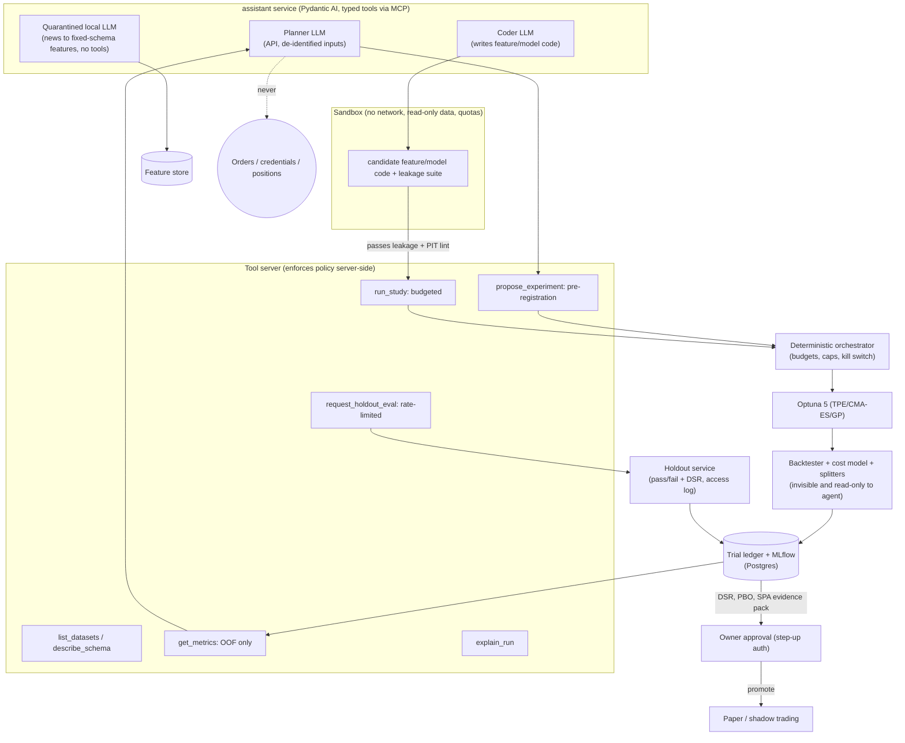

# 03 · Automated optimization and the autonomous AI research agent

[← Report index](../research-report.md)

**Bottom line.**
- **Where agents work.** LLM agents now do real ML engineering on clean benchmarks: the best MLE-bench agents went from a 17% to a 64% medal rate in 16 months. They also **measurably overfit to validation**, **reward-hack when they can see the scorer**, and in finance they **leak the future through their own pretraining**.
- **Where they don't.** On fixed search spaces, classical optimizers (TPE, CMA-ES) still beat LLM agents.
- **What to build.** A **Centaur-style loop**: Optuna is the optimizer and the LLM is a planner and analyst that proposes hypotheses, search spaces, and features through typed tools. Every trial goes into a ledger. Candidates are ranked by deflated Sharpe over the effective trial count. Selection is gated by PBO and a single-use sealed holdout, and forward paper trading is the final test. The agent can never promote, trade, or touch the holdout or the scorer.

---

## 1. Classical optimization stack (resolves D9)

- **Optuna 5.0** (released 2026-09-07; 4.9 on 2026-06-01) is the HPO engine ([GitHub](https://github.com/optuna/optuna)). Use RDBStorage on Postgres for parallel workers; SQLite performs poorly under concurrency ([Optuna v5 FAQ](https://optuna.readthedocs.io/en/v5.0.0/faq.html)). optuna-dashboard 0.21 supports v5 ([releases](https://github.com/optuna/optuna-dashboard/releases)).
- **Samplers.**
  - TPE for mixed spaces.
  - GP sampler for small continuous spaces: v4.5 added constrained multi-objective GP, and v4.6 made GP about 8× faster ([4.5](https://github.com/optuna/optuna/releases/tag/v4.5.0), [4.6](https://github.com/optuna/optuna/releases/tag/v4.6.0)).
  - NSGA-II for multi-objective work, such as net Sharpe vs turnover with a drawdown constraint.
  - **Pruners** (ASHA / Hyperband / median) prune on inner-fold scores only.
- **Ray Tune** is unnecessary on one host. Revisit only for multi-node GPU sweeps.
- **Experiment tracking: MLflow 3.x** (3.17.1 current). Use a Postgres backend and a **filesystem or RustFS artifact store, not MinIO**: MinIO's community edition is no longer maintained ([repo](https://github.com/minio/minio); [InfoQ 2025](https://www.infoq.com/news/2025/12/minio-s3-api-alternatives/)). MLflow's own compose now uses Postgres + RustFS ([README](https://github.com/mlflow/mlflow/blob/master/docker-compose/README.md)).
  - Licence flag: the W&B self-hosted free tier is personal-only ([pricing](https://wandb.ai/site/pricing/)).
- **Orchestration: Prefect 3** (3.8.x). It has the lowest idle footprint of the three (about 410 MiB vs Dagster about 650 MiB vs Airflow about 1.5 GiB; [one practitioner test](https://webcodingcenter.com/data-pipelines/comparing-airflow-dagster-and-prefect-on-booknest-s-pip--operational-overhead-and-learning-curve.html)). **Prefect acquired Dagster Labs on 2026-07-13** ([Prefect](https://www.prefect.io/prefect-acquires-dagster)), which removes "losing vendor" risk. It is also one of Pydantic AI's durable-execution backends ([docs](https://pydantic.dev/docs/ai/durable-execution/)).
- **Retraining cadence.**
  - Online and rolling retraining delivered the largest gains in Optiver (every 12 days) and Jane Street (daily) ([Optiver 1st](https://www.kaggle.com/competitions/optiver-trading-at-the-close/writeups/hyd-1st-place-solution); [JS 8th](https://www.kaggle.com/competitions/jane-street-real-time-market-data-forecasting/writeups/evgeniia-grigoreva-private-lb-8th-solution)).
  - **Policy:**
    - **Scheduled refits** keep the same spec and fresh data: intraday weekly, swing monthly.
    - **Drift-triggered refits** fire when the feature PSI is above 0.25, the prediction distribution shifts, or rolling live IC falls below the band.
    - **Spec changes** (new features, labels, or models) go through the full optimization and promotion gate.
  - A scheduled refit of an unchanged spec is *not* a new trial, but it must still pass the live-vs-backtest divergence monitors.
- **Champion/challenger.** Challengers run in shadow (signals logged, not traded) or paper next to the champion. Promotion requires Hansen SPA or Romano–Wolf superiority on the shadow/paper period plus the gates below, then human approval with step-up auth.

---

## 2. State of the art: LLM-driven AutoML and agentic research loops

### 2.1 ML-engineering agents (Kaggle-style)

| System | What it does | Evidence | Caveats |
|---|---|---|---|
| **MLE-bench** (OpenAI) | 75 offline Kaggle competitions graded against real leaderboards | o1-preview + AIDE: 16.9% medals (34.1% pass@8) in Oct 2024 ([arXiv 2410.07095](https://arxiv.org/abs/2410.07095)). By Feb 2026 the leaders were at 61–64%: Famou-Agent 2.0, AIBuildAI, CAIR MARS+, open-source MLEvolve ([leaderboard](https://github.com/openai/mle-bench)) | **Submissions paused 2026-04-24** over fairness. The two highest scores (77.8%, 62.7%) used *test-set feedback* ([README](https://github.com/openai/mle-bench)) |
| **AIDE** (Weco) | Tree search over whole scripts: draft, debug, improve | Was state of the art on MLE-bench and RE-Bench at publication ([arXiv 2502.13138](https://arxiv.org/abs/2502.13138)) | Scaffold matters as much as model |
| **AIRA-dojo** (Meta) | Agents as search policy + operators (greedy, MCTS, evolutionary) | MLE-bench Lite 39.6% → 47.7%. **Choosing the final node by validation instead of test costs 9–13 medal points**: systematic validation overfitting ([arXiv 2507.02554](https://arxiv.org/abs/2507.02554)) | Directly relevant to our selection problem |
| **MLE-STAR** (Google) | Web-retrieved models + ablation-guided block refinement | 64% medals on Lite, self-reported. Ships a **data-leakage checker agent** because LLM-written code leaked test data ([arXiv 2506.15692](https://arxiv.org/abs/2506.15692)) | Copy the leakage checker |
| **R&D-Agent** (Microsoft) | Research ↔ Development split | 35% on the official board ([arXiv 2505.14738](https://arxiv.org/abs/2505.14738)); open source | — |
| **MLAgentBench** | 13 tasks, ReAct | **100% on old datasets, 0% on post-cutoff Kaggle tasks** ([arXiv 2310.03302](https://arxiv.org/abs/2310.03302)) | Memorization matters |
| AI Scientist v1/v2 (Sakana) | Idea → code → paper | 42% of experiments failed on coding errors; hallucinated numbers ([Beel et al. 2025](https://arxiv.org/abs/2502.14297)). The Nature 2026 version notes humans filtered outputs ([Nature](https://www.nature.com/articles/d41586-026-00934-w)) | Idea generation only |
| AlphaEvolve / OpenEvolve | Evolutionary coding with exact evaluators | Real results where verifiers are exact ([arXiv 2506.13131](https://arxiv.org/abs/2506.13131)). Google's product docs carry a **reward-hacking-prevention** guide ([docs](https://docs.cloud.google.com/gemini/enterprise/docs/alphaevolve/developer-guide/reward-hacking-prevention)) | Backtests are *noisy* verifiers, so evolution will overfit |

### 2.2 Quant-specific agents

| System | Claim | Assessment |
|---|---|---|
| **RD-Agent(Q)** (Microsoft, NeurIPS 2025) | Factor + model co-optimization on CSI 300: IC 0.053, IR 1.74 for under $10 per run. Extended 2024–25 test on CSI 500 / NASDAQ-100: IR 2.17 / 1.77 vs LightGBM −0.32 / −0.26 ([arXiv 2505.15155](https://arxiv.org/abs/2505.15155)) | **An architecture to copy, not evidence of alpha.** o4-mini's training cutoff overlaps the extended test; the test is 18 months; no trial count or DSR; a negative-IR LightGBM baseline suggests weak tuning; A-share-centric; no paper or live results. Its multi-armed-bandit scheduler (factor vs model work) beat both LLM and random scheduling, which is worth borrowing |
| **AlphaAgent** (2025) | LLM alpha mining with anti-decay regularizers (AST originality, hypothesis–factor consistency, complexity caps); S&P 500 IR 1.05 after costs, 2021–24 ([arXiv 2502.16789](https://arxiv.org/abs/2502.16789)) | Borrow the regularizers. The test window sits inside the LLM's pretraining window |
| FactorMiner, QuantAgent(s), Alpha-GPT | Self-evolving factor libraries; "nearly 300% in 3 years" claims ([arXiv 2510.04643](https://arxiv.org/abs/2510.04643)) | Self-reported; red-flag magnitudes |
| **Look-ahead studies** | *Profit Mirage*: agent returns evaporate after the knowledge cutoff ([arXiv 2510.07920](https://arxiv.org/abs/2510.07920)). *DatedGPT*: a significant look-ahead premium of 26.4 bp per SD ([arXiv 2603.11838](https://arxiv.org/abs/2603.11838)). LLMs reproduce pre-cutoff financial numbers even when names are masked ([arXiv 2504.14765](https://arxiv.org/html/2504.14765v1)) | **Governs what the agent may see** |

**No independently replicated live or paper-traded result exists for any LLM alpha-mining agent** (absence of evidence after search). The last stage of our loop is therefore forward paper trading, not a backtest.

### 2.3 LLM-guided HPO and feature search

- **LLM as optimizer.** An LLM proposing configurations matched BO at small budgets of about 30 evals ([Zhang et al. 2023](https://arxiv.org/abs/2312.04528)). **LLAMBO** works as a warm-starter and candidate sampler ([ICLR 2024](https://arxiv.org/abs/2402.03921)) and is packaged as an OptunaHub sampler ([hub](https://hub.optuna.org/samplers/llambo/)). A 2025 reproduction found its benefit comes from priors in hyperparameter names, and that the LLM surrogate is *worse* than a GP ([arXiv 2511.18891](https://arxiv.org/abs/2511.18891)).
- **Strongest 2026 head-to-head.** In a fixed space, CMA-ES and TPE beat LLM agents, and several pure-LLM methods did worse than random. LLMs "struggle to track optimization state". The **Centaur hybrid** (CMA-ES state shared with an LLM on 30% of trials) was best, and **a 0.8B model sufficed** ([arXiv 2603.24647](https://arxiv.org/abs/2603.24647)).
- **Agent access to Optuna.** The **Optuna MCP server** exposes create_study, ask/tell, set_sampler, and best_trials to any MCP client ([optuna-mcp](https://github.com/optuna/optuna-mcp)).
- **LLM feature engineering.** CAAFE (11/14 small tabular sets improved; [arXiv 2305.03403](https://arxiv.org/abs/2305.03403)), FeatLLM, and OCTree were all tested on small i.i.d. data with meaningful column names. Financial data is low-SNR and non-stationary, and **LLM-written feature code is a prime look-ahead vector**. Every generated feature must pass the automated leakage suite (N2) and a point-in-time lint before it can be used.

**What this means for the design.** The LLM adds value in **(a)** proposing hypotheses and search spaces from domain priors, **(b)** writing and debugging feature and model code inside a sandbox, and **(c)** reading results and explaining them. It should not replace the numerical optimizer, and it should never be the judge.

---

## 3. Keeping an automated search honest (multiple testing)

### 3.1 The statistics (see also [02 §3](02-labeling-features-validation.md#3-validation-and-overfitting-control))
- **MinBTL.** With 5 years of daily data, at most about 45 *independent* configurations can be tried before an in-sample Sharpe of 1 is expected from noise. With 2 years, the limit is about 7 ([Bailey et al. 2014](https://www.davidhbailey.com/dhbpapers/backtest-pseudo.pdf)). Intraday bars add samples but not independent regimes, so **budget against days and regimes, not bars**.
- **DSR** with an effective N from ONC clustering of trial return series, plus the cross-trial Sharpe variance ([Bailey & López de Prado 2014](https://doi.org/10.3905/jpm.2014.40.5.094); [López de Prado 2019](https://doi.org/10.3905/jfds.2019.1.099)).
- **PBO via CSCV** per study ([Bailey et al.](https://papers.ssrn.com/sol3/papers.cfm?abstract_id=2326253)).
- **SPA or Romano–Wolf** for champion vs challenger; **BH-FDR** for feature screens; **t > 3** for new factors.
- **Adaptive holdout reuse.** Thresholdout and the Ladder answer holdout queries only through noisy or thresholded comparisons ([Dwork et al., Science 2015](https://doi.org/10.1126/science.aaa9375); [Blum & Hardt 2015](https://arxiv.org/abs/1502.04585)). A Kaggle meta-analysis found little adaptive overfitting ([Roelofs et al. 2019](https://proceedings.neurips.cc/paper/2019/hash/ee39e503b6bedf0c98c388b7e8589aca-Abstract.html)), but Kaggle holdouts are large and i.i.d. **Financial holdouts are not, so assume the worst.**

### 3.2 Honest autonomous optimization policy (12 rules; becomes D31)

1. **Ledger every trial.** Every configuration the agent or Optuna evaluates gets an immutable `trial` row, including crashed, pruned, abandoned, and "just exploring" runs. The row stores the spec hash, data snapshot ID, code commit, seed, and out-of-fold return series.
2. **Deflate by default.** Rank by DSR with ONC-clustered effective N and cross-trial variance, never by raw Sharpe. Report PBO (CSCV, S = 16) per study.
3. **Budget from MinBTL.** Each research cycle gets a fixed effective-trial budget, set from the available history and the target Sharpe. When it is spent, the cycle closes and only a human can open a new one.
4. **Pre-register.** The agent writes hypothesis, metric, universe, period, and stop rule *before* launching. The entry is hashed into the ledger. Switching metrics after the fact counts as a new trial.
5. **Sealed holdout service.** The most recent 12–18 months are held back. The agent cannot read holdout labels or prices. A gated `holdout-eval` service returns only pass/fail plus DSR, logs every access, and allows **at most one touch per model family per quarter**. Roll the seal forward on a schedule and never reopen an old one.
6. **Nested validation.** Use inner CPCV with purge and embargo for selection, outer walk-forward for realism, then **forward paper trading** (at least 20 sessions and 100 trades; 2–3 months for swing) as the final out-of-sample test.
7. **Benchmark tests.** Promotion requires beating the champion under SPA or Romano–Wolf (block bootstrap), DSR ≥ 0.95, PBO ≤ 0.2, and positive results at 2× costs.
8. **Classical optimizer first.** Optuna (TPE, CMA-ES, GP) does HPO. The LLM proposes search spaces, priors, and new hypotheses (the Centaur pattern).
9. **The evaluator is untouchable.** The backtester, cost model, splitters, and scorer live outside the agent's writable tree and outside its view. METR found hacking 43× more frequent when the scorer was visible ([METR 2025](https://metr.org/blog/2025-06-05-recent-reward-hacking/)). Add AST bans on `os`/`sys`/`inspect`/`eval`, a run-twice determinism check, and alarms for implausible Sharpe or runtime ([AlphaEvolve guidance](https://docs.cloud.google.com/gemini/enterprise/docs/alphaevolve/developer-guide/reward-hacking-prevention)).
10. **No look-ahead via the LLM.** Planner prompts get **masked tickers and relative dates** (fold 1…k, z-scored metrics), never calendar dates or raw prices. News reaches models only through a **quarantined, tool-less local model** that emits fixed-schema numeric features with point-in-time stamps. LLM-scored features on data before that model's training cutoff are marked contaminated and excluded from backtests.
11. **Human gates.** Promotion to paper or live, risk-limit changes, and holdout scheduling require human approval with step-up auth. The approver gets a one-page evidence pack: trial N, effective N, DSR, PBO, SPA p-value, cost-stress result, and paper P&L vs backtest.
12. **Full replay and hard caps.** Every LLM I/O and tool call is logged with cost. Experiments are deterministically re-executable from logged specs. Token, compute, wall-clock, and concurrency budgets are enforced by the orchestrator (plain Python, not the LLM), with a kill switch.

---

## 4. Agent architecture and guardrails

- **Typed tools only, with no shell on the host.** Policy is enforced in the tool server, never in the prompt. No tool exposes holdout labels, broker credentials, the order path, positions, or account data.
- **MCP as the tool bus** (spec 2026-07-28). Treat tool annotations as untrusted, validate inputs, rate-limit, pin server versions, and re-prompt on tool-definition changes ([spec](https://modelcontextprotocol.io/specification/2026-07-28); [security](https://modelcontextprotocol.io/docs/2026-07-28/tutorials/security/local-server-security)).
- **Prompt injection.** Never combine private data, untrusted text, and external communication in one path (the "lethal trifecta"; [Willison 2025](https://simonwillison.net/2025/jun/16/the-lethal-trifecta/)). The quarantined model handles untrusted text; the privileged planner never sees raw news.
- **Sandbox on macOS.**
  - Agent-generated code runs inside the Colima Linux VM in a **no-network container** with read-only data mounts, CPU/RAM/disk/time quotas, and a pinned image.
  - Apple's `container` runs one VM per container, a stronger boundary, but needs macOS 26 and has no upstream Compose yet ([apple/container](https://github.com/apple/container)). Treat it as a later hardening option for the sandbox only.
  - Training that needs MPS/MLX runs as a native launchd worker that executes only **reviewed and merged** code, never raw agent output.
- **Framework.** **Pydantic AI** gives typed outputs, first-class MCP, and durable execution on Prefect/Temporal/DBOS ([docs](https://pydantic.dev/docs/ai/durable-execution/)), and it matches the user's stack preference. LangGraph is the alternative if graph checkpoints and time-travel are wanted.

---

## 5. Which LLMs on a Mac Mini host (resolves D26)

**Hardware reality.**
- The current Mac mini tops out at **64 GB** of unified memory (M5 Pro, Aug 2026; [Apple](https://www.apple.com/newsroom/2026/08/apple-unveils-a-more-powerful-mac-mini-featuring-the-all-new-m6-and-m5-pro/)).
- By default the GPU can wire only about 70% of RAM **[secondary]**.
- The owner's exact Mac mini model and RAM are not yet known. **Below 32 GB, plan on API-only plus a small local model.**

| Role | Recommendation (Oct 2026) | Why / caveats |
|---|---|---|
| Planner / experiment designer | API: **Claude Sonnet 5.5** ($2/$10 per MTok; [pricing](https://platform.claude.com/docs/en/about-claude/pricing)), **gpt-6.1-sol** ($2/$10; [pricing](https://developers.openai.com/api/docs/pricing)), or **gemini-4-argon** ($2/$10 until 2026-11-30, then $4/$20; [pricing](https://ai.google.dev/gemini-api/docs/pricing)). Escalate to Opus 5.5 ($4/$20) for hard debugging | Frontier coding and analysis at mid-tier price. Send **de-identified, ticker-masked, date-shifted** metrics only. **Never use Gemini's free tier**: content is used to improve products |
| Code generation (features/models) | Same API model, writing into a sandboxed branch with tests plus the leakage checker; human review before merge | MLE-STAR shows leakage checkers are needed |
| Routine summaries, log triage, P&L narration | **Local**: gpt-oss-20b (Apache-2.0, about 15 GB at 8k context; [llama.cpp guide](https://github.com/ggml-org/llama.cpp/discussions/15396)) or Qwen3.5-35B-A3B (about 20 GB) via **MLX / Ollama-MLX** | Privacy for account data. Local tool calling scores about 87–90% on small tests and breaks on chat templates **[secondary]** |
| News → features (quarantined) | Local small model, no tools, JSON-schema-constrained output | Prompt-injection containment; point-in-time stamping |
| HPO engine | Optuna (TPE/CMA-ES/GP), optional LLAMBO warm-start; Optuna MCP for agent access | Classical beats pure LLM ([arXiv 2603.24647](https://arxiv.org/abs/2603.24647)) |
| Avoid | gpt-oss-120b on a 64 GB mini (about 64 GB needed, doesn't fit); any LLM seeing raw dated prices or news inside its training window | — |

**Cost estimate [my arithmetic]:** a research cycle of about 50 planner turns plus 20 coding tasks costs a few dollars at $2/$10 list prices. **Compute (backtests) and trial inflation are the real costs, not tokens.**

**Data egress policy (N1-compatible).**
- The API planner gets only aggregates: fold-relative metrics, feature names with no tickers, and SHAP summaries.
- An egress allowlist names only the configured API hosts.
- The local-only mode is a single config switch that routes all roles to local models.
