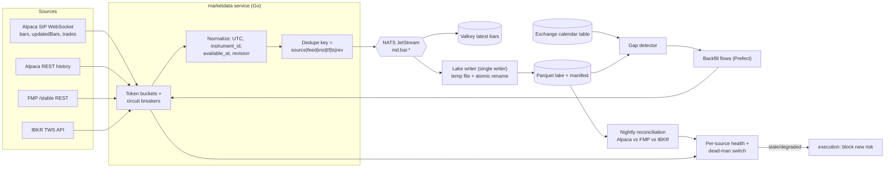

# 04 · Brokers, account routing, data sources, and reliable ingestion

[← Report index](../research-report.md)

**Bottom line.**
- **PDT no longer applies.** FINRA retired the Pattern Day Trader rule effective **2026-06-04**, and Alpaca removed PDT in production that day. The $20k Alpaca account can day-trade without a trade count.
- **Routing.** Route by *operational fit*:
  - **Alpaca** takes intraday automation (clean REST and WebSocket, no gateway, same vendor as the data feed).
  - **IBKR** takes swing strategies and the larger capital, ideally in a dedicated linked account.
- **IBKR connectivity** is the most fragile component. IBC, the headless-login tool everyone uses, was **archived on 2026-09-01**, and IBKR still requires a weekly 2FA login.
- **Data.** Pay for Alpaca **Algo Trader Plus ($99/mo, SIP)**. Use **FMP** for fundamentals, calendars, estimates, and the universe, *not* as the intraday price source. Buy survivorship-free intraday history once.

---

## 1. PDT is gone: account routing for Alpaca ($20k) and IBKR ($100k)

### 1.1 Regulatory facts (verified against primary sources)
- The SEC approved SR-FINRA-2025-017 on 2026-04-14 ([Rel. 34-105226](https://www.sec.gov/rule-release/34-105226)).
- **FINRA Regulatory Notice 26-10** sets the effective date at **2026-06-04**, with firms allowed to phase in until **2027-10-20** ([RN 26-10](https://www.finra.org/rules-guidance/notices/26-10)).
- The PDT designation, the 4-in-5 day-trade count, and the $25k minimum are replaced by an **intraday margin deficit (IMD)** regime. An IMD must be met "as promptly as possible". A *practice* of failing, with a deficit unmet by the 5th business day, triggers a 90-day freeze.
- De minimis IMDs don't count toward that practice: those no larger than the lesser of 5% of equity or $1,000 (same source).
- **Alpaca** lifted PDT in production on 2026-06-04 ([Alpaca blog](https://alpaca.markets/blog/finra-retires-the-pdt-rule-introducing-alpacas-new-intraday-margin-framework/)):
  - It removed `pattern_day_trader`, `daytrade_count`, `daytrading_buying_power`, `dtbp_check`, and `pdt_check` on 2026-07-06 ([changelog](https://docs.alpaca.markets/us/changelog/2026-06-03-pdt-651df23)).
  - It lowered the equity needed for 4× intraday buying power to $2,000.
  - Pre-trade checks now reject orders that would create an IMD.
- **IBKR** went live for eligible clients on 2026-06-04, but says some accounts "may still be subject to PDT during transition through October 2027" ([IBKR guide](https://www.ibkrguides.com/clientportal/messagecenter/supportpdtreset.htm)). Four or more IMD failures in 12 months can restrict **all** of the client's margin accounts for 90 days. At $100k, the old PDT rule wouldn't bind anyway.
- **Alpaca has no cash accounts.** Every individual account is margin, with 1× margin below $2k. Users approximate a cash account with `max_margin_multiplier=1` ([config API](https://docs.alpaca.markets/reference/patchaccountconfig-1); [forum](https://forum.alpaca.markets/t/dan-wheres-the-cash-only-account-option/18353)).
- Settlement is T+1. Proceeds can be re-traded immediately in margin accounts.

### 1.2 Recommended routing

| Account | Capital | Strategies | Configuration | Why |
|---|---|---|---|---|
| **Alpaca** (margin) | ~$20k | **Intraday** ML strategies (15m decision bars, flat by close); small swing sleeve allowed | `max_margin_multiplier=1` (or 2 if deliberately chosen); `no_shorting=true` unless a strategy needs shorts | No PDT limit any more. Clean API with no 2FA gateway. Data and execution share one SIP feed, so stops elect on the same prints. At 1×, IMDs are essentially impossible |
| **IBKR** (margin) | ~$100k | **Swing** strategies (1–10 day holds) and larger sizing; intraday only after the IBKR adapter proves stable | **Dedicated linked account for bot capital** (recommended, see [05](05-virtual-portfolios-and-tax.md)); GTC broker-side protective stops on every position | Swing tolerates a gateway outage, because a resting stop protects the position. Intraday does not. The linked account isolates margin from the manual book (the 4-in-12 rule restricts *all* margin accounts) |

**Risk-engine changes (replace the master's U1 placeholder).**
- **Drop the PDT guard as a gating rule.** Keep `day_trade_count` as a *metric* and a per-account `pdt_guard: off | legacy` config flag, in case a broker still applies legacy logic during the phase-in. Default: Alpaca `off`; IBKR `off`, because >$25k.
- **Add an intraday-margin guard.** A pre-trade check rejects an intent if projected gross exposure for the account exceeds `min(strategy_allocation_sum, broker_buying_power × margin_utilization_cap)`. Defaults: `margin_utilization_cap = 0.5` on IBKR (protects manual positions) and `1.0` on Alpaca with the multiplier at 1×.
- **Treat any IMD or margin call reported by a broker as a halt condition** for that account (N5 fail-closed).

**Where a different answer would change this:**
- If the IBKR account is still on legacy PDT logic *and* below $25k (not the case at $100k), the guard flips to `legacy` for that account.
- If the owner wants intraday on IBKR from day one, D18's fragility, covered next, becomes a live-trading risk.

---

## 2. Alpaca integration notes

| Topic | Fact | Source |
|---|---|---|
| Auth | API key/secret headers; separate paper and live keys. OAuth2 is only for third-party "Connect" apps. Broker API is for businesses | [auth](https://docs.alpaca.markets/us/docs/authentication); [OAuth](https://docs.alpaca.markets/us/docs/using-oauth2-and-trading-api) |
| Trading rate limit | 200 req/min per account; **not raised by a data plan** | [forum (staff)](https://forum.alpaca.markets/t/429-rate-limit-exceeded-when-creating-orders/14120) |
| Data plans | Basic (free): IEX real-time, 30 WS symbols, 200 hist calls/min, SIP history only if ≥15 min old. **Algo Trader Plus $99/mo**: full SIP, unlimited WS symbols, OPRA, 10,000 calls/min. History since 2016 | [market data](https://docs.alpaca.markets/docs/about-market-data-api) |
| WebSocket | **One connection per endpoint**; a second gets error 406. Authenticate within 10 s | [streaming](https://docs.alpaca.markets/docs/streaming-market-data) |
| Bar corrections | Minute bars labeled by start time. Late trades trigger `updatedBars` (same timestamp) at about the half-minute mark. Trade `corrections`/`cancelErrors` stream automatically | [real-time data](https://docs.alpaca.markets/us/docs/real-time-stock-pricing-data) |
| Orders | market/limit/stop/stop_limit/trailing_stop; brackets (OTOCO), OCO, OTO; extended hours limit-only (day/gtc); no brackets or trailing stops outside RTH; notional orders can't be replaced | [orders](https://docs.alpaca.markets/docs/orders-at-alpaca) |
| `client_order_id` | ≤128 chars; recommended for per-strategy attribution | [API ref](https://docs.alpaca.markets/us/reference/postorder); [working with orders](https://docs.alpaca.markets/us/docs/working-with-orders) |
| **Self-cross guard** | An opposite-side order that could interact with your own resting order is rejected with **HTTP 403** (bracket/OCO/trailing exempt); also in paper | [user protection](https://docs.alpaca.markets/docs/user-protection) |
| Lots | **FIFO only**; positions aggregated per symbol | [forum](https://forum.alpaca.markets/t/closing-individual-lots-within-a-profitable-position/18549) |
| Shorting | ETB 5,000+ names at $0 borrow; HTB via locates API | [margin & shorting](https://docs.alpaca.markets/docs/margin-and-short-selling) |
| News | Benzinga-sourced, since 2015, REST and WS, included in data plans | [news](https://docs.alpaca.markets/us/docs/historical-news-data) |
| Corporate actions | `GET /v1/corporate-actions` (splits, dividends, mergers, spin-offs, name changes, worthless removal) | [ref](https://docs.alpaca.markets/us/reference/corporateactions-1) |
| Kill switch | `DELETE /v2/orders` (cancel all, 207 per-order status); `DELETE /v2/positions` liquidates everything, so **never use it**, because it would close manual holdings | [ref](https://docs.alpaca.markets/reference/deleteallorders) |

**Gotchas.**
1. Run one in-house market-data fan-out process. Notebooks and other tools must never open their own Alpaca data socket on the same key.
2. Any reader of the removed PDT fields breaks, so delete that code.
3. Strategy and manual orders on opposite sides of the same symbol collide on the 403 guard. The OMS must cancel and replace, not layer.
4. Account-level "close all positions" endpoints are forbidden by N3. Flatten only strategy-owned quantity, order by order.

---

## 3. IBKR integration notes

| Topic | Fact | Source |
|---|---|---|
| **OAuth Web API** | **Not available to individual accounts** (organizations, FAs, and IBrokers only) | [IBKR OAuth2](https://www.interactivebrokers.com/docs/web-api/authentication/oauth-2/register.md); [support reply 2026-03](https://github.com/paulfryer/ibkr/issues/2) |
| Client Portal Gateway | Browser login on the same machine, 24h max session, ~6 min idle timeout (call `/tickle`), 2FA daily | [CPGW limits](https://www.interactivebrokers.com/docs/web-api/authentication/cpgw/limitations-of-the-client-portal-gateway.md); [auth FAQ](https://www.interactivebrokers.com/docs/web-api/authentication/faq.md) |
| **TWS API via IB Gateway** | The robust retail path. Official API 10.50 stable / 10.51 latest, protobuf messages, Python ≥3.11, Java 21. PyPI `ibapi` is stale | [TWS API download](https://www.interactivebrokers.com/docs/tws-api/doc/download-the-tws-api/introduction.md) |
| **IBC** | **Retired 2026-09-01; repo archived**; last release 3.24.2 (2026-08-21) for Gateway 10.48+ | [IBC README](https://raw.githubusercontent.com/IbcAlpha/IBC/master/README.md) |
| Container | `gnzsnz/ib-gateway-docker` is maintained (pushed 2026-10-14), bundles IBC 3.24.2, ships **native arm64** builds using IBKR's official linux-arm installer | [repo](https://github.com/gnzsnz/ib-gateway-docker); [PR #397](https://github.com/gnzsnz/ib-gateway-docker/pull/397) |
| Re-auth | Sessions are invalidated **Sunday 01:00 ET**, so full 2FA is needed weekly. IBC's daily auto-restart reuses the session. **Restarting the container mid-week forces a new 2FA** | [IBKR re-auth](https://www.interactivebrokers.com/docs/third-party-integrations/tws-settings/best-practice-configure-tws-ib-gateway/daily-weekly-reauthentication.md); [IBC #313](https://github.com/IbcAlpha/IBC/discussions/313) |
| Clients | Python **ib_async** 2.1 (active, BSD); `ib_insync` archived. Go: only `scmhub/ibapi` (community, 4 contributors). Rust: `ibapi` crate (used by NautilusTrader) | [ib_async](https://github.com/ib-api-reloaded/ib_async); [scmhub/ibapi](https://github.com/scmhub/ibapi) |
| Status codes | 1100 connectivity lost; 1101 restored, data lost (resubscribe); 1102 restored, data kept | [message codes](https://interactivebrokers.github.io/tws-api/message_codes.html) |
| Historical data | ≤30 s bars: 60 req/10 min, no identical request within 15 s, ≤6 per contract per 2 s, ≤50 open requests. **No delisted symbols**; small bars only 6 months back | [pacing](https://www.interactivebrokers.com/docs/tws-api/doc/market-data-historical/historical-data-limitations/pacing-violations-for-small-bars-30-secs-or-less.md); [unavailable data](https://www.interactivebrokers.com/docs/tws-api/doc/market-data-historical/historical-data-limitations/unavailable-historical-data.md) |
| Market data | Free: Cboe One + IEX. US snapshot bundle $10 (waived at $30 commissions) plus streaming add-on $4.50 (waived at $15). Default 100 lines | [pricing](https://www.interactivebrokers.com/en/pricing/market-data-pricing.php); [lines](https://www.interactivebrokers.com/docs/general/market-data-subscriptions/market-data-lines/how-market-data-is-allocated.md) |
| `orderRef` | Free-form string set via API, returned on executions. **Max length undocumented** **[UNVERIFIED]**. `permId` is the durable broker ID | [execution ref](https://www.interactivebrokers.com/docs/tws-api/ref/execution.md) |
| Linked accounts | Any number of separately funded individual accounts under one username; market data charged once; "two linked accounts for two different trading strategies" is a listed scenario | [linked account scenarios](https://www.ibkrguides.com/clientportal/createlinkedaccountscenarios.htm) |
| Kill switch | `reqGlobalCancel` cancels **all** open orders, including manual ones. Prefer per-order cancel by `orderRef` prefix; reserve global cancel for the emergency "account" scope | [TWS API](https://interactivebrokers.github.io/tws-api/) |

**IBKR operating model (design consequences).**
- **The IBKR adapter is written in Python on ib_async** and runs as its own `broker-gateway-ibkr` process behind the same gRPC/NATS contract as the Go Alpaca adapter (D1).
- **Pin** the gnzsnz *stable* image tag and IBC 3.24.2. Treat Gateway upgrades as planned changes with a paper-account soak.
- **Weekly runbook:** after Sunday 01:00 ET, approve the IBKR Mobile 2FA push. The platform sends a Pushover reminder and blocks IBKR strategies until the session is healthy and reconciled.
- Keep VNC (bound to localhost, reached via Tailscale) for recovery.
- Gateway down, or status 1100, means a **halt for IBKR strategies**. Resting GTC stops protect swing positions in the meantime.
- **Fallback if IBC breaks on a future Gateway:**
  1. Stay on the last known-good Gateway build.
  2. Use a community IBC fork if one emerges.
  3. Fall back to manual login via VNC weekly.
  - Third-party TOTP automation tools exist, but their maturity and IBKR terms-of-service status are **[UNVERIFIED]**.

**The order attribution ID still fits.** `tb1-<strategyShortId>-<intentULID>-<attempt>` is about 40 characters, well under Alpaca's 128. Verify the IBKR `orderRef` length and persistence in a Phase 1 spike, and always store `permId` as the durable join key.

---

## 4. Financial Modeling Prep (FMP)

### 4.1 Plans and limits (fetched 2026-10-17)

| Plan | Price (monthly / annual equiv.) | Rate limit | 30-day bandwidth | History | Intraday |
|---|---|---|---|---|---|
| Basic | $0 | 250/day | 500 MB | 5 yr | none |
| Starter | $29 / $19 | 300/min | 20 GB | 5 yr (US only) | none (EOD) |
| Premium | $69 / $49 | 750/min | 50 GB | 30+ yr | "Intraday charts" (intervals by tier **[UNVERIFIED]**) |
| Ultimate | $139 / $99 | 3,000/min | 150 GB | 30+ yr | **1-minute**, plus transcripts, 13F, ETF holdings, bulk endpoints |
| Build / Enterprise | quote | 3,000+/min | 100 GB / 1 TB+ | — | commercial / display rights |

Sources: [FMP pricing](https://site.financialmodelingprep.com/pricing-plans); [FAQ](https://site.financialmodelingprep.com/faqs). Bulk endpoints are throttled to 1 call per 10 s (60 s for some) and refresh every 6–8 h.

### 4.2 Coverage relevant to this platform
- **Prices:** historical EOD (full, unadjusted, and dividend-adjusted variants); intraday 1min/5min/15min/30min/1h/4h; batch quotes.
- **Universe and corporate actions:** `delisted-companies`, `symbol-change`, dividend and split calendars.
- **Events:** earnings calendar (EPS/revenue actual vs estimate; BMO/AMC reportedly via `includeReportTimes=true`, **partially unverified**), earnings surprises (bulk), **economic calendar** (UTC time, country, previous/estimate/actual, impact), treasury rates, exchange hours and holidays.
- **Sentiment and flow:** stock news, press releases, analyst estimates, grades (current, historical, consensus), insider trades, 13F institutional ownership, congressional trades, ETF holdings, sector performance, TipRanks point-in-time ratings.
- **Fundamentals:** statements with `filingDate`/`acceptedDate`, as-reported statements, report dates.
- Source: [FMP stable docs](https://site.financialmodelingprep.com/developer/docs).

### 4.3 Gotchas that shape the design
1. **Legacy `/api/v3` and `/api/v4` return 403 for accounts created after 2025-08-31.** Build against `/stable/` only. Check whether the owner's existing integration uses legacy paths ([changelog](https://site.financialmodelingprep.com/developer/docs/changelog); [issue](https://github.com/tradermonty/claude-trading-skills/issues/58)).
2. **Intraday bars aren't suitable as training truth:**
   - Regular trading hours only.
   - **Split-adjusted only.**
   - New York local timestamps.
   - About 3 calendar days returned per 1-min request (about 120 calls per symbol-year).
   - History filed under the *current* ticker.
   - **No intraday bars for long-delisted tickers.**
   - Realistic 1-min depth is about 2004 despite "30+ years" marketing.
   - Source: [finance-query FMP notes](https://verdenroz.github.io/finance-query/library/providers/fmp/) (independent implementation).
3. **Fundamentals are restated in place** with no `as_of`. Key on `acceptedDate` and snapshot every fetch.
4. **Real-time WebSocket entitlement by plan is unclear.** The plan table shows "Real-time Data: –" **[UNVERIFIED]**. Don't depend on it.
5. **Practitioners report price gaps and fundamentals errors** ([r/algotrading](https://www.reddit.com/r/algotrading/comments/1s07rh1/psa_on_historic_data_providers/)). That is why cross-source reconciliation is mandatory (§6).
6. **Licensing:** personal plans forbid display in multi-user apps without a Data Display and Licensing Agreement ([ToS §2.2](https://site.financialmodelingprep.com/terms-of-service)). The same applies to Massive and other "individual" plans, and IBKR pro/non-pro fees differ sharply. **Going multi-user means renegotiating data licenses.**

**Role of FMP in the platform:** the source of truth for fundamentals, estimates and grades, the earnings calendar, the economic calendar, the delisted and symbol-change universe, insider and 13F data, and ETF holdings. It is the **secondary/reconciliation source** for daily bars and a *fallback* intraday source. It is not used for intraday training data. The existing plan is probably enough; Premium (annual, $49/mo) is the minimum for quarterly fundamentals and calendars.

---

## 5. Data source plan with costs (deliverable 8)

| Need | Source | $/month | Notes |
|---|---|---|---|
| Real-time SIP bars/trades/quotes + intraday history since 2016 + news | **Alpaca Algo Trader Plus** | **99.00** | Same feed for training and serving. Swing-only operation could stay on free Basic, since SIP history ≥15 min old is free |
| Fundamentals, estimates, calendars, delisted universe, macro calendar | **FMP** (existing plan) | 0 extra (Premium is $49–69 if upgrading) | Snapshot every fetch |
| Survivorship-free intraday history incl. delisted (backtests) | One-off bulk purchase: **FirstRate Data** Stocks Complete (≈$500 one-time, **[UNVERIFIED price]**; amortized over 12 mo ≈ $42) | ≈ 41.67 (year 1) | Alternative: Massive Developer $79/mo for 1–2 months of backfill, then cancel. **First verify whether Alpaca history includes delisted symbols** (Phase 1 spike) |
| Survivorship-free daily + point-in-time fundamentals (swing) | **Sharadar** bundle (optional) | 29.00 | Personal licence covers own trading ([Sharadar](https://sharadar.com/subscribe)) |
| IBKR quotes for IBKR-routed orders | Snapshot $10 + streaming $4.50 | 0–14.50 | Waived at $30/$15 monthly commissions |
| Macro with vintages, filings, short interest | FRED/ALFRED, SEC EDGAR, FINRA | 0 | Free |
| Options-implied features (later) | ThetaData Options Value | (40.00) | Phase 4+, only if budget allows |
| **Total extra (year 1)** | | **≈ $170–185** | Year 2: ≈ $128–143 |

Other line items outside the data budget:
- Cloud GPU bursts: about $10–50/mo as needed.
- LLM API: about $5–30/mo **[estimate]**.
- Pushover: $5 one-time.
- TradingView Essential: $14.95/mo, only if webhooks are used.

Vendors considered and not chosen as primary:
- Massive (formerly Polygon) Advanced, $199: real-time with full history and delisted names, but non-pro only.
- Databento US Equities Standard, $199.
- EODHD: delisted intraday only for tickers delisted after 2021.
- Tiingo, $30: IEX real-time.
- Norgate: EOD only, $630/yr.
- Sources: [Massive](https://massive.com/pricing); [Databento](https://databento.com/blog/introducing-databento-us-equities); [EODHD](https://eodhd.com/pricing); [Tiingo](https://www.tiingo.com/blog/best-stock-price-api/); [Norgate](https://norgatedata.com/stockmarketpackages.php).

**Where a different answer would change this:**
- A $0 budget means Alpaca Basic, so swing only on SIP history, or intraday with IEX on both train and serve, accepting about 3–4% volume coverage.
- A larger budget (around $400) means Massive Advanced or Databento for a single, clean, survivorship-free intraday plus real-time source.

---

## 6. Reliable ingestion design

### 6.1 Requirements → mechanisms

| Requirement | Mechanism |
|---|---|
| **Idempotent writes** | Natural key `(source, feed, instrument_id, timeframe, ts_open)` plus a `revision` counter. Writes are upserts: a later revision wins and the prior revision is kept in a `bar_revisions` audit partition. Lake files are written to a temp path then atomically renamed; a manifest in Postgres records `(partition, file, row_count, checksum)` |
| **Late/corrected bars** | Subscribe to Alpaca `updatedBars`; set `is_final` only after the correction window (bar close + 60 s). Nightly REST re-pull of the trading day overwrites any revised bars and logs the diff |
| **Gap detection** | Expected-bar grid from an **exchange calendar table** (XNYS sessions, half-days, holidays) generated once by Python `exchange_calendars` 4.13 into Postgres, shared by Go and Python ([release](https://github.com/gerrymanoim/exchange_calendars/releases/tag/4.13.2)). Missing grid cells become `gap` rows → backfill jobs. Zero-volume bars for illiquid names are flagged, not treated as gaps |
| **Backfill** | Prefect flows with chunked windows sized to each vendor's limits (Alpaca multi-symbol bars; FMP 3-day 1-min windows). Resumable from a checkpoint table; same upsert path as live |
| **Retries** | Exponential backoff with **full jitter** ([AWS](https://aws.amazon.com/blogs/architecture/exponential-backoff-and-jitter/)); retry only idempotent requests; honor `Retry-After` |
| **Rate limits** | Per-source **token buckets** at about 80% of the documented limit: Alpaca data 10,000/min (ATP) or 200 (Basic); Alpaca trading 200/min, reserved for the OMS so data jobs can't starve orders; FMP 300/750/3,000/min by plan plus the bandwidth budget; IBKR pacing rules; SEC ≤10 req/s with User-Agent |
| **Circuit breakers** | Per-source breaker (closed/open/half-open) on error rate or latency. Open breaker → source health `degraded` → dependent strategies blocked |
| **Per-source health** | `sys.health.<source>` metrics: last message age, gap count, error rate, breaker state, reconciliation status. Exposed in Grafana and the UI; staleness feeds the trading **dead-man switch** |
| **Deduplication** | NATS JetStream `Nats-Msg-Id` = hash of the natural key plus revision (2-minute dedupe window); consumers idempotent on the same key |
| **Cross-source reconciliation** | Nightly job compares Alpaca SIP daily bars (aggregated from 1-min) against FMP EOD (and IBKR for traded symbols). **Tolerances:** close within 0.05% or 1 tick; OHLC high/low within 0.1%; volume within 5% (SIP vs SIP); IEX vs SIP volume is *expected* to differ (IEX ≈ 3–4% of volume), so never compare across feeds. Breaches → `data_quality` incident, symbol-day quarantined from training until resolved |
| **Corporate actions** | Daily pull from Alpaca and FMP; disagreements block adjustment for that symbol and alert |
| **Point-in-time** | Every record carries `event_time`, `available_at`, `ingested_at`; fundamentals snapshots keyed by fetch time |
| **Outbox** | Order and fill events use a **transactional outbox** (Postgres → NATS) so the ledger and bus can't diverge. Market data goes bus-first with the lake as the replay source |

### 6.2 Ingestion flow

