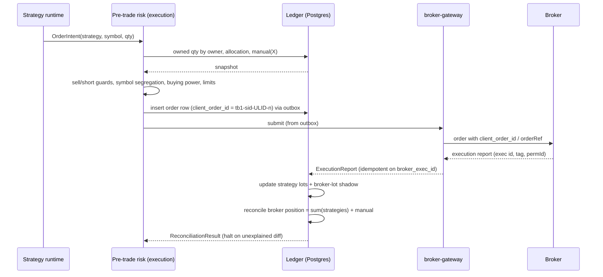

# 05 · Virtual strategy portfolios, order attribution, and tax mechanics

[← Report index](../research-report.md)

**Bottom line.**
- **Always keep internal virtual ledgers.** Multiple strategies per account require them, and neither broker offers retail sub-accounting.
- **At IBKR, add broker-level segregation:** open a **dedicated linked account for bot capital**. It is free, separately funded, and market data is charged once. This removes same-symbol conflicts with the manual book, isolates margin, and makes tax lots clean.
- **At Alpaca**, where there are no retail sub-accounts, FIFO is the only lot method, and a self-cross guard applies, enforce **symbol segregation**: strategies don't trade symbols held manually, by default.
- **Tax.** Neither broker's 1099-B captures cross-account wash sales, so the platform ledger must be the tax source of truth, or the owner should consider a §475(f) election.

---

## 1. Broker capabilities

| Capability | Alpaca (retail Trading API) | IBKR (individual) |
|---|---|---|
| Per-order tag | `client_order_id` ≤128 chars ([ref](https://docs.alpaca.markets/us/reference/postorder)) | `orderRef` free-form, returned on executions (max length **[UNVERIFIED]**); `permId` durable ([ref](https://www.interactivebrokers.com/docs/tws-api/ref/execution.md)) |
| Sub-accounts | **None for retail.** OmniSub is a Broker API (omnibus partner) feature ([blog](https://alpaca.markets/blog/introducing-omnisub-for-broker-api-alpacas-powerful-technology-for-sub-accounting/)). Multiple retail accounts per login: **[UNVERIFIED]** | **Linked accounts**: any number of separately funded individual accounts under one username; strategy separation is a listed scenario ([IBKR](https://www.ibkrguides.com/clientportal/createlinkedaccountscenarios.htm)). Model portfolios / `modelCode` are FA-only |
| Positions | Aggregated per symbol; average entry price is FIFO-compressed at end of day ([docs](https://docs.alpaca.markets/us/docs/position-average-entry-price-calculation)) | Aggregated per account |
| Lot relief | **FIFO only** ([forum](https://forum.alpaca.markets/t/closing-individual-lots-within-a-profitable-position/18549)) | Default FIFO; LIFO, HighCost, MaxLTGain, etc.; **Specific Lot per trade** (until 8:30 PM ET on trade date), but not as the default; API support for per-order lot selection **[UNVERIFIED]** ([IBKR](https://www.ibkrguides.com/traderworkstation/lot-matching-methods.htm)) |
| Self-cross | Opposite-side order that could interact with your own resting order → **403** ([docs](https://docs.alpaca.markets/docs/user-protection)) | Self-trade prevention exists; behavior across linked accounts **[UNVERIFIED]** |

## 2. Options compared (resolves D19)

| Option | Pros | Cons | Verdict |
|---|---|---|---|
| **A. One account, virtual ledgers only** (master default) | No account admin; buying power shared | Same-symbol conflicts with manual holdings; FIFO lots at Alpaca mean the broker's tax lots differ from strategy lots; strategies can consume margin that manual positions rely on; the self-cross 403 | Required at Alpaca (no alternative); acceptable with guards |
| **B. Dedicated broker sub-account per strategy** | Perfect isolation | IBKR only; one account per strategy is admin-heavy; each needs funding; doesn't scale to many experimental strategies | Overkill |
| **C. Hybrid (recommended)**: **one dedicated "bot" linked account at IBKR** holding all strategy capital, with **virtual ledgers per strategy inside it**; at Alpaca, one account with virtual ledgers plus symbol segregation from manual holdings | Manual book physically separate at IBKR (no same-ticker conflicts, margin isolation, clean 1099-B lots for the bot account); virtual ledgers still handle multiple strategies; data model unchanged | Two IBKR accounts to fund and monitor; cross-account wash sales still exist (see §4) | **Chosen** |

The master's data model already allows mapping a strategy to a dedicated sub-account (`broker_account_id` on every strategy, order, and fill). This only changes the *default deployment*, not the schema.

**Where a different answer would change this:** if the owner doesn't want a second IBKR account, Option A applies at IBKR as well, and the same-ticker guards below become load-bearing for the IBKR manual book.

## 3. Ledger design

### 3.1 Owners and buckets
- Each broker account's real position in symbol X equals Σ(strategy virtual positions in X) + `manual`(X).
- `manual` is **derived**: broker quantity minus all strategy-owned quantity. It absorbs untagged orders, TradingView-placed orders, transfers, and anything without the `tb1-` prefix.
- **Lot-level tracking** in each virtual ledger uses specific lots (tax-agnostic internal attribution) plus a separate **broker-lot shadow ledger** that mirrors the broker's relief method (FIFO at Alpaca; the configured method at IBKR). The tax report uses the broker-lot view; strategy P&L uses the virtual view. Expect a documented, reconciled difference between them.

### 3.2 Invariants (N3, extended by research)
1. **Sell guard.** A strategy sell, close, or short is rejected if it would reduce the account position below the quantity owned by others (manual plus other strategies).
2. **Short guard.** No strategy short in X while any other owner is long X in the same account. A sell beyond the strategy's own quantity would net against manual shares at the broker.
3. **Symbol segregation (Alpaca default ON, IBKR bot account OFF).** Strategies may not trade symbols present in `manual` in the same account, unless explicitly allowlisted per symbol. Reasons: the Alpaca 403 self-cross guard, FIFO lot relief that would sell the *manual* shares' tax lots first, and wash-sale entanglement.
4. **Opposite-side resting orders.** The OMS never holds opposite-side resting orders in the same symbol and account across strategies. Net internally first, or cancel and replace.
5. **Buying-power allocation.** Σ(strategy allocations) ≤ `allocatable_capital` = min(configured cap, broker buying power × utilization cap). The over-allocation guard is checked at allocation change *and* at every pre-trade check. Manual positions' margin needs are reserved first (IBKR's IMD failure rule restricts *all* margin accounts).
6. **Flatten scope.** Kill-switch flatten closes only strategy-owned quantity, order by order. Account-wide liquidation endpoints (Alpaca `DELETE /v2/positions`) are forbidden.

### 3.3 Reconciliation
- **Triggers:** continuous on every execution report, and full on every stream reconnect, at session open and close, and on demand.
- **Check:** broker positions per symbol = Σ virtual + manual. Unexplained differences halt the affected strategies (N3). Every reconnect triggers a REST snapshot (at-least-once streams; [Alpaca](https://docs.alpaca.markets/docs/websocket-streaming)).
- **Manual trades:**
  - An untagged fill changes `manual`.
  - If a manual sell would push `manual` negative (the owner sold "bot" shares by hand), the ledger raises a **conflict**: halt strategies in that symbol and ask the owner to assign the quantity.
  - With symbol segregation on, this can only happen if the owner trades a bot symbol manually.
- **Corporate actions:**
  - Apply splits, symbol changes, and mergers to every owner's lots from the corporate-action table (Alpaca plus FMP, cross-checked) *before* the next reconciliation.
  - If the broker applies an action the platform hasn't seen, the reconciliation diff halts and alerts, never auto-fixes.
  - Cash dividends are credited pro rata to the owners holding on the ex-date.

### 3.4 Attribution flow

## 4. Tax and wash sales

- **Wash-sale scope.** Wash sales apply across *all* of a taxpayer's accounts, including IRAs and a spouse's accounts. An IRA repurchase permanently disallows the loss ([IRS Pub 550](https://www.irs.gov/publications/p550); [Rev. Rul. 2008-5](https://www.irs.gov/pub/irs-drop/rr-08-05.pdf)).
- **Brokers report only same-account, same-CUSIP wash sales** on the 1099-B. Cross-account wash sales (Alpaca ↔ IBKR, bot account ↔ manual account) must be self-reported on Form 8949 with code W ([1099-B instructions](https://www.irs.gov/instructions/i1099b); [8949](https://www.irs.gov/instructions/i8949)).
- **Specific identification** must be made by the settlement date and confirmed by the broker in writing; otherwise FIFO applies ([26 CFR 1.1012-1(c)](https://www.ecfr.gov/current/title-26/chapter-I/subchapter-A/part-1/subject-group-ECFR5a368d8ba363b3c/section-1.1012-1)).
- **§475(f) mark-to-market.**
  - Requires trader status.
  - Gains and losses become ordinary, with **no wash-sale disallowance** and no $3k loss cap.
  - The election is due by the original due date of the *prior* year's return (e.g. 2027-04-15 for tax year 2027).
  - Investment positions must be identified the same day, and a separate account is the practical method ([IRS Topic 429](https://www.irs.gov/taxtopics/tc429)).
  - **The dedicated IBKR bot account (Option C) is exactly the segregation §475(f) needs.** Raise this with a tax adviser before the deadline.
- **Platform implications:**
  - The ledger computes cross-account wash-sale exposure (±30 days, substantially identical securities including options) across Alpaca, both IBKR accounts, and a configurable list of external accounts (IRA, spouse) entered manually.
  - It produces a Form 8949 draft.
  - An optional **wash-sale-aware pre-trade warning** flags when a strategy loss sale would be washed by a manual or other-account purchase. It is advisory, not blocking, unless configured.
- **Records:** keep trade and ledger records for 3 years generally, 6 if income was underreported by more than 25%, and 7 for worthless securities ([IRS](https://www.irs.gov/businesses/small-businesses-self-employed/how-long-should-i-keep-records)). The append-only audit log plus Postgres backups satisfy this. Set retention to 7 years.
