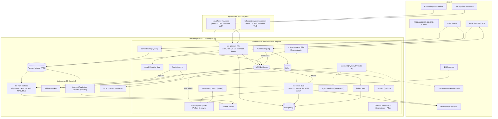
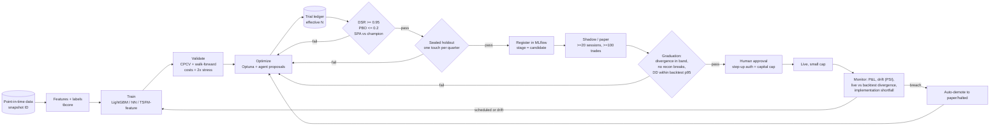
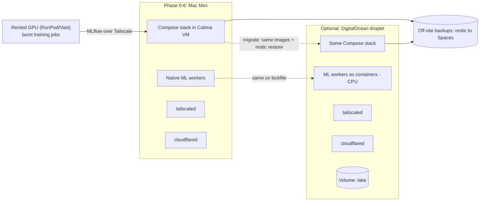

# 06 · Architecture, tech stack, and the Mac Mini host

[← Report index](../research-report.md)

**Bottom line.**
- **Services and languages.** Keep the master's service split: a Go core plus Python ML.
  - Write the IBKR adapter in Python (`ib_async`). There is no official Go TWS API, and the only Go library has four contributors.
  - Keep NATS JetStream, but configure it for durability: `sync_interval: always`, with Postgres as the system of record.
  - Keep Parquet + DuckDB with a single writer, with **DuckLake-on-Postgres** as the upgrade path.
- **Mac Mini host.** It runs the stack in **Colima**, because Lima's boot-time LaunchDaemon is the only free, headless, start-before-login option.
  - The **ML workers run natively under launchd**, because containers on macOS can't use the GPU.
  - Reliability depends on FileVault unlock over SSH, UPS and auto-restart settings, broker-side protective orders, and an *external* dead-man monitor.
- **Swaps from the master:**
  - Frontend: a static Vite/React SPA instead of Next.js.
  - Real-time: SSE first.
  - Monitoring: VictoriaLogs and Grafana Alloy instead of Loki and Promtail.
  - Model artifacts: filesystem or RustFS instead of MinIO.

---

## 1. Go vs Rust vs Python (clear answer)

| Option | For | Against | Verdict |
|---|---|---|---|
| **Go core + Python ML** | GC pauses are sub-millisecond ([Go 1.25/1.26 notes](https://go.dev/doc/go1.26)), irrelevant at seconds-level latency. Static binaries; strong concurrency for streams and the order path. Official Alpaca Go SDK v3.11 (2026-05) ([releases](https://github.com/alpacahq/alpaca-trade-api-go/releases)). Isolates the order path from the ML runtime and its dependency churn | **No official IBKR Go API**. `scmhub/ibapi` is a community library with four contributors ([GitHub](https://github.com/scmhub/ibapi)). Two backend languages | **Recommended**, with the IBKR adapter in Python |
| Rust core | Strongest safety and performance; NautilusTrader uses Rust `ibapi` ([Nautilus IB](https://nautilustrader.io/docs/latest/integrations/interactive_brokers/)) | Slowest to write; latency is not the bottleneck; smaller agent/LLM codegen reliability than Go/Python **[judgment]** | Not justified at seconds-level latency |
| All-Python (asyncio/uvloop, or 3.14 free-threaded) | One language; best broker libraries (`alpaca-py`, `ib_async`) | CPU-bound work on one event loop adds latency (about 130 ms vs under 50 ms in one free-threading benchmark, [Medium 2026](https://medium.com/towardsdev/i-ran-my-real-workload-on-free-threaded-python-heres-the-truth-6cb9da94e3d6), single author). Couples the order path to ML dependency upgrades; weaker static typing on money and state machines | Viable fallback; the main loss is isolation and type safety, not speed |

**Decision.** Use Go for `api-gateway`, `marketdata`, `execution` (OMS + risk), `ledger`, and the Alpaca adapter. Use a **Python `broker-gateway-ibkr` adapter process** (`ib_async`) behind the same protobuf/NATS contract. Use Python for ML, backtesting, optimization, the assistant, and context data. Revisit only if `scmhub/ibapi` matures or IBKR ships an official Go client.

## 2. Messaging and contracts

- **NATS JetStream**, kept as the bus.
  - **License risk is resolved.** NATS stays Apache-2.0 under CNCF after the 2025-05-01 agreement ([CNCF](https://www.cncf.io/announcements/2025/05/01/cncf-and-synadia-align-on-securing-the-future-of-the-nats-io-project/)).
  - Current release is 2.15.1 (2026-10-09). The cold-start footprint is about 6 MiB, versus about 327 MiB for Kafka 4.2 ([benchmark](https://petrolmuffin.github.io/BrokersPerformance/)).
  - **Durability: Jepsen (NATS 2.12.1) lost 131,418 of 930,005 acknowledged writes** in power-failure tests. The cause is the default fsync every 2 minutes ([Jepsen](https://jepsen.io/analyses/nats-2.12.1)). On a single node:
    - Set `sync_interval: always`.
    - Treat Postgres as the system of record for orders, fills, and ledger.
    - Publish order events through a transactional outbox.
    - Make consumers idempotent and able to reconcile from the brokers after a crash.
  - At bar-level message rates, the fsync cost doesn't matter.
- **Alternatives considered.**
  - Valkey Streams: fewer moving parts, but AOF `everysec` can lose up to about 1 s of writes.
  - Redpanda: BSL licence.
  - Kafka 4: KRaft simplifies it, but it is still JVM-heavy.
- **gRPC + Protobuf + buf** stays as the contract layer. IBKR's own TWS API moved to protobuf, which fits this choice ([IBKR 2025 notes](https://ibkrguides.com/releasenotes/prod-2025.htm)).
- The UI gets REST plus **SSE**; see [07](07-ui-and-tradingview.md).

## 3. Storage

| Store | Choice | Evidence / notes |
|---|---|---|
| Analytical bars/ticks | **Hive-partitioned Parquet + DuckDB 1.5.x** (pin it; **DuckDB 2.0 ships 2026-10-21**, don't adopt it on day one ([calendar](https://duckdb.org/release_calendar))) | DuckDB allows one read-write process *or* many read-only processes per `.duckdb` file ([concurrency](https://duckdb.org/docs/current/connect/concurrency)). Plain Parquet globs avoid the lock; use write-to-temp plus atomic rename, and a writer-only compactor. US 1-min bars are about 1B rows/yr, comfortable for DuckDB on Parquet |
| Lake upgrade path | **DuckLake 1.0 (2026-04-13) with a Postgres catalog** | Multi-writer ACID over Parquet, time travel, and inlining of small streaming inserts ([DuckLake 1.0](https://ducklake.select/2026/04/13/ducklake-10/); [catalogs](https://ducklake.select/docs/stable/duckdb/usage/choosing_a_catalog_database.html)). Adopt it once backfill and live ingestion write at the same time |
| TSDB alternative | QuestDB 9.4 (Apache-2.0, native ASOF JOIN, Parquet partitions) | The best server alternative if embedded DuckDB stops being enough. TimescaleDB keeps compression under its TSL licence. **ArcticDB is BSL and needs a commercial agreement for any business use**, so avoid it ([ArcticDB](https://docs.arcticdb.io/latest/licensing/)). ClickHouse is overkill on one host |
| Transactional | **PostgreSQL** | OMS, ledger, users, audit, plus the MLflow, Optuna, Prefect, and DuckLake catalogs. Concentrated risk, so back it up properly |
| Hot cache | **Valkey 9.x** (BSD, Linux Foundation) | Redis 8 is AGPL/RSAL/SSPL; Dragonfly is BSL; KeyDB is abandoned ([Valkey](https://valkey.io/); [Redis licences](https://redis.io/legal/licenses/)). Optional at MVP: NATS KV can serve "latest bar" |
| DataFrames | **Polars 1.x pinned**; Polars 2.0 (2026-10-06) has breaking changes ([releases](https://github.com/pola-rs/polars/releases)) | Migrate deliberately |
| Artifacts | Filesystem artifact root (restic-backed) or **RustFS**; **not MinIO** (community edition unmaintained) | [MLflow compose](https://github.com/mlflow/mlflow/blob/master/docker-compose/README.md) |

**Mac-specific storage layout.**
- **Bind mounts on macOS run about 3× slower than native; named volumes inside the VM are fastest** ([Mainardi 2025](https://www.paolomainardi.com/posts/docker-performance-macos-2025/)). Put **Postgres, NATS, and Valkey on named volumes**.
- The **Parquet lake sits on the host filesystem** (an APFS directory bind-mounted into the `marketdata` writer container). The native ML workers read it directly.
- Lake writes are batched appends, so the bind-mount penalty is acceptable. **Verify atomic rename semantics across VirtioFS in the Phase 1 spike.**

## 4. Compute and the Mac Mini

| Workload | Where | Notes |
|---|---|---|
| LightGBM / XGBoost / CatBoost | **Native macOS, CPU** (OpenMP via Homebrew `libomp`) | M-series CPUs are excellent for GBDT; XGBoost on an M3 Ultra was 1.57× faster than a 48-core Xeon ([gbm-bench](https://github.com/pgagarinov/gbm-bench)). LightGBM GPU is often *slower* than CPU at this scale ([LightGBM #6697](https://github.com/microsoft/LightGBM/issues/6697)) |
| Small GRU/TCN/Transformer | **Native, PyTorch MPS or MLX** | MLX is 1–3× faster than MPS for PatchTST/iTransformer on M4 Pro ([ECMS 2026](https://www.scs-europe.net/dlib/2026/ecms2026acceptedpapers/0638_dis_ecms2026_0035.pdf)). MPS has no float64 ([PyTorch](https://docs.pytorch.org/docs/main/notes/mps.html)) |
| TSFM inference (Chronos-2, Chronos-Bolt, TimesFM 2.5) | Native CPU / MPS / MLX | Chronos-2 runs at about 30 ms per batch-1 forecast with an MLX int8 port on M4 Max ([tsfm.ai](https://tsfm.ai/blog/chronos-2-apple-silicon-mlx)). Hundreds of symbols per bar is feasible |
| Heavy sweeps, TSFM fine-tunes | **Cloud GPU burst** | RunPod RTX 4090 from $0.34/h (community) to $0.89/h (secure), RTX 5090 $0.69–1.19/h, H100 PCIe $1.99–2.89/h ([RunPod](https://www.runpod.io/pricing)); Vast.ai 4090 ≈ $0.5/h; DigitalOcean RTX 4000 Ada $0.76/h ([DO](https://docs.digitalocean.com/products/droplets/details/pricing/)). Jobs pull a dataset snapshot, train, log to MLflow at home over Tailscale, and push artifacts |
| Local LLM | Native MLX / Ollama-MLX | See [03 §5](03-optimization-and-ai-agent.md#5-which-llms-on-a-mac-mini-host-resolves-d26) |

**Why native?** There is **no Metal GPU passthrough** into Linux containers under any macOS runtime ([apple/container #62](https://github.com/apple/container/discussions/62); [Red Hat 2025](https://developers.redhat.com/articles/2025/06/05/how-we-improved-ai-inference-macos-podman-containers)).
- ML workers run as launchd services with `KeepAlive`, built from the same `uv` lockfile. They talk to NATS and Postgres over loopback-published ports.
- On the future Linux droplet, the same workers run in containers (CPU) or burst to rented GPUs. The code is the same and only the process supervisor changes.

**Sizing.** The Mac mini's RAM is not yet confirmed.
- **32 GB is the practical minimum.** Give the Colima VM 12–16 GB and leave the rest for native ML.
- **48–64 GB** if a local LLM (about 15–20 GB) should run alongside training.

## 5. Docker on macOS: runtime choice and 24/7 reliability

| Runtime | Headless and starts before login? | I/O | Licence | Verdict |
|---|---|---|---|---|
| Docker Desktop | **No.** Needs a GUI login; logging out stops the engine ([for-mac #4388](https://github.com/docker/for-mac/issues/4388)) | Good | Free for personal use | Not for an unattended host |
| OrbStack | **No.** "Not supported" (issue #1767) | **Best** (bind-mount 4K IOPS 158k/135k; [weboo.dev](https://weboo.dev/posts/apple-containerization-docker-colima-orbstack/)) | Free personal; Pro $8/mo | Only with auto-login, which conflicts with FileVault |
| **Colima 0.10 / Lima 2.2** | **Yes**, via `limactl` boot-time **LaunchDaemon** autostart ([Lima autostart](https://lima-vm.io/docs/usage/autostart/)) | Slower bind mounts; named volumes fine | MIT, free | **Recommended** |
| Apple `container` 1.5 | Per-container VM | Weak container-to-container network | Free, macOS 26 | No upstream Compose and DNS gaps; not ready for a multi-service stack ([releases](https://github.com/apple/container/releases)) |

**Reliability checklist (Mac host).**
1. **Power:**
   - Turn on "Start up automatically after a power failure" and "Prevent automatic sleeping when the display is off", plus `pmset autorestart 1` ([Apple](https://support.apple.com/guide/mac-help/change-energy-settings-mchlp1168/mac)).
   - Put a **UPS on USB** with shutdown thresholds. Confirm the UPS actually cuts output so auto-restart fires ([note](https://powerfallback.com/software/macos-ups-settings/)).
   - An M4 mini idles at 3–4 W ([Geerling](https://www.jeffgeerling.com/blog/2024/m4-mac-minis-efficiency-incredible/)).
2. **FileVault on**, with Remote Login enabled. **macOS 26+ on Apple Silicon can unlock FileVault over SSH after a reboot** ([Apple Platform Security](https://support.apple.com/guide/security-pdf/managing-filevault-sec8447f5049/web); [Geerling](https://www.jeffgeerling.com/blog/2025/you-can-finally-manage-macs-filevault-remotely-tahoe/)).
   - This requires **open-source `tailscaled` as a system daemon**, since only that variant runs pre-login ([Tailscale macOS variants](https://tailscale.com/kb/1065/macos-variants)), and wired Ethernet.
   - Containers start only after the unlock.
3. **Updates:**
   - **Turn off automatic macOS installs**, which reboot unattended. Keep Background Security Responses on and patch on weekends ([Apple](https://support.apple.com/en-us/101591)).
   - A reboot costs a FileVault unlock and probably an IBKR 2FA.
4. **Supervision:**
   - Compose `restart: unless-stopped`, health checks, and `depends_on: service_healthy`.
   - Per-service memory limits, so a DuckDB query can't OOM the OMS.
   - launchd `KeepAlive` for the native workers.
5. **External dead-man monitor.**
   - A host can't page about its own death. An external uptime check (e.g. Healthchecks.io or similar) pings a heartbeat route through the tunnel and alerts the phone when it stops.
   - Separately, the execution service raises a **Pushover emergency** page on stale data or a lost broker stream.
6. **Broker-side protection:**
   - Every algorithmic entry carries a broker-side protective order (bracket/OCO at Alpaca, GTC stop at IBKR), so a host or network outage never leaves naked risk.
   - Intraday strategies also get a broker-side end-of-day exit where supported, or a scheduled cancel/flatten on reconnect.
7. **Network blips:** streams reconnect with backoff. Every reconnect forces a REST reconciliation before new intents are allowed (N5).
8. **Backups:** restic nightly to off-site object storage (e.g. DO Spaces $5/mo; [pricing](https://docs.digitalocean.com/products/spaces/details/pricing/)), covering a Postgres dump via `--stdin-from-command`, the raw lake partitions, MLflow artifacts, and the SOPS/age material (kept separately). Run restore drills.

## 6. Orchestration, observability, deployment

- **Jobs.** Prefect 3 (see [03](03-optimization-and-ai-agent.md)). Ray and Temporal aren't needed. Celery offers nothing over Prefect here.
- **Observability.** Use **Grafana + Prometheus (or VictoriaMetrics) + VictoriaLogs + Grafana Alloy**, with Tempo optional from Phase 5.
  - **Promtail reached EOL on 2026-03-02 and Grafana Agent on 2025-11-01**; use Alloy ([Grafana](https://grafana.com/docs/loki/latest/setup/migrate/migrate-to-alloy/)).
  - VictoriaLogs used about 1.3 GB of RAM vs 4–7 GB for Loki in a 500 GB/7-day test ([TrueFoundry](https://www.truefoundry.com/blog/victorialogs-vs-loki), vendor-adjacent). That matters on a shared Mac.
  - Grafana has native Pushover and Telegram contact points; ntfy goes through a webhook.
  - **Risk alerts are paged from the execution service directly**, not only via Grafana.
- **Remote deployment.**
  - Default: **Mac mini + Compose (Colima)**.
  - Later: a DigitalOcean droplet, General Purpose 8 vCPU / 32 GB at $252/mo ([DO](https://www.digitalocean.com/pricing/droplets)), with the *same* Compose file, the lake on a Volume, and the ML workers containerized.
  - k3s adds about 1.6 GB of overhead for no single-node benefit; Nomad is BUSL. **Stay on Compose.**

## 7. Tech stack summary (deliverable 4)

| Layer | Choice | Top alternative | Reason | Licence / cost flag |
|---|---|---|---|---|
| Core services | Go 1.26 | All-Python | Isolation, typing, official Alpaca SDK | BSD |
| IBKR adapter | Python `ib_async` (separate process) | Go `scmhub/ibapi`; Nautilus Rust adapter | No official Go API; library bus factor | BSD |
| ML / research | Python 3.13, `uv` workspace, Polars 1.x, LightGBM, PyTorch (MPS), MLX | — | Ecosystem | OSS |
| Contracts | Protobuf + gRPC + buf | — | Typed, cross-language | Apache-2.0 |
| Bus | NATS JetStream 2.15, `sync_interval: always` | Valkey Streams | Small, Apache-2.0, KV/object store | Apache-2.0 |
| Analytical store | Parquet + DuckDB 1.5 (pinned), single writer → DuckLake/Postgres | QuestDB 9.4 | Embedded, zero ops | MIT / Apache-2.0 |
| Transactional | PostgreSQL 17/18 | — | Uncontested | PostgreSQL |
| Cache | Valkey 9 | NATS KV only | BSD, LF | BSD |
| Backtest | Custom two-tier on `tbcore` | NautilusTrader (IBKR only) | No second OMS; Alpaca supported | — |
| Tracking / registry | MLflow 3 + Postgres + filesystem/RustFS | Aim | Standard | Apache-2.0; avoid MinIO and the W&B free tier |
| HPO | Optuna 5 (RDB on Postgres) | — | Classical beats LLM-only | MIT |
| Orchestration | Prefect 3 | Dagster (now owned by Prefect) | Lightest | Apache-2.0 |
| Container runtime (Mac) | Colima / Lima LaunchDaemon | OrbStack (needs login) | Headless boot | MIT |
| Remote orchestration | Docker Compose everywhere | k3s | Single node | — |
| Observability | Grafana + Prometheus/VictoriaMetrics + VictoriaLogs + Alloy (+ Tempo later) | Loki | Lower RAM; Promtail EOL | AGPL (Grafana) / Apache-2.0 |
| Frontend | Vite + React 19 SPA + TanStack Router/Query + Tailwind + shadcn/ui | Next.js 16 | No RSC server surface | MIT |
| Charts | Lightweight Charts 5.2 + ECharts 6 / uPlot + Perspective 4 | — | Licence-clean | Apache-2.0 (attribution) |
| Auth | Built-in passkeys (go-webauthn) + TOTP, server-side sessions | Pocket ID / Keycloak (multi-user) | Single owner | Apache-2.0 / BSD |
| Secrets | SOPS + age; app-level AES-GCM envelope encryption | OpenBao | Small footprint | MPL; avoid Vault (BSL) |
| Network | Tailscale (tailscaled) + Cloudflare Tunnel/Access for public URL and webhooks | Pangolin on a VPS | No inbound ports | Tailscale Personal is non-commercial |

## 8. Architecture diagrams (deliverable 5)

### 8.1 Services and data flows on the Mac Mini host

### 8.2 Research and deployment loop

### 8.3 Deployment topology: local first, remote later

